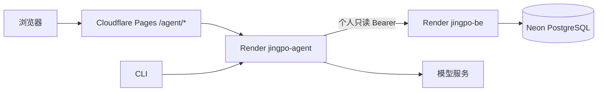

# Agent 生产部署

## 快速入口

| 用途 | 控制台 |
| --- | --- |
| Render 服务列表与部署 | [Render Dashboard](https://dashboard.render.com/) |
| Cloudflare Pages 前端与 `/agent/*` 代理 | [Cloudflare Pages · jingpo-fe](https://dash.cloudflare.com/d318e6f2f4a817b7ca27249ebfee4afd/pages/view/jingpo-fe/4626deac-99f9-4e9b-b4c9-8b433ffcc476) |
| 详细架构、配置解释与故障排查 | [V9 Agent 部署规格](../docs/技术方案/v9/agent/spec.md) |

## V11 发布顺序

V11 的 BE 迁移会在 BE 容器启动时自动执行（`a11c0de20210`）。需先发布 BE 并确认迁移成功，再发布 FE 和 Agent。发布前先在 Neon 创建可恢复的数据库备份/快照。

1. 发布包含 V11 的 BE 版本，检查 Render 日志中的 Alembic 升级成功，并确认 `/health/ready` 正常。
2. 发布 FE，确认 Pages 的 `/agent/*` Function 仍代理到 Agent，`VITE_AGENT_V8_ENABLED=true`。
3. 发布 Agent。首期自动执行白名单为空，动作仍由用户逐次确认。
4. 验证健康检查、登录后的只读查询和动作预览。不要用真实生产业务对象做写入验收；写入流程应使用隔离测试账号和测试数据。

发布期间可先保持 `AGENT_ALLOW_ACTIONS=false`，这样 Agent 不会产出 V11 动作候选。待 BE、FE、Agent 都已发布并完成只读冒烟检查后，再将其设为 `true` 并重启/部署 Agent，开放候选提案。该变量只控制 Agent 是否提供动作候选，不授予 BE 写权限；每项写入仍由 FE Cookie+CSRF、BE 权限/状态复核和用户确认保护。当前 BE 自动执行白名单为空。

## 回滚

发现问题时，先在 Render 将 `AGENT_ALLOW_ACTIONS=false`，停止新动作候选；再按需回滚 FE、Agent 或 BE 应用版本。迁移会新增提案/策略表及 `operation_logs` 关联列，降级会删除提案和审计关联数据。若已运行迁移，不要直接执行 Alembic downgrade；应用版本回滚前先确认旧 BE 能兼容新增字段，若需恢复数据库结构，应使用发布前的 Neon 备份并评估期间产生的数据影响。

## 服务与请求流

Agent 部署为 Render Web Service `jingpo-agent`。网页请求从 Cloudflare Pages 的同源 `/agent/*` Function 转发到 Agent；CLI 可直接访问 Agent 的 HTTPS 地址。Agent 使用个人只读 Bearer 调用 BE，不直接连接 Neon。



## Render 设置

在 Render Dashboard 打开 `jingpo-agent` → **Settings → Build & Deploy**，检查：

| 设置 | 值 |
| --- | --- |
| Branch | `main` |
| Auto-Deploy | 开启 |
| Root Directory | `agent` |
| Runtime | Docker |
| Dockerfile Path | `Dockerfile` |
| Docker Build Context | `.` |
| Health Check Path | `/agent/health` |

Root Directory 限定为 `agent` 后，其他目录的提交不会触发 Agent 自动部署。Dockerfile Path 和 Context 相对于 `agent/`。若需排除测试和文档，在 **Build Filters** 设置 Included Paths=`agent/**`，Ignored Paths=`agent/tests/**`、`agent/**/*.md`；不要忽略 Python 源码、`requirements.txt` 或 Dockerfile。过滤路径相对于仓库根目录。手动部署及服务配置变更仍会触发部署。[Render Monorepo 部署文档](https://render.com/docs/monorepo-support)

## Render 环境变量

在 `jingpo-agent` → **Environment** 配置；密钥仅存于 Render，不要提交到仓库。

| 变量 | 配置 |
| --- | --- |
| `BE_BASE_URL` | BE 的 Render 内部地址；若服务不支持私有网络，使用 `https://jingpo-be.onrender.com` |
| `LLM_PROVIDER` | `qwen` 或 `deepseek` |
| `LLM_MODEL` | 所选模型供应商当前可用的模型名 |
| `DASHSCOPE_API_KEY` 或 `DEEPSEEK_API_KEY` | 只配置所选供应商对应的密钥 |
| `LLM_BASE_URL` | 可选；默认端点可用时不设置 |
| `AGENT_DEBUG` | `false` |
| `AGENT_ALLOW_ACTIONS` | `true` to enable web action proposals; omit or set `false` to keep the Agent read-only |

不要手动设置 `PORT`；Render 会提供，容器在本地环境下默认回落到 `8001`。建议 Agent 与 BE 使用相同 Render region。免费服务不能接收私有网络请求时，`BE_BASE_URL` 应指向 BE HTTPS 公网地址。

## Cloudflare Pages 代理

在 `jingpo-fe` Pages 设置中确认：

| 变量 | 位置 | 值 |
| --- | --- | --- |
| `AGENT_API_ORIGIN` | Functions Production runtime | Agent 的 HTTPS origin，例如 `https://jingpo-agent.onrender.com`，不带末尾斜杠 |
| `VITE_AGENT_V8_ENABLED` | Production build | `true` |
| `BE_API_ORIGIN` | Functions Production runtime | `https://jingpo-be.onrender.com` |

FE 通过 Pages Function `/agent/*` 转发 SSE 流，不要改成浏览器跨站直连 Render。FE 的构建目录和代理配置见 [FE 生产部署](../fe/deploy-prod.md)。

## 部署后检查

将 Agent origin 替换成 Render Dashboard 显示的实际地址：

```bash
AGENT_ORIGIN="https://jingpo-agent.onrender.com"
curl -i "$AGENT_ORIGIN/agent/health"
curl -i -X POST "$AGENT_ORIGIN/agent/api/v1/sessions"
```

健康检查应返回 `200`；不带 Bearer 的创建会话请求应返回 `401`。随后登录生产 FE，发起一条查询，确认助手能返回结果且请求经过 `/agent/*`。CLI 验收步骤见 [V9 Agent 部署规格](../docs/技术方案/v9/agent/spec.md)。

Agent 使用单实例内存保存会话；服务重启或发布会清空会话。横向扩容前需要增加共享会话存储与跨实例协调。
