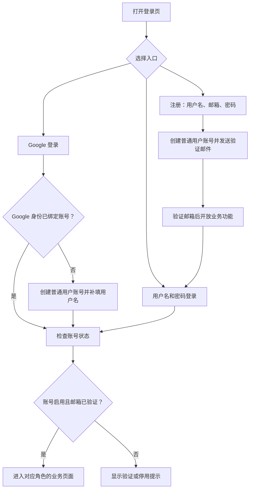
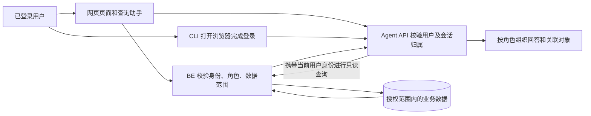

# JINGPO 鲸破 · PRD V8：登录、角色与数据权限

> 2026-10-14 · 草案，待用户 review。本文记录已讨论的产品规则，覆盖 BE、FE、Agent；尚未编写本功能的 spec、plan，也未开始编码或验收。

## 1. 问题与目标

系统将供公司销售、财务、运营和开发人员共同使用。需要知道当前是谁、允许操作什么、能查看哪些数据，同时让查询助手按角色使用合适的表达方式。

第一版支持注册、登录、邮箱验证、找回密码、Google 登录和简单用户管理。账号只能拥有一个角色；角色权限先固定，后续再提供权限配置页面。

普通用户在网页操作自己的订单，查看自己的运单和进度；ops 处理全公司业务；developer 查询全公司数据，并由 Agent 提供更详细的技术解释；admin 是唯一超级管理员。

本 PRD 是 V8 登录与权限专题。[V8 待办](TODO.md) 中原有的服务范围管理、排程补偿、线路版本同步继续独立跟踪，不因本专题自动进入实现范围。

## 2. 用户流程与界面示意

### 2.1 注册、验证和登录



注册全放开，不设置邀请或人工审核；未验证账号只能处理验证、登录相关事务。Google 首次登录只有在提供可信的已验证邮箱时才可直接完成邮箱验证，否则进入验证流程。

```text
登录                         注册
用户名 [                  ]  用户名 [                  ]
密码   [                  ]  邮箱   [                  ]
[登录] [使用 Google 登录]    密码   [                  ]
[注册账号] [忘记密码]        [注册并发送验证邮件]

个人账号：用户名、邮箱、当前角色、Google 绑定状态、退出登录
用户管理（仅 admin）：搜索用户、查看验证状态、修改角色、启用/停用
```

### 2.2 找回密码与绑定 Google

用户提交邮箱后收到找回密码邮件，打开链接设置新密码。成功后撤销该账号所有设备的登录，包括网页和 CLI，需要重新登录。验证、重置链接有有效期且只能使用一次；具体时限在 spec 中确定。邮件发送失败可重试，不显示成功发送的假提示。

已有账号必须登录后主动绑定 Google。相同邮箱的 Google 身份不能直接合并已有账号；提示用户登录原账号后绑定，或通过邮件找回密码。绑定不能改变角色和业务数据归属。Google 首次登录若邮箱或用户名与已有账号冲突，提示处理冲突，不静默创建重复身份。

### 2.3 业务访问与 Agent 登录



这张图描述 V8 目标流程，不代表现有代码已接入。用户切换账号后不能继续查看上一个账号的页面缓存、对话或关联对象。

## 3. 范围与关键规则

### 3.1 固定角色权限

| 能力 | admin | ops | developer | 普通用户 |
| --- | --- | --- | --- | --- |
| 查看订单、运单、进度及业务历史 | 全公司 | 全公司 | 全公司 | 自己创建的订单及其关联运单、进度 |
| 创建订单 | 可以 | 可以 | 不可以 | 可以 |
| 网页修改、取消订单 | 全公司，受业务状态限制 | 全公司，受业务状态限制 | 不可以 | 自己的订单，受业务状态限制 |
| 调整运输安排及执行物流操作 | 可以，受业务状态限制 | 可以，受业务状态限制 | 不可以 | 不可以 |
| 维护站点、线路、班次及相关公共配置 | 可以 | 可以 | 只读 | 仅获取下单需要的选项 |
| 用户管理、修改角色、停用账号 | 可以 | 不可以 | 不可以 | 不可以 |
| Agent 查询数据范围 | 全公司 | 全公司 | 全公司 | 自己的订单、关联运单和进度 |
| Agent 回答风格 | 业务化 | 业务化 | 技术化 | 业务化 |
| Agent 创建或修改业务数据 | 不支持 | 不支持 | 不支持 | 不支持 |

有权限不代表任何状态都可操作。已发生的物流事实、冻结运输段、取消条件及时间限制仍遵守现有业务规则。订单取消若需要新增业务流程，须在 spec 中说明状态与关联运单、任务的影响，不做无条件删除。

developer 的技术化回答可说明业务对象 ID、关联关系、计划版本与执行状态；不得提供密码、登录凭据、模型密钥等敏感配置。技术表达与查询授权分别控制。

### 3.2 数据归属和共享任务

- 新订单记录实际创建账号；客户端不能自行指定或伪造创建者。系统自动生成的运单通过订单继承访问范围。
- ops/admin 修改别人的订单后，原创建者不变。第一版不包含业务归属转移页面，离职交接留待后续明确。
- 普通用户可以查看自己运单的运输计划与进度。共享任务只展示解释该运单进度所需的信息，不展示其他成员订单、运单、客户资料，也不能通过任务详情链接获取其他成员信息。
- 历史数据没有可靠创建者时不猜测归属，只对 admin、ops、developer 开放。历史运单与任务、计划和审计记录继续保留。
- 列表、搜索、总数、详情、轨迹、历史、关联对象和 Agent 工具结果均遵守相同范围。输入别人订单号或直接打开别人详情地址不能绕过限制。

### 3.3 账号与登录状态

- 用户名与邮箱唯一；用户名用于密码登录，邮箱必填并验证后开放业务功能。密码安全规则和名称规范在 spec 中确定。
- 默认角色为普通用户。一个账号只能有一个角色，注册参数不能指定高权限角色。
- 支持多设备登录，每次登录从成功时起最多有效 24 小时；持续使用不会无限延长该期限。
- 退出登录撤销当前设备的登录；停用账号立即禁止后续访问，重新启用不恢复被撤销的旧登录。
- 修改角色后立即按新权限执行；重置密码撤销全部登录。正在查询的 Agent 也不能继续返回已失去权限的数据，下一次访问需重新校验。
- 公共入口仅用于注册、登录、验证、找回密码及 Google 登录相关流程。业务接口不能在未登录时读取或修改数据。
- 邮件发送、登录、注册和重置需要限制滥用；返回消息不能泄露账号是否存在或输出密码、完整凭据。具体规则在 spec 中细化。

### 3.4 唯一超级管理员与用户管理

初始化时指定唯一 admin 的账号、邮箱和密码；不能把第一个注册者自动设为 admin。提供只能在服务器执行的管理员恢复方式，供忘记密码或邮箱不可用时恢复管理能力。

用户管理页支持搜索、查看单一角色/启用状态/邮箱验证状态，给普通账号分配普通用户、ops、developer 角色，以及启用或停用账号。第一版不提供创建第二个 admin、停用唯一 admin 或降低其角色的操作。

角色调整、启停账号和业务修改记录操作者、服务器时间、操作对象及修改内容；记录不能包含密码或登录密钥。未验证的账号即使被分配角色，也不能跳过邮箱验证。

### 3.5 BE、FE 与 Agent 的责任

| 项目 | 第一版要完成的产品能力 |
| --- | --- |
| BE | 账号身份与登录状态、验证和找回邮件、Google 身份绑定、固定角色授权、数据归属与过滤、唯一 admin 初始化/恢复、用户管理、操作审计；数据库升级保留历史业务数据 |
| FE | 登录/注册/验证/找回密码页面、Google 入口和绑定流程、个人账号、admin 用户管理页、角色对应导航和按钮、无权限与登录失效提示；页面跳转和关联链接遵守用户数据范围 |
| Agent | 网页助手与 CLI 使用个人身份；CLI 通过浏览器登录；会话和历史按用户隔离；每次工具查询继承用户权限，关联对象链接同样受限；developer 技术化回答，其他角色业务化回答；全部只读 |
| 本地与部署 | 本地 Docker 支持邮件测试容器，可在浏览器查看验证和找回邮件；正式环境配置 SMTP 和 Google 登录所需配置；认证参数、数据迁移及升级方式由后续 spec/plan 明确 |

模型不能决定用户的真实角色，也不能靠提示词完成权限控制。BE 是业务授权的最终判断方；Agent API 还需限制会话、消息和查询结果的归属，不能使用一个全权限账号替所有用户查询。

### 3.6 本专题不包含

自定义角色/权限配置页面、多角色账号、除 Google 外的登录提供商、组织或站点级数据范围、业务归属交接页面，以及 Agent 写操作。V8 其他待办是否并行实现另行确定。

## 4. 验收示例

以下是目标验收项，目前均未实现或验收。

| 编号 | 场景 | 预期结果 |
| --- | --- | --- |
| V8-A01 | 任意用户注册，尝试指定 ops 角色 | 只能得到普通用户账号；邮箱验证前不能访问业务数据 |
| V8-A02 | 完成邮箱验证、重复使用验证链接 | 首次开放业务功能，重复链接不能再次改变账号状态 |
| V8-A03 | 用户 A/B 分别创建订单，A 搜索 B 的编号或直开详情 | A 的列表、详情、总数、Agent 结果均不泄露 B 的数据 |
| V8-A04 | A/B 运单共享任务，A 查询自己的进度并点击关联对象 | 展示 A 的计划与进度，不暴露 B 的订单和共享成员资料 |
| V8-A05 | 普通用户在网页修改自己的订单，或通过 Agent 请求修改 | 网页按状态允许或拒绝；Agent 不执行写操作 |
| V8-A06 | ops 修改其他用户订单，developer 发起相同写请求 | ops 按业务规则操作并保留原创建者；developer 被拒绝 |
| V8-A07 | 普通用户读取历史无归属数据，ops/developer 查询 | 普通用户无法访问，ops/developer 可以查询 |
| V8-A08 | 非 admin 调整角色，admin 修改账号角色 | 非 admin 被拒绝；合法修改立即生效并记录审计 |
| V8-A09 | 登录超过 24 小时，或退出其中一台设备 | 过期设备需重新登录；退出只撤销当前设备 |
| V8-A10 | 用户多设备登录后重置密码，或被停用 | 原网页、CLI 和 Agent 登录均不能继续访问；重置链接不能重复使用 |
| V8-A11 | 首次 Google 登录及绑定相同邮箱已有账号 | 首次新建普通用户并补用户名；已有账号需登录后主动绑定，不自动合并或升级角色 |
| V8-A12 | 切换账号、猜测另一用户会话 ID、查询期间被降权 | 不展示另一用户对话或缓存，不返回已超出当前权限的结果 |
| V8-A13 | developer 与普通用户询问可访问的同一运单 | developer 返回更技术化的关联解释；普通用户返回业务进度，数据范围分别校验 |
| V8-A14 | 停用/降级唯一 admin，或首次注册抢占 admin | 系统拒绝；管理员可通过服务器恢复方式恢复访问 |
| V8-A15 | 本地 Docker 注册和找回密码，邮件服务发送失败 | 能在测试邮件页面完成流程；发送失败提示重试，不伪报成功 |

## 5. Review 与后续交付顺序

1. 用户先 review 本 PRD，修正产品范围、角色表和验收目标。
2. PRD 通过后，分别编写 BE、FE、Agent 的 spec 与 plan，明确接口、数据结构、会话与权限检查、迁移、配置和验证步骤。
3. 文档 review 通过后再编码，按各项目 plan 记录实际验证结果；完成代码不等于通过验收。

当前只有 PRD 草案；身份与邮件的具体技术选择、Google 接入配置、密码规则、接口错误契约及迁移方案由下一阶段细化。
