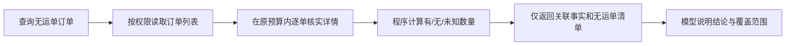

# V10 · 评测与关联统计修正

2026-10-20。修复评测样本与评分设计，保留全部 29 个场景。最终两轮均通过有限规则评分及逐题复核；原先的状态错误归因已更正。

## 根因与历史结论更正

旧合成样本存在同源事实矛盾：ORD-0004 的订单详情里，关联 SHP-0104 的阶段是 PENDING_PICKUP；单独查询该运单却返回 AT_STATION。旧 HOLD-03 回答沿用订单详情的待揽收状态，有查询依据，不能据另一接口的冲突样本直接判为模型幻觉。此前验收中对此的归因不正确，现撤回这个模型错误结论；原始报告保留，用于追溯评测设计问题。

另有当前运输计划与目的站不一致、任务线路两端不一致、历史最新版本区段与当前版本不一致的合成数据。旧历史差异回答仍包含未证实的推断，但不能将这套相互冲突的样本当成稳定验收基线。

新版 `v10-synthetic-2` 从同一运单数据生成订单关联视图；同步计划目的站、任务区段、当前及历史版本的区段集合。更正历史形成连续的旧站→新站链，最终站与运单当前站一致；运输中任务的超时分钟与服务器时间及计划到达时间一致。启动合成服务前检查这些关系，矛盾样本直接拒绝运行。回归测试主动注入错误状态、目的站和历史区段，确认检查能拦住。

## 程序计算、模型解释

`search_orders(include_shipment=true)` 的内部结果改为关联核验视图：

| 字段 | 含义 |
| --- | --- |
| items[].shipment_presence | PRESENT 有关联、ABSENT 已确认无关联、UNKNOWN 未核实 |
| items[].shipment | 已确认时仅返回 ID/编号或 null，不携带运输阶段 |
| without_shipment | 已核实 shipment=null 的订单清单 |
| summary | 订单总数、已读数、核实数、有/无/未知数、未读数及全量完成标志 |

未读取详情或读取失败不能当作无运单；取消运单仍算有关联。分页或关联核实不完整时全量完成为 false。普通列表模式保留原行为。网页 API、BE 接口、权限和每轮预算不变；数据规模超过预算仍会返回未完成，尚未实现 BE 批量筛选。

## 评分口径

`v10-5` 将结果分开记录：

- runtime_ok：是否正常完成调用。
- core_answer_ok：预先定义的答案检查是否通过。
- evidence_ok：预期对象及程序统计是否覆盖。
- forbidden_claims_ok：是否出现已定义的禁止表述。
- additional_claims_review：额外陈述需对照本轮实际数据复核，自动检查不冒充全文事实校验。

时间按显式时区的实际时刻比较；查询为空与服务失败允许有限等价表达，并用错误时间、错误偏移、矛盾表述作反例。HOLD-03 同时核对程序统计与无运单 ID，不以答案碰巧提到 ORD-0003 作为唯一证据。

报告保留样本版本、代码 SHA-256、调用计划及用量。旧样本报告禁止按新样本直接重评；跨版本不计算“准确率提升”。额外陈述复核由 Codex 执行并注明，用户人工签核单独处理。

## 范围与验证

没有移除或跳过任何题目。当前排除项为空；若未来排除特殊场景，需记录题目、业务原因、用户影响和恢复条件，且不能计入通过数量。

执行顺序：受控回归与样本预检 → HOLD-03/HOLD-02 定向真实模型验证 → 两轮完整 29 题 → 逐题复核。真实模型仅连接本地合成 BE，未修改开发或生产数据。

## 最终验收

- 65 项 Agent 受控测试通过；合成后端预检通过；HOLD-03/HOLD-02 定向模型检查自动评分通过。
- DeepSeek `deepseek-flash` 对同一 Agent 代码及 `v10-synthetic-2` 样本完成两轮 29 题完整评测。原始问答不变，仅离线重评评分规则；每轮预期对象引用覆盖均为 89/89，运行中断和自动规则失败均为 0。
- 两轮逐题核对核心答案、引用与工具证据，未发现关键事实错误。HOLD-03 程序统计和无运单订单正确；BIZ-02 “已取消”绑定到 ORD-0002 的对象范围后通过；计划历史按对应快照回答。全 29 题均保留，没有排除特殊场景。
- 证据：[两轮逐题结果、回答、工具调用、SHA-256 与分项结论](acceptance-v10-synthetic-2.json)。89/89 是对象引用覆盖，不代表对任意物流问题的准确率，也不外推到生产业务数据。额外陈述经 Codex 对照合成后端逐题检查，未做独立用户签核。
