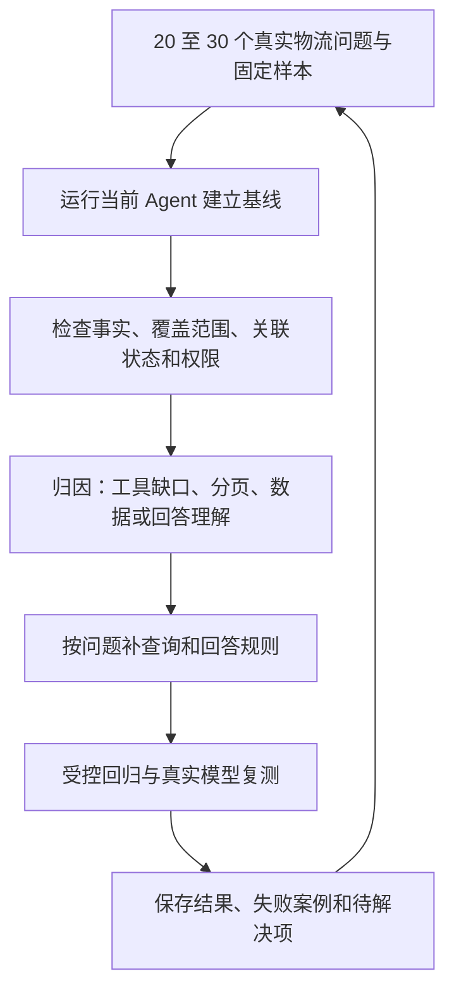

# V10 · Agent 查询准确性、完整性与回答依据

> 2026-10-18 · 规划，尚未实现或验收。实施顺序见 [plan](plan.md)。V9 部署方案保留在 [V9 spec](../../v9/agent/spec.md)。

## 1. 要解决什么问题

面向演示操作者和内部运营人员，优先保证“答得准、查得全、能核对”。当前已有只读工具、身份隔离、查询预算、结果截断提示和关联对象引用，但这些能力不能证明真实模型每次都选对工具、遍历完整或正确理解关系。

用户应能知道：答案覆盖了哪些数据，哪些关系属于未来计划、当前关联或历史，以及关键结论依据哪个对象和时间。先用固定问题找出实际缺口，再决定代码改动。

| 优先级 | 本期目标 | 用户能看到的变化 |
| --- | --- | --- |
| P0 | 固定问题集与准确率评测 | 常见问题有可重复的验收标准，改动后能发现退步 |
| P1 | 查询完整性 | 联查和分页按问题需要继续查；未查完明确说明范围 |
| P2 | 回答有依据 | 关键结论带授权对象类型、ID、状态及相关时间，区分事实、推断、未查到、未查完 |
| 辅助 | 基础 token 用量记录 | 可诊断耗用；不作为前三项的交付前提 |
| 后续 | 持久会话、多实例共享、费用预算 | 本期暂缓，按实际使用问题另立方案 |

## 2. 怎么解决

受控工具测试用于定位执行问题，真实模型评测用于检验选工具和回答能力，两者分别记录结果。

## 3. 固定问题集与评分

首批选择 20 至 30 个真实业务问题，可使用隔离固定样本复现。每例记录：问题、样本版本、可信身份范围、预期对象集合、预期事实、必须区分的状态、允许缺失的信息、禁止结论和评分规则。按问题类型留出少量未参与提示词调整的验收题，避免只对调试题有效。

| 问题组 | 必须覆盖的例子 |
| --- | --- |
| 对象联查 | 从订单找到运单及运输任务；共享任务不混入别人的订单 |
| 关联状态 | PLANNED、ACTIVE、RELEASED 分开；轨迹实际关联单独标明，未来计划不能当成已执行 |
| 更正历史 | 单运单是否改过目的站；授权范围内所有发生过更正的运单；多次更正去重且不丢历史 |
| 分页与限量 | 多页、空页但 total 非零、结果截断、预算用尽、部分接口失败 |
| 业务判断 | 取消、延误、时间版本、计划时间与实际动作时间不混淆 |
| 权限与追问 | 普通用户与公司级身份范围；对象不可见、权限变化、追问沿用正确对象 |

评测使用固定数据预期和明确规则核对对象集合、状态和时间；自然语言表达允许人工复核，模型评分只能辅助。记录模型名称、运行参数、代码版本、样本版本、日期、耗时、调用次数及失败原因。真实模型至少重复运行两轮，逐轮报告，不能只选最好结果。

验收目标：每轮授权范围内对象查全率、关键事实正确率均不低于 95%；计划/实际/解除状态混淆、越权泄露和没有依据的肯定结论为零；人为设计的未完成查询均明确说明未完成。查全率按预期对象集合计算，事实正确率按预设事实项计算；分母、失败和跳过项均展示，不能把未查完或跳过算成功。存在关键错误即不通过验收。

## 4. 查询完整性规则

- “所有、全部、有哪些”先明确授权范围与筛选条件。完整性仅针对本次条件和可见数据，不宣称全库完整。
- 优先使用后端直接支持的历史/筛选接口，例如目的站更正审计，不默认遍历所有运单再逐个查任务。更正记录数与去重运单数分开。
- 分页遍历、去重和完成状态由程序记录，避免仅靠模型记忆；页面大小遵守各工具现有上限，运单清单最多每页 100 条。
- 跨订单、运单、任务的关系优先读取业务关联，不通过编号相似或站点相同猜测；共享任务、未来计划、已解除关联和轨迹实际关联分别解释。
- 保持现有每轮 5 次模型、8 次工具、24 次业务 HTTP、120 秒及结果大小限制，不通过放开无限查询实现查全。工具内部翻页也计入同一预算，并逐请求复核身份。
- 预算不足、接口失败或输出截断时记录已查页/记录数、剩余是否已知、未完成原因。源数据已查全但展示截断，须区分“查询完成”和“展示不完整”。
- 后端不支持所需条件时，记录具体接口缺口及影响，再决定 BE 改动；不先承诺一定能全量查询。列表查询不保证跨页事务快照，实时数据变化时说明查询时间范围和局限。

## 5. 回答依据与客户端契约

关键结论基于本轮或仍有效的授权查询结果，展示适用的对象类型、ID、业务编号、关联状态与相关时间。时间标明计划、预计、实际或记录时间；源字段为空时说未知，不补造时间。回答中的“依据”不能只是一张不相关的对象卡片。

| 情况 | 回答要求 |
| --- | --- |
| 事实 | 说明查询得到的记录及对应对象 |
| 推断 | 标明推断，指出依据及不确定性 |
| 未查到 | 只描述当前权限与查询条件内未找到；不可见不等于业务上不存在 |
| 未查完 | 给出已查范围与未完成原因，不能回答“没有”或“全部如下” |

普通用户沿用 V8 安全视图，不生成其无权访问的运输任务详情引用。自由文本及身份凭据不进入评测公开报告或诊断日志。

FE 请求继续携带现有问题、session_id、message_id 和个人 Bearer；不增加由客户端指定的角色、预算或评测开关。优先复用 answer、references、warnings 表达依据和覆盖范围。若需要结构化覆盖信息，先在实施中确定字段与兼容规则，同步更新 [网页助手契约](../../v7/agent/web-assistant.md)，再改 Agent/FE；本规格尚未冻结新响应字段。评测离线运行，无需前端评测入口。

## 6. 验证与风险

按 [plan](plan.md) 顺序建立基线、修复、复测。优先复用现有 tests、verify_backend.py 和隔离 BE 联调方式，受控与真实模型证据分开，缺少样本时记为待验证。评测数据固定在隔离环境，不为准备样本修改生产或开发业务数据。

token 用量仅在供应商实际返回时记录输入、输出和总量，缺失标未知；重复请求缓存命中不产生新的模型耗用。费用估算、价格配置和硬预算另行设计。会话持久化与多实例不属于本期验收。
