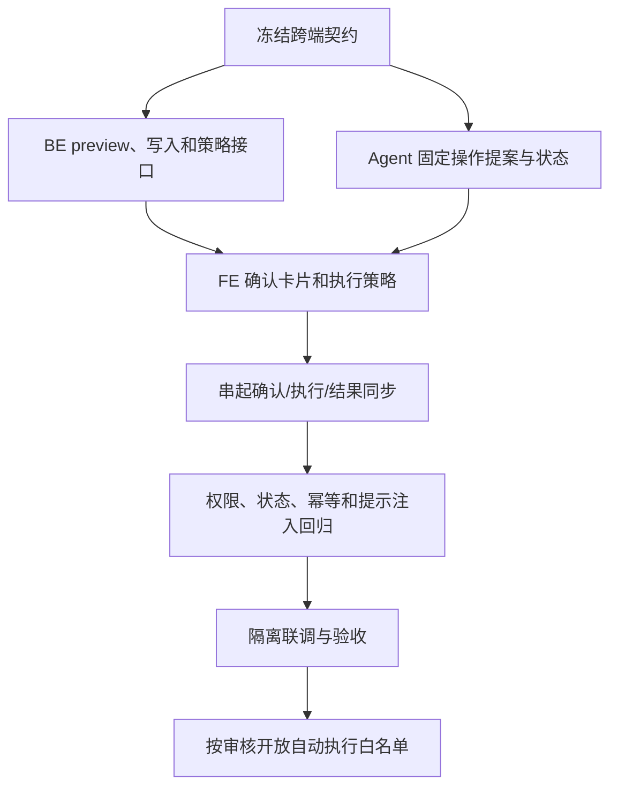

# V11 · Agent 受控业务写入实施与验证计划

> 代码实现与自动化验收已完成。首期按网页助手、CLI 只读、每条消息最多一个动作候选、自动执行白名单为空执行。真实读屏器/触屏走查见 FE plan。详细契约见 [Agent spec](spec.md)、[BE](../be/spec.md)、[FE](../fe/spec.md)。

## 1. 目标与实施顺序

让网页助手能把自然语言修改请求变成明确提案；由 FE 展示确认和调用 BE，BE 按当前用户身份、业务状态和自动执行策略执行。先完成每次确认的闭环，自动执行只在 BE 白名单和用户策略能力验收后开放。

三端统一候选接口、首期操作清单和空白名单已冻结；实现不得跳过后续新增操作或开放白名单所需的专项 review。

## 2. 阶段和交付条件

| 阶段 | Agent 工作 | 依赖 / 验收条件 | 状态 |
| --- | --- | --- | --- |
| V11-A0 契约冻结 | 冻结网页入口、只读 CLI、固定 action、候选字段、终态和同步行为；自动白名单为空 | 三端 spec/实现字段一致；未知动作不能显示操作卡 | 已冻结；隔离 BE/Agent HTTP 与 Chrome 页面流程通过，人工读屏/触屏验收见 FE plan |
| V11-A1 提案模型 | 固定 action 工具与 Pydantic schema；只允许登记字段，按用户角色过滤工具 | Agent 无 mutation 调用；developer 无写提案；订单候选检查对象和可修改状态 | 已实现；新增 SSE 测试通过 |
| V11-A2 预览与 SSE | 只读查询对象，生成 session/message 绑定候选；SSE 发 `action_proposed`，FE 自行换取 BE 权威预览 | Agent token 保持只读，单条消息最多一个候选，默认关闭且须显式启用 | 已实现；`AGENT_ALLOW_ACTIONS` 默认 false；隔离 Agent/BE HTTP 与真实 Agent 浏览器链路已验证 |
| V11-A3 提案生命周期 | BE 持有实际 proposal；Agent 仅保存有界 correlation 并在 sync 时从 BE 查状态 | 不能跨会话或跨候选同步；PREVIEWED 返回 pending，终态同步幂等 | 已实现；Agent sync 用例通过 |
| V11-A4 执行结果同步 | FE 提交 proposal ID；Agent 使用只读凭据核验 candidate/session/message/action/status | 不接收客户端成功文字；BE 状态不确定时 FE 不显示成功 | 已实现；隔离 HTTP 与 Chrome 真实 Agent 页面取消、BE 终态核验通过 |
| V11-A5 预算、并发和隐私 | 动作候选受每条消息/会话限制；BE 每分钟后台清理过期 payload，并由请求路径补清 | 确认等待不占模型任务；日志不记凭据和完整地址；Agent session correlation 有上限且不能挤掉未完成 proposal | 已实现；Agent 每会话最多保留 20 条动作关联；新增 10,000 次终态淘汰与 1,000 次未决保持压力回归通过；满额时停止生成新候选；V11 动作调试日志不输出订单号、前后地址或 Bearer |
| V11-A6 受控回归 | 覆盖提案 schema、SSE、状态同步与原查询回归 | `make check-agent` 全套通过，不调用真实付费模型 | 通过：74 项测试 |
| V11-A7 隔离联调 | 与 BE/FE 在隔离数据验证订单字段修改、目的站更正的预览、确认、BE 拒绝、实际写入、结果回显和审计链路 | 真实个人身份；无开发/生产业务库写入；BE、FE 各自验收通过 | BE/Agent 订单与目的站隔离 HTTP 闭环通过；Chrome 验证真实 FE→Agent→BE 订单确认与取消，Agent 使用确定性假模型；读屏/触屏手工验收仍待完成 |
| V11-A8 自动执行评审 | 首期默认不开放自动白名单；基于具体低风险动作单独审查，然后实现 BE policy read/setting 和 FE 行为联动 | 默认关闭、用户能撤销；BE 在执行时复查 action type、actor、范围和策略；高风险动作仍逐次确认 | 已完成首期工程风险审查：订单更新和目的站更正均保留逐次确认；白名单为空。若增加低风险 action，再另行评审 |

## 3. 固定操作范围

首批固定为以下两类动作，字段由 Agent 严格 schema 和 BE 领域请求共同校验：

| action type | 已有 BE 接口线索 | Agent 需做的事 | 执行策略 |
| --- | --- | --- | --- |
| `order.update` | `PATCH /api/v1/orders/{order_id}`；有幂等键，需核对对象版本/并发更新前提 | 读取当前订单、字段白名单、前后值校验和结果复核 | 每次确认 |
| `shipment.destination.update` | `PATCH /api/v1/shipments/{shipment_id}/destination`；请求含预期旧目的站、目标站和原因 | 按用户站名从 BE 目录解析唯一可用派送站；核实原因、当前目的站及 BE 返回的运输计划影响 | 每次确认 |

Agent 不调用其他 mutation endpoint。创建、取消、计划调整、实际轨迹事件、批量修改暂不纳入首批动作；如果本轮 review 决定增加，先补对应 BE/FE 契约和验收案例。

## 4. Agent 受控验证矩阵

| 类别 | 必测边界 |
| --- | --- |
| 意图与参数 | 查询继续只读；写入意图被识别；对象/字段缺失先追问；额外字段、自由 URL、未知 action type 拒绝 |
| 用户与对象 | 普通用户只针对本人可操作对象；developer 无写提案；跨用户 proposal 查询、批准、同步均拒绝且不泄露对象存在性 |
| 用户确认 | 未确认绝不触发写入；批准只绑定单个 action hash；修改内容需新提案；拒绝、取消、过期都不写 |
| 自动执行 | Agent 不决定自动批准；客户端伪造自动模式不生效；BE 策略关闭或不可用时不得执行；白名单以外回到逐次确认 |
| 并发和幂等 | 旧对象版本冲突；重复批准、SSE 重连、相同 message 重放、网络结果未知都不会造成重复写入 |
| 结果与对话 | BE 确认后才报告成功；重新读取核验对象和变化；拒绝/未知/服务故障按不同状态展示并同步会话 |
| 注入和日志 | 备注、地址、操作历史中的命令不能获得用户授权或改写 action；日志和 checkpoint 不含凭据及不必要的个人数据 |

真实模型评测单独进行，至少检查写入意图识别、目标对象解析、缺失信息追问、越权对象和只读问题不触发写入。已新增合成数据评测入口 `agent/tests/eval_v11.py`：`--preflight` 不调用模型，`--run --round <名称>` 才会调用已配置模型；报告写入 `/tmp/jingpo-agent-v11/`，模型调用和机器评分仍需人工复核。评测不代替 BE 权限与 FE 确认测试。

## 5. 跨端契约和未完成验收

以下契约已由实现落定并完成自动化/隔离联调；剩余验收仅包括实体读屏器和触屏设备的人工走查：

1. 已在隔离 PostgreSQL 和真实 BE/Agent HTTP 服务间验证网页登录态、订单 SSE 候选、权威预览、明确确认、状态同步及 proposal/message/BE request/operation log 关联。
2. 已验证目的站更正 SSE 候选、当前站点预览、明确确认与终态同步；业务状态、站点和原因边界由 BE service 回归覆盖。
3. FE 刷新恢复、账号切换、请求超时、Agent 重启和提案过期已有组件回归；读屏/触屏设备手工检查仍需完成。
4. 已通过撤权后不能确认、并发确认幂等和业务写入故障原子 rollback 专项检查。

当前自动白名单为空，两个 action 都要求逐次用户确认。端到端联调使用隔离数据和真实网页登录身份，不得对开发/生产业务数据执行写入。

自动执行首期审查结论：`order.update` 允许修改地址、数量和履约时效，误执行的业务影响较大；`shipment.destination.update` 会更改路线终点并影响运输安排。两者都不批准免确认。BE 白名单保持空，FE 遵循这一服务端结果；后续增加较低风险动作时再按字段范围单独审查。

## 6. 交付记录

| 日期 | 内容 | 验证结果 | 状态 |
| --- | --- | --- | --- |
| 2026-10-21 | 实现网页只读凭据下的固定动作候选、SSE、proposal status sync；更新 FE/BE/Agent 实现及契约 | BE 临时 PostgreSQL 全量迁移、`alembic check` 无差异、88 项测试中 79 项通过、9 项 opt-in skip；Agent 67 项通过；FE typecheck/lint/build 通过 | 代码已接入；隔离三端写流程、真实浏览器和异常恢复待验收；自动白名单保持空 |
| 2026-10-21 | 使用临时 PostgreSQL 完成订单修改和目的站更正的 Agent/BE HTTP 闭环；补充 BE 撤权、并发和回滚验证；新增 FE 动作卡片组件测试并修复重复预览 | `make check-v11-integration`：BE 92 项（83 passed、9 opt-in skipped）；另 `make check-agent`：67 项通过；`make check-fe`：typecheck/lint/build 和 3 项组件测试通过 | Agent/BE API 与 FE 组件验收通过；FE 页面级浏览器验收和真实模型专项评测待完成；自动白名单保持空 |

每次实现后在此记录代码范围、BE/FE 契约版本、使用的身份和隔离环境、测试命令与结果、未通过项及是否开放自动白名单。不能将合成测试、接口存在或代码完成写成端到端验收通过。
| 2026-10-21 | 默认关闭 Agent 动作工具；加固 FE 多提案生命周期和逐次确认 | `make check-agent` 67 项；`make check-fe` 6 项组件测试、typecheck/lint/build 通过；`make check-v11-integration` BE/Agent 隔离 HTTP 流程通过 | 代码和受控验收完成；真实浏览器及真实模型专项验收待完成；白名单为空 |
| 2026-10-21 | 文档化 `AGENT_ALLOW_ACTIONS` 的本地/Render 默认关闭与显式开启配置 | 配置读取、输入校验纳入 Agent 67 项受控测试；V11 隔离 BE/Agent HTTP 集成通过 | 未配置时生产 Agent 保持只读；动作候选启用需部署明确设置变量 |
| 2026-10-21 | 新增 V11 合成数据真实模型评测脚本与 7 个提案场景；限制 Agent 每会话最多 20 条动作关联且只回收终态记录 | `eval_v11.py --preflight` 通过、不调用模型；`make check-agent` 69 项通过；`make check-v11-integration` BE 92 项（83 passed、9 skipped）、迁移和订单/目的站 HTTP 联调通过 | 评测入口已实现；付费模型评测和压力专项未运行，自动白名单为空 |
| 2026-10-21 | 加入 developer 只读/普通用户仅订单提案的工具注册回归，并扩展真实模型样本至 7 项 | `make check-agent` 69 项通过；`eval_v11.py --preflight` 通过，mutation tool 未注册 | 受控角色边界通过；付费模型评测仍待单独运行 |
| 2026-10-21 | 完成 DeepSeek 7 场景合成数据真实模型评测并逐条复核；发现模型会把内部 candidate UUID 误称提案编号，已从工具结果移除并加提示词/评分器/回归测试防护；补做动作关联压力及 FE 过期/Agent 重启恢复回归 | 基线 7 例机器检查无失败，但人工复核发现 DESTINATION-01 暴露候选 UUID；修复后 DeepSeek `DESTINATION-01` 单例复验通过、0 机器问题；`make check-agent` 70 项通过（含 10,000 次终态淘汰和 1,000 次未决保持）；`make check-v11-integration` BE 92 项（83 passed、9 skipped）及真实 HTTP 闭环通过；`make check-fe` 11 项组件测试、typecheck/lint/build 通过；preflight 通过 | 候选 ID 不再给模型；正式 BE proposal 只在 FE 权威预览后成立；Chrome 当前本地站点需登录，故未使用现有凭据；真实浏览器页面、读屏/触屏验收仍待完成 |
| 2026-10-22 | 复跑 Agent 全套受控测试与全新 PostgreSQL 上的 BE/Agent 隔离 HTTP 集成；FE 增补预览失败重试、stale/过期清除旧值和重新提案处理 | `make check-agent` 70 项通过；`make check-v11-integration` BE 92 项（83 passed、9 skipped），迁移/schema/订单与目的站 HTTP 闭环通过；`make check-fe` 13 项组件测试、typecheck/lint/build 通过；`make check-hooks` 8 项通过 | 可自动验证项通过；浏览器页面级流程、读屏/触屏手工验收和自动白名单风险评审仍未完成；白名单为空 |
| 2026-10-22 | Chrome 上完成登录隔离用户、展示 BE 权威订单预览、明确确认和结果显示；验证 BE 中订单值实际更新 | Chrome headless 页面通过 FE，使用临时 Vite proxy 和假 Agent SSE；隔离 PostgreSQL 上 BE 真实处理 preview/execute，确认后 GET 读取到新值；临时账号、容器和服务已清理 | 页面级 FE/BE 确认闭环通过（Agent 使用 mock）；Agent/BE 真实 HTTP 闭环由隔离集成另行覆盖；读屏/触屏手工验收和自动白名单风险评审仍待完成 |
| 2026-10-22 | 用真实 Agent HTTP 服务和 Chrome 验证拒绝终态同步；修复 BE `result=null` 时 Agent 500 | `make check-agent` 70 项通过；Chrome 真实 FE→Agent SSE→BE preview/reject→Agent sync 流程通过，拒绝后订单保持不变；Agent 终态单测覆盖 REJECTED/EXPIRED/FAILED 空 result | 浏览器端取消与 Agent/BE 状态同步通过；模型使用确定性假模型，读屏/触屏手工验收和自动白名单风险评审仍待完成 |
| 2026-10-22 | 接入 FE 自动执行策略状态展示；再次完成全量 BE/Agent 隔离闭环 | FE `make check-fe` 15 项组件测试、typecheck/lint/build 通过；`make check-v11-integration` BE 92 项（83 passed、9 skipped），订单/目的站 HTTP 联调通过；`make check-agent` 70 项通过 | Agent 维持只提案、FE/BE 逐次确认；无白名单时 FE 不自动执行；真实付费模型和人工无障碍走查不在本次验证范围 |
| 2026-10-22 | 完成首期 automatic allowlist 风险评审，订单与目的站修改均不批准免确认；修复自动模式 403 误将 proposal 终结为 FAILED | `make check-v11-integration`：BE 92 项（83 passed、9 skipped），自动模式拒绝后 proposal 保持 PREVIEWED，迁移、schema 和 Agent/BE HTTP 闭环通过 | 首期白名单仍为空；不改变逐次确认产品行为；自动模式风险审查完成 |
| 2026-10-22 | 在 `feat/v11` 上复跑完整 Agent、FE 与 BE/Agent 隔离门禁 | `make check-agent`：70 项通过；`make check-fe`：17 项组件测试、typecheck、lint、build 通过；`make check-v11-integration`：BE 92 项（83 passed、9 skipped）、迁移/schema 和 Agent candidate→BE preview→确认→Agent 核验/审计关联通过；临时数据库已删除 | 自动化验收复核通过；生产 build 保留既有大 chunk 警告；实体读屏器/触屏走查仍待完成；自动白名单为空 |
| 2026-10-22 | 补齐 FE 对已审批自动执行策略的实际执行分支，并保留白名单/用户偏好双重约束 | `make check-fe`：19 项组件测试、typecheck、lint、build 通过；测试验证没有 eligible/用户授权时拒绝伪造 `AUTO_ALLOWED`，两者齐全时提交 automatic execute，策略关闭时回退确认且只提交一次 | 当前 BE eligible 列表仍为空，所以实际首期行为仍逐次确认；FE 自动策略链路已实现；实体读屏/触屏手工验收仍待完成 |
| 2026-10-22 | 回归 V11 Agent 候选调试日志的隐私边界 | `make check-agent`：70 项通过；真实 graph proposal 测试在 debug 日志中断言订单编号、旧/新地址和个人 Bearer 均未出现；candidate SSE 仍携带需要由 FE 预览的目标地址 | 日志脱敏与业务输出边界通过；生产部署后的运行日志观测仍待部署后完成 |
| 2026-10-22 | 本轮重新运行 Agent 全量受控检查 | `make check-agent`：依赖检查通过，70 项测试通过；未调用付费模型 | 代码侧 Agent 验收复核通过；真实模型场景专项复核与生产日志观测仍按本计划另行执行 |
| 2026-10-22 | 复核 V11 写入口浏览器身份边界与 Agent/BE 隔离链路 | `make check-v11-integration`：BE 94 项（85 passed、9 skipped）；匿名、Bearer、错误 Origin/CSRF、developer 写入拒绝回归通过；Agent candidate→BE preview→确认→状态核验和审计关联通过 | Agent/BE 集成复核通过；生产运行日志观察仍待发布后完成 |
| 2026-10-22 | 回归 candidate 重放绑定并复跑 V11 隔离集成 | `make check-v11-integration`：BE 95 项（86 passed、9 skipped）；Agent candidate→BE preview→确认→状态核验和审计关联通过；`make check-agent` 70 项通过 | Agent/BE 自动验收通过；生产运行日志观察仍待发布后完成；自动白名单为空 |
| 2026-10-23 | 目的站提案改为接受站名，并通过 BE 站点目录解析唯一启用且允许派送的站；不再让用户查站点 ID | 新增名称精确/唯一前缀/歧义/停用/不可派送回归；隔离集成由 Agent 输入站名并核对候选中的 ID 与 BE 目录一致 | 站名映射实现和自动回归完成；真实模型调用未重跑；理由仍须用户明确提供；白名单为空 |
| 2026-10-23 | 复跑 Agent 单测与 V11 全量隔离集成 | `make check-agent`：74 项通过；`make check-v11-integration`：BE 95 项（86 passed、9 skipped）、迁移降级/重升及 Agent 使用站名生成目的站候选、BE 预览确认/状态核验通过；本机 `/agent/health` 返回 200 | 代码及确定性集成回归通过；真实模型调用未执行；白名单为空 |
