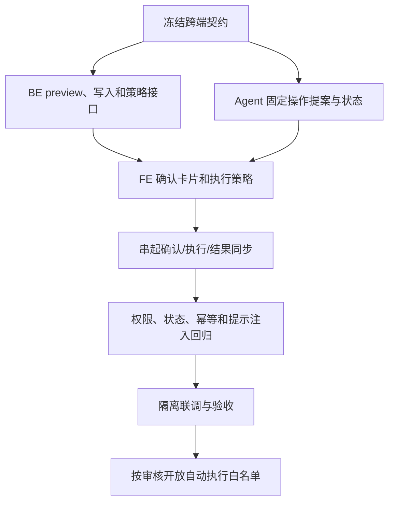

# V11 · Agent 受控业务写入实施与验证计划

> 草案，待 Agent/BE/FE 技术方案 review。V11 PRD 已通过 review；三端 spec/plan 已形成首版，接口尚待联合冻结，实现尚未开始。按 [Agent spec](spec.md) 和 [BE](../be/spec.md)/[FE](../fe/spec.md) 契约执行。

## 1. 目标与实施顺序

让网页助手能把自然语言修改请求变成明确提案；由 FE 展示确认和调用 BE，BE 按当前用户身份、业务状态和自动执行策略执行。先完成每次确认的闭环，自动执行只在 BE 白名单和用户策略能力验收后开放。

三端 spec 已提出统一候选接口；最终字段、操作清单和风险白名单须联合 review 后冻结。实现不得跳过前置 review。

## 2. 阶段和交付条件

| 阶段 | Agent 工作 | 依赖 / 验收条件 | 状态 |
| --- | --- | --- | --- |
| V11-A0 契约冻结 | 对齐 SSE `action_proposed`、动作状态同步、proposal 生命周期、错误码、固定 action schema；明确首期仅网页或同时支持 CLI | 联合 review [Agent](spec.md)、[BE](../be/spec.md)、[FE](../fe/spec.md)；当前提议按网页助手，CLI 保持只读 | 待 review |
| V11-A1 提案模型 | 新增固定 `action_type` 注册表和 Pydantic 参数 schema；把模型提出的动作限制在允许字段；解析业务编号到当前用户可访问的唯一对象 | 无写请求；对象不唯一、字段缺失、无权限或 schema 不符时仅追问/拒绝 | 待开始 |
| V11-A2 预览与 SSE | 查询 BE 当前对象，生成绑定 actor、session、message 的候选动作；增加 `action_proposed` 事件，由 FE 用网页身份向 BE 换权威 preview/proposal | Agent token 维持只读；BE preview 能说明必要影响；Agent 不发 mutation 请求 | 待开始 |
| V11-A3 提案生命周期 | 实现 proposal 的批准、拒绝、取消、过期、失效和单次状态约束；同一 proposal 不能改对象/参数、跨会话或重复消费 | 状态转换可控；重放、越权、过期和会话失效测试通过 | 待开始 |
| V11-A4 执行结果同步 | FE 调用 `/sessions/{id}/actions/{candidate_id}/sync`；Agent 使用只读凭据 GET BE proposal 状态并验证实际结果，再更新会话；不信任客户端提交的成功文本 | BE 返回稳定 action/proposal correlation；结果无法核实时标记未知，不说成功 | 待开始 |
| V11-A5 预算、并发和隐私 | 将提案/结果核验纳入请求超时、并发、限流和 trace；日志只记安全的 action type、状态和 correlation，不记 token、完整地址或无关字段 | 确认等待不占用模型任务；断线、重试、会话清理行为有界 | 待开始 |
| V11-A6 受控回归 | 补齐 Agent 单测和假的 BE；覆盖合法/非法提案、身份隔离、SSE、拒绝、过期、重放、数据版本冲突、结果核验、恶意业务文本 | `make check-agent` 通过；不调用真实付费模型 | 待开始 |
| V11-A7 隔离联调 | 与 BE/FE 在隔离数据验证订单字段修改、目的站更正的预览、确认、BE 拒绝、实际写入、结果回显和审计链路 | 真实个人身份；无开发/生产业务库写入；BE、FE 各自验收通过 | 待开始 |
| V11-A8 自动执行评审 | 首期默认不开放自动白名单；基于具体低风险动作单独审查，然后实现 BE policy read/setting 和 FE 行为联动 | 默认关闭、用户能撤销；BE 在执行时复查 action type、actor、范围和策略；高风险动作仍逐次确认 | 暂缓，白名单待 review |

## 3. 固定操作范围

首批只评估 PRD 候选中的两类动作。BE 盘点后再冻结字段：

| action type | 已有 BE 接口线索 | Agent 需做的事 | 执行策略 |
| --- | --- | --- | --- |
| `order.update` | `PATCH /api/v1/orders/{order_id}`；有幂等键，需核对对象版本/并发更新前提 | 读取当前订单、字段白名单、前后值校验和结果复核 | 每次确认 |
| `shipment.destination.update` | `PATCH /api/v1/shipments/{shipment_id}/destination`；请求含预期旧目的站、目标站和原因 | 核实站点、原因、当前目的站及 BE 返回的运输计划影响 | 每次确认 |

Agent 不调用其他 mutation endpoint。创建、取消、计划调整、实际轨迹事件、批量修改暂不纳入首批动作；如果本轮 review 决定增加，先补对应 BE/FE 契约和验收案例。

## 4. Agent 受控验证矩阵

| 类别 | 必测边界 |
| --- | --- |
| 意图与参数 | 查询继续只读；写入意图被识别；对象/字段缺失先追问；额外字段、自由 URL、未知 action type 拒绝 |
| 用户与对象 | 普通用户只针对本人可操作对象；developer 无写提案；跨用户 proposal 查询、批准、同步均拒绝且不泄露对象存在性 |
| 用户确认 | 未确认绝不触发写入；批准只绑定单个 action hash；修改内容需新提案；拒绝、取消、过期都不写 |
| 自动执行 | Agent 不决定自动批准；客户端伪造自动模式不生效；BE 策略关闭或不可用时不得执行；白名单以外回到逐次确认 |
| 并发和幂等 | 旧对象版本冲突；重复批准、SSE 重连、相同 message 重放、网络结果未知都不会造成重复写入 |
| 结果与对话 | BE 确认后才报告成功；重新读取核验对象和变化；拒绝/未知/服务故障按不同状态展示并同步会话 |
| 注入和日志 | 备注、地址、操作历史中的命令不能获得用户授权或改写 action；日志和 checkpoint 不含凭据及不必要的个人数据 |

真实模型评测单独进行，至少检查写入意图识别、目标对象解析、缺失信息追问和只读问题不触发写入。真实模型验收不代替 BE 权限与 FE 确认测试；API 成本和运行证据按当时模型配置记录。

## 5. 跨端阻塞项

联合 review 后需冻结：

1. BE 如何提供不写入的动作预览、影响说明和 `allowed_actions`。
2. FE 如何用现有 Cookie/CSRF 调用 BE 动作；如何从 Agent proposal 对应到 BE 幂等键和审计记录。
3. 订单修改是否需要增加 `expected_updated_at` 或等价版本条件；目的站预期值如何覆盖并发状态改变。
4. 动作结果如何同步到 Agent 并由 Agent 的只读 BE 查询核验；接口不能接受客户端伪造的执行成功事实。
5. 用户自动执行偏好存放位置、谁可设置、如何撤销及服务端执行时如何判断；在该决策完成前白名单为空。
6. 首期 CLI 是否只读；当前计划按网页入口实施。

以上是实现依赖，不是已实现内容。依赖未冻结时只可进行不调用写接口的 schema/fixture 探索，不可对接真实业务写入。

## 6. 交付记录

| 日期 | 内容 | 验证结果 | 状态 |
| --- | --- | --- | --- |
| 2026-10-21 | 根据已通过 review 的 V11 PRD 编写 Agent/BE/FE spec 与 plan 首稿 | 文档链接检查、`git diff --check` 通过；尚无代码改动或运行测试 | 三端文档待联合技术 review |

每次实现后在此记录代码范围、BE/FE 契约版本、使用的身份和隔离环境、测试命令与结果、未通过项及是否开放自动白名单。不能将合成测试、接口存在或代码完成写成端到端验收通过。
