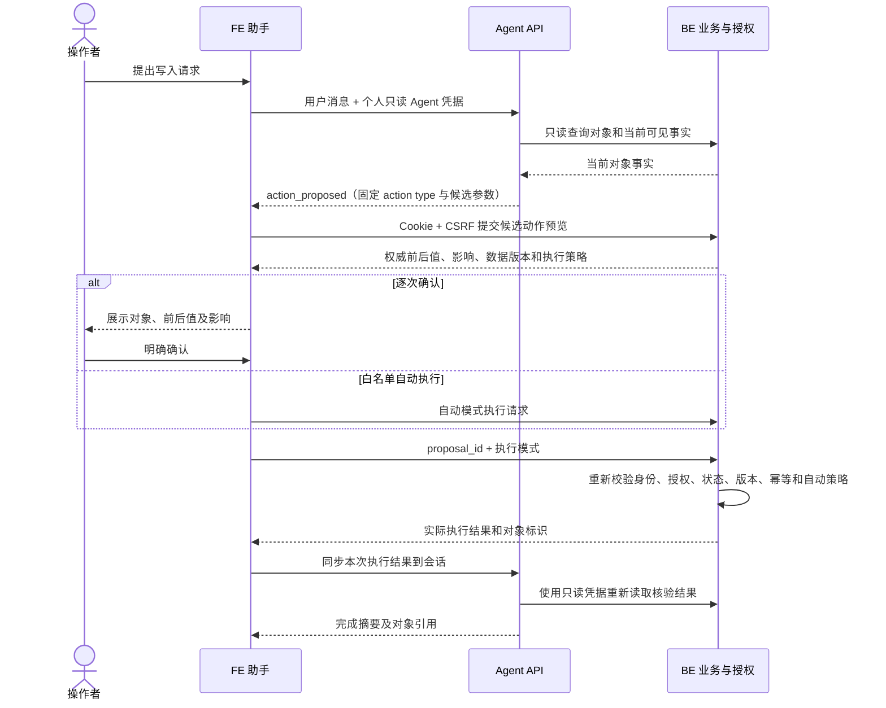
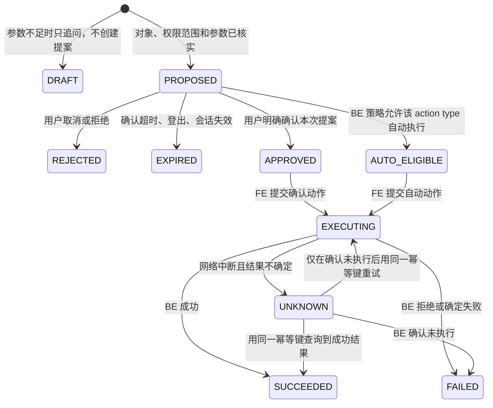

# V11 · Agent 受控业务写入规格

> 2026-10-21 · 根据 [V11 PRD](../../../prd/v11/JINGPO-agent-v11.md) 编写。首期契约按三端实现冻结：网页入口、CLI 只读、单条消息至多一个动作候选、自动执行白名单为空。

## 1. 怎么解决

Agent 负责把用户的自然语言请求整理成一个固定类型、经过校验的操作提案；它不直接持有 BE 写凭据，也不调用任意 URL。网页 FE 展示提案并处理确认交互，BE 再用当前登录用户身份执行权限、状态、范围和幂等检查。自动执行由 BE 的用户策略和操作白名单决定，模型不能给自己批准。



BE 的执行策略查询和动作执行接口已按 V11 契约实现，并通过隔离数据库迁移、BE 回归及 Agent/BE HTTP 联调。Agent 仍只生成候选并通过只读凭据核验终态；实际预览和写入由 FE 当前网页登录态与 BE 完成。浏览器订单确认/取消链路已通过确定性假模型验证，实体读屏器和触屏设备走查仍待完成。

## 2. 当前实现约束

- Agent 通过 `/auth/agent-token` 获得绑定个人会话的只读凭据；当前 `IdentityClient` 要求 `read_only=true`，BE `authorize_business` 会拒绝只读凭据的写请求。
- Agent 的所有查询继续携带当前个人只读凭据，并在线复核身份。普通用户的只读范围、ops/admin 的公司查询范围和 developer 只读限制保持不变。
- 不把网页 Cookie、CSRF token、BE 服务凭据或管理员凭据交给 Agent。FE 使用现有已登录浏览器会话与 CSRF 保护访问 BE 动作接口。
- V11 不把 Agent 子凭据升级为通用 BE 写凭据。若后续需要 CLI 或 Agent 服务端直接执行，必须另行设计受限、短时、绑定具体动作的授权凭据，不复用系统级高权限 token。

## 3. 操作提案与状态

### 3.1 固定操作目录

Agent 只允许提出 registry 中定义的 `action_type`，例如：

| action_type | 目标对象 | 输入字段 | V11 策略 |
| --- | --- | --- | --- |
| `order.update` | `order` | 允许修改的订单字段 | 必须用户确认 |
| `shipment.destination.update` | `shipment` | 用户给出的目标站名称、原因；Agent 从 BE 站点目录解析 ID，候选仍只发送 ID | 必须用户确认 |

首期候选来自现有 BE 接口：订单 `PATCH /api/v1/orders/{order_id}`、运单目的站 `PATCH /api/v1/shipments/{shipment_id}/destination`。目的站工具按用户输入的站名查询 BE 站点目录，只有唯一、启用且允许派送的站点才会映射为内部 ID；不唯一时请用户按站名/code 澄清，不要求用户提供 ID。Agent 只提交结构化动作，不接收模型生成的路径、HTTP 方法或任意字段。新增其他 `action_type` 前需在 BE/Agent spec 中完成权限、状态、影响、幂等与审计盘点。

V11 首期即使支持自动执行，写入自动白名单也先保持为空；低风险自动动作清单经过单独评审和 BE 实现后才能开放。取消、目的站更正、已确认计划调整、批量操作始终逐次确认。

### 3.2 提案结构

Agent SSE 给 FE 的候选动作采用结构化字段。以下字段属于 `action_proposed`；BE preview 成功后才返回 `proposal_id`、对象展示、变化、影响、执行策略和过期时间：

```json
{
  "candidate_id": "uuid",
  "agent_session_id": "uuid",
  "message_id": "uuid",
  "action_type": "shipment.destination.update",
  "subject_type": "shipment",
  "subject_id": "812",
  "payload": { "expected_destination_station_id": 21, "destination_station_id": 34, "reason": "用户明确提出的更正原因" }
}
```

- Agent 事件称为 `candidate_id`，由 Agent 服务端生成；FE 调 BE 预览后，BE 返回 `proposal_id` 并持有规范化 payload、快照版本和过期时间。candidate ID 与 proposal ID 用于追踪，均不能当作授权凭证。
- `action_type` 和对象类型必须从服务器端白名单映射；FE 不接受模型提供的 URL 或导航路径。
- `payload` 通过对应严格 schema 校验，禁止额外字段、空修改和类型模糊；业务编号先解析到唯一授权对象 ID。
- FE 调 BE 生成权威预览后，前后值、影响和数据版本以 BE 响应为准。Agent 不生成可信的影响描述。
- BE 提案保存 `actor owner`、candidate/session/message correlation、action type、对象、规范化 payload、payload hash、读取到的对象版本和短时过期时间。提案不包含 Bearer/Cookie/CSRF。

FE 通过 BE preview 换取权威 `proposal_id`、subject、changes、impact、execution_policy 与 expires_at。SSE 不携带这些服务端事实。

### 3.3 状态流转



状态仅用于解释业务交互，不取代 BE 业务状态。一个提案最多成功执行一次；`APPROVED` 不可用于其他 payload、对象、操作或用户。用户改变对象/参数、BE 版本变化或权限发生变化，旧提案失效并重新读取、展示和确认。

## 4. FE 与 BE 接口责任

### 4.1 Agent API

现有 `POST /agent/api/v1/sessions/{id}/messages` 保持用户消息、SSE 进度和最终回答能力；实现新增 `action_proposed` 事件和动作状态同步接口：

| SSE 事件 | 用途 | 内容要求 |
| --- | --- | --- |
| `progress` | 查询或生成提案进度 | 不包含原始工具响应或模型推理 |
| `action_proposed` | 提醒 FE 向 BE 申请权威预览 | `candidate_id`、`agent_session_id`、`message_id`、固定 `action_type`、`subject_type`、`subject_id` 和严格校验后的候选 payload；不含批准或执行状态 |
| `result` | 只读回答或已核验写入结果 | 现有 answer/references/warnings，加动作结果摘要 |
| `error` | 请求、身份、业务核验或服务失败 | 稳定错误码和安全提示 |

FE 在动作成功、拒绝或取消后调用 `POST /agent/api/v1/sessions/{session_id}/actions/{candidate_id}/sync`，请求 `{ "proposal_id": "uuid" }`。Agent 校验 Bearer 所有者、Agent session 所有者和 candidate 关联，再用只读凭据 `GET /api/v1/agent-actions/{proposal_id}` 读取 BE 的可信状态。客户端提交的成功文字不作为事实。Agent 将已核验的动作结果写入有界会话动作记录，响应 `{candidate_id, proposal_id, status, subject, result_summary}`；后续追问可沿用这条结果。未知状态只返回核对中，不说成功。

同步接口拒绝跨用户/跨 session proposal、candidate 与 proposal 不匹配、已过期 session 和伪造状态。终结状态同步幂等；proposal 未终结时返回 `409 ACTION_PENDING`，FE 可稍后重新读取。

### 4.2 FE

- 收到 `action_proposed` 后先用网页身份向 BE 请求权威预览；预览成功后才渲染受控动作卡片。文本里的 Markdown、模型生成的按钮或链接不能触发写入。
- 用户确认、取消和自动执行状态清楚显示。确认操作只提交 BE 生成的固定 proposal ID 与执行模式；payload 和 hash 由 BE 服务端保存，FE 不重发；新参数必须重新预览。
- FE 用当前登录 Cookie + CSRF 调用 BE 的 preview/execute/policy 接口；FE 不把 Cookie/CSRF 放进 Agent API 请求。
- 执行使用 BE 预览返回的 proposal ID，BE 从服务端保存的规范化 payload 执行；FE 不重发或拼装已确认 payload。proposal ID 派生稳定业务幂等键。
- 自动执行由 FE 执行，且必须同时满足 BE preview 返回 `AUTO_ALLOWED`、action type 在 BE eligible 白名单中、当前用户已在 BE 策略中启用该 action；Agent SSE 和 FE 本地偏好不能单独触发自动写入。
- BE 返回权限拒绝、业务冲突、版本冲突、请求超时或结果未知时，FE 展示对应状态，不乐观显示成功。

### 4.3 BE

BE 专项规格定义以下 API 契约；这些 V11 接口已实现，临时数据库迁移、BE 回归、订单与目的站隔离 HTTP 流程通过。Chrome 已验证真实 FE→Agent→BE 订单确认和取消；目前仍待实体读屏器与触屏设备走查：

| BE 能力 | 要求 |
| --- | --- |
| GET/PUT `/api/v1/auth/agent-write-policy` | 返回/修改当前用户自己的自动执行偏好；默认关闭；仅能选择系统允许的 action type；策略变化审计 |
| POST `/api/v1/agent-actions/preview` | Cookie + CSRF；严格校验 action type/payload、对象权限和业务状态；创建短时 proposal；返回权威前后值、影响、对象版本和 `CONFIRM_REQUIRED`/`AUTO_ALLOWED` |
| POST `/api/v1/agent-actions/{proposal_id}/execute` | Cookie + CSRF；仅接受 `mode=approved` 或 `mode=automatic`；校验 proposal 所有者、期限、一次性状态、当前权限和版本；automatic 需再次检查用户策略 |
| POST `/api/v1/agent-actions/{proposal_id}/reject` | Cookie + CSRF；标记拒绝/取消，不调用业务写 service |
| 版本前提 | execute 时对照 proposal 读取的 `updated_at`/领域版本；状态改变时返回 409，不覆盖新数据 |
| 幂等与追踪 | proposal 只能成功消费一次；用 proposal ID 派生业务幂等键；审计 actor、source=`agent`、proposal/candidate/message/session correlation、approval mode、变更和结果 |
| 响应 | 返回可信的 action/proposal correlation、业务对象类型/ID/编号、实际状态和可展示影响；不回传凭据 |

preview 和 execute 使用 server-side proposal 记录；execute 复用订单/运单领域 service，而不允许客户端提交任意 endpoint。订单和运单均以 preview 的 `updated_at` 做并发版本比较，运单同时核对预期旧目的站与业务状态。

## 5. 模型、权限与失败处理

- 模型只负责识别意图和提出候选参数。服务端校验 action schema、对象可见性、当前字段、目标取值和必填原因；模型无权判定 BE 是否允许。
- 涉及业务写入的工具默认分为 `propose_*` 与只读工具；`propose_*` 只能创建待处理提案，不调用 BE mutation。
- 对象不可见按现有普通用户安全语义返回“当前账号范围内未找到”，不泄露对象存在与否。
- BE 身份服务不可用时不执行；权限复核失败、对象版本变化、审批过期、策略接口不可用时统一 fail closed。
- 断开 SSE 不撤回已经到达用户的提案，也不执行写入。重新连接按 `message_id`/`proposal_id` 查询已有状态，不能重跑生成重复动作。
- 用户批准后 FE 请求超时，状态记为 `UNKNOWN`；FE/Agent 先按幂等键确认结果，不能换新键盲目重试。
- 写入前、审批时和 BE 执行时都检查身份归属。审批期间如账号停用、角色降级、会话撤销或权限变化，BE 必须拒绝。
- 业务字段可能包含恶意指令；它们只能作为展示数据，不能更改 action type、调用范围或批准状态。

## 6. 验证要求

受控 Agent 测试、BE 授权测试和 FE 交互测试分层执行；CI 只使用假模型、模拟 BE 和临时数据库，不调用付费模型。

| 测试 | 必须证明 |
| --- | --- |
| 提案校验 | 合法 action 生成规范提案；缺字段、非法字段、对象歧义、额外字段和错误类型不会发出可执行提案 |
| 身份与范围 | 普通用户只可提议本人可操作对象；developer 无写入口；不同用户不能查看或确认另一人的提案 |
| 用户确认 | 确认前没有 BE mutation；拒绝、取消、过期没有写入；确认只执行同一 payload 一次 |
| 自动策略 | 默认关闭；仅 BE 白名单 action 可自动执行；伪造 FE 参数、模型声明或客户端缓存不能开启自动执行 |
| 并发与幂等 | 预览后对象变化被拒绝；重复确认、请求重放和超时恢复不造成重复业务效果 |
| 结果核验 | Agent 只把重新读取确认的结果说成成功；BE 错误和不确定结果均正确展示 |
| 提示注入 | 备注、地址、轨迹和任务文本不能让 Agent 绕过确认或改变动作对象 |
| 审计 | 每个成功/拒绝动作可关联用户、proposal、BE request 和结果；日志不包含凭据与不必要的完整个人数据 |

真实模型评测作为单独的验收步骤，覆盖写入意图识别、对象选择、字段解析和不应写入场景；不能用自动规则通过代替业务权限验收。具体数据集和成本由 plan 确定。

## 7. 跨端决策与后续边界

1. 首期入口已定为 FE 网页助手，CLI 保持只读。
2. 首期动作已定为 `order.update` 和 `shipment.destination.update`，均要求逐次确认；自动执行白名单为空。
3. BE 策略、preview/execute/reject/status、版本前提和审计关联字段已实现并完成隔离联调。
4. Agent SSE candidate、动作状态同步及 FE/BE 调用路径已按三端 spec 落地。
5. 自动授权由用户管理自己的偏好；适用动作仍须由 BE 系统白名单决定，首期没有 eligible action。

后续扩充 action 或开放自动白名单前，需另行更新三端规格并完成风险评审。真实读屏器和触屏设备走查仍属于交付验收项。
