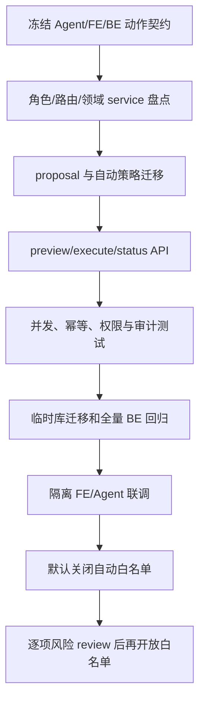

# V11 · BE 受控 Agent 写入实施与验证计划

> 代码实现与自动化验收已完成。首期网页动作网关已接入，CLI/Agent bearer 仍只读；两个 action 逐次确认，自动白名单为空。生产日志和留存观察需部署后完成。契约见 [BE spec](spec.md)。

## 1. 顺序

| 步骤 | 工作 | 完成条件 | 状态 |
| --- | --- | --- | --- |
| V11-BE-01 | 冻结 action type、候选/proposal schema、状态、错误码与自动策略 | 三端同一契约；首期仅网页写入口，自动白名单为空 | 已冻结并经隔离 BE/Agent HTTP 与 FE 浏览器流程核对；读屏/触屏手工验收见 FE plan |
| V11-BE-02 | 盘点身份、对象范围、订单更新/目的站服务、operation_logs 和幂等 | 明确角色、领域 service、事务和版本条件 | 已完成并复用原领域 service |
| V11-BE-03 | proposal、用户策略及审计关联迁移 | upgrade/downgrade 可用；无历史业务回写；alembic check 无差异 | 已实现；一次性 PostgreSQL 已验证全量升级、V11 降一级后重升及 schema 无差异 |
| V11-BE-04 | preview/policy API | Cookie+CSRF 写入；Agent 只读；预览无业务副作用；隐藏越权对象 | 已实现；基本权限用例通过 |
| V11-BE-05 | execute/reject/status 与两个固定 service | 执行时重检权限/状态/版本；幂等；审计相关字段 | 已实现；成功、重放、stale、拒绝和只读 bearer 测试通过 |
| V11-BE-06 | 数据库、权限、竞态和留存回归 | 覆盖撤权、并发、过期和失败原子性 | 已完成：撤销 web 会话后拒绝执行；并发确认得到同一成功结果且只有一条操作日志；业务写入故障时订单与日志回滚；过期 payload 清理通过 |
| V11-BE-07 | 迁移、alembic check、全部 BE tests | 临时隔离 PostgreSQL，不接触开发/生产库 | 通过：`make check-v11-integration` 同时执行全量 BE 检查，95 项中 86 passed、9 skipped；迁移 head 与 `alembic check` 通过 |
| V11-BE-08 | 与 FE/Agent 联调并核对 audit correlation | 用户身份、proposal、message、BE request、最终结果可串联；失败路径无假成功 | 已完成隔离 HTTP 联调：订单更新、目的站更正均走真实 BE HTTP 与 Agent API；Chrome 真实 FE→Agent→BE 订单确认/取消页面流程通过；订单审计关联核对通过；读屏/触屏手工验收仍见 FE plan |
| V11-BE-09 | 自动执行白名单专项评审 | 初始为空；只有明确列项、可撤销设置、执行时 BE policy checks 全通过后逐项开放 | 已完成首期工程风险审查：订单可修改地址、数量和履约时效，目的站更正会改变运输安排，均不适合免确认；eligible 白名单继续为空，不开放自动写入 |

## 2. 测试矩阵

| 类别 | 样例 |
| --- | --- |
| 鉴权 | web Cookie+正确 CSRF；无登录、错误 CSRF、只读 Agent token、CLI token、developer token 均不能写 |
| 角色/范围 | user 修改本人订单可按业务条件继续、修改他人订单返回安全 404；ops/admin 受业务条件限制；developer 永远只读 |
| Preview | 合法订单字段和目的站动作返回前后值、版本和影响；额外字段、无效 station、空 reason、不可编辑对象不生成 proposal |
| 自动策略 | 默认空；policy 只允许 eligible action；自动执行同时要求 enabled 和 allowlist；旧 policy version 不生效 |
| 状态 | proposal 过期、被拒、已消费、业务状态改变、权限撤销均不能写入 |
| 并发 | 两个 proposal 基于同一版本，只能有一个成功；第二个返回 stale 并要求新预览 |
| 幂等 | 相同 proposal 重放返回相同结果；同 ID 不同内容拒绝；网络超时可查询确定结果 |
| 原子性 | 业务 service 成功与 proposal SUCCEEDED 一起提交；失败 rollback；无幽灵操作日志 |
| 隐私审计 | owner-only GET status；不返回他人字段；日志不包含 token、CSRF、模型密钥和不必要地址 |

## 3. 风险和未决项

- 当前 Agent token 被 BE 明确设为只读；本方案保留这一限制，写入必须从 FE 的网页登录会话进入。
- 订单和运单 proposal 都保存 `updated_at` 及自动策略版本；BE 每分钟清理到期 payload，最长保留窗口约 6 分钟，状态接口也会主动清理。
- 审计关联字段和普通用户可读的 proposal status 已做最小化；隔离测试覆盖过期 payload 清除、状态脱敏和 Agent debug 日志不泄漏凭据/地址。部署后的实际运行日志与数据库留存观测须待发布 V11 后完成。
- 自动执行白名单目前为空；未完成专项 review 前不得开启真实自动写入。
- 2026-10-22 首期工程风险审查结论：`order.update` 可影响收寄地址、件数及履约时间；`shipment.destination.update` 会改变运输目的站并影响既有安排。两类动作都继续逐次确认，不加入自动执行白名单。未来若有更低风险动作，需独立列出字段范围、影响和回滚方式再审。

## 4. 交付记录

| 日期 | 内容 | 验证 | 状态 |
| --- | --- | --- | --- |
| 2026-10-21 | 实现 proposal/policy 表、写入口及审计关联；接入订单更新和目的站更正 service | `make check-be`：临时 PostgreSQL 全量迁移、`alembic check` 无差异；88 项中 79 项通过、9 项既有 opt-in skip | 代码完成；撤权/并发/事务故障与 FE/Agent 隔离联调待完成；白名单为空 |
| 2026-10-21 | 补齐撤权、并发确认、事务回滚测试；新增订单和目的站两条真实 HTTP 隔离联调 | `make check-v11-integration`：92 项 BE 测试中 83 passed、9 skipped；迁移与 schema 检查通过；订单/目的站 Agent 候选、BE 预览、网页登录态确认和 Agent 状态核验通过 | BE 与 BE/Agent API 验收通过；FE 浏览器及读屏验收仍待完成；白名单为空 |
| 2026-10-22 | 在全新一次性 PostgreSQL 容器重跑 V11 集成入口，确认不依赖开发库 | `TEST_DATABASE_URL=... make check-v11-integration`：迁移至 `a11c0de20210`、`alembic check` 无差异；BE 92 项（83 passed、9 opt-in skipped）；订单/目的站 Agent→BE→Agent HTTP 闭环通过；临时库和容器已删除 | 当前 BE/Agent 隔离回归通过；浏览器页面验收与自动白名单专项评审仍待完成；白名单为空 |
| 2026-10-22 | 策略更新响应补 no-store；复跑全量隔离迁移、BE 回归和 Agent/BE HTTP 联调 | `make check-v11-integration`：迁移与 `alembic check` 通过；BE 92 项（83 passed、9 skipped）；Agent candidate→BE preview→确认→Agent 核验与审计关联通过；临时数据库已删除 | BE/Agent 联调通过；FE 按 eligible 列表显示策略，自动白名单为空；白名单风险评审仍待完成 |
| 2026-10-22 | 评审首期两个动作的自动执行风险；增加伪造 automatic mode 和策略缓存头回归；修复被拒的自动模式错误终结 proposal | `make check-v11-integration`：迁移与 `alembic check` 通过；BE 92 项（83 passed、9 skipped）；Agent/BE HTTP 闭环通过。测试确认策略 GET/PUT no-store、直接请求 automatic 返回 403 且 proposal 仍为 PREVIEWED，可继续取消或确认 | 两个动作均不列入自动白名单；BE policy/执行路径保持 fail closed；已发现问题修复并回归通过 |
| 2026-10-22 | 在 `feat/v11` 上复跑 BE 隔离迁移、全量回归及 Agent/BE HTTP 集成 | `make check-v11-integration`：迁移至 `a11c0de20210`、`alembic check` 无差异；BE 92 项（83 passed、9 skipped）；订单/目的站 HTTP 与审计关联通过；临时数据库已删除 | BE/Agent 自动化验收复核通过；生产部署留存/日志观测及 FE 实体读屏/触屏验收仍待外部运行；自动白名单为空 |
| 2026-10-22 | 本轮重新核对 V11 BE 迁移、schema、权限与隔离 HTTP 门禁 | `make check-v11-integration`：临时库迁移至 `a11c0de20210`、`alembic check` 无差异；BE 92 项（83 passed、9 skipped）；Agent candidate→BE preview→确认→状态核验及审计关联通过；临时库已清理 | 代码侧 BE 验收复核通过；生产日志/留存观察待部署后进行；自动白名单为空 |
| 2026-10-22 | 为 V11 写入口补充匿名、Bearer、错误 Origin/CSRF 与 developer 角色拒绝回归 | `make check-v11-integration`：临时库迁移与 `alembic check` 通过；BE 94 项（85 passed、9 skipped）；Agent candidate→BE preview→确认→状态核验与审计关联通过；临时库已清理 | 写入口鉴权边界直接覆盖并通过；生产日志/留存观察待部署后进行；自动白名单为空 |
| 2026-10-22 | 补充 candidate 重放内容绑定回归，确保同一 candidate 不能替换 message 或业务内容；完善 FE 预览响应严格校验与提案到期核对 | `make check-v11-integration`：BE 95 项（86 passed、9 skipped），迁移、`alembic check` 和 Agent→BE HTTP 确认/审计关联通过；`make check-fe`：35 项通过，typecheck/lint/build 通过 | 代码侧自动验收通过；实体读屏/触屏设备走查及生产日志/留存观察待外部运行；自动白名单为空 |
| 2026-10-22 | 将最近一次迁移降级/重升纳入隔离检查，补上 V11 migration downgrade 的实际验证 | `make check-v11-integration`：临时数据库全量 upgrade → `alembic check` → downgrade `a11c0de20210` → upgrade head → `alembic check` 均通过；BE 95 项（86 passed、9 skipped）；Agent/BE HTTP 闭环通过 | V11 迁移回退与恢复路径已在可丢弃数据库验证；未对开发或生产数据执行降级 |
