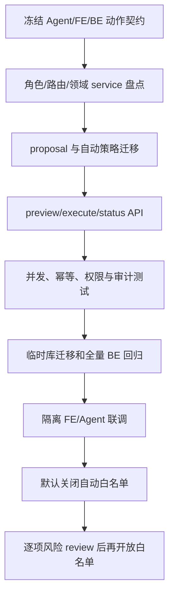

# V11 · BE 受控 Agent 写入实施与验证计划

> 草案，待三端技术 review。PRD 已通过 review；本计划未开始实现。契约见 [BE spec](spec.md)。

## 1. 顺序

| 步骤 | 工作 | 完成条件 | 状态 |
| --- | --- | --- | --- |
| V11-BE-01 | 与 Agent/FE 冻结 action type、candidate/proposal schema、policy 策略、状态和错误码 | 三端 spec 同一契约版本；没有未审的 mutation action | 待开始 |
| V11-BE-02 | 盘点 V8 身份、普通用户对象归属、订单更新、目的站更正、operation_logs 和幂等实现 | 明确各 role、service 入口、事务范围和当前版本字段 | 待开始 |
| V11-BE-03 | 设计并实现 proposal、用户自动策略和审计关联迁移 | upgrade/downgrade 策略审查通过；历史业务数据不回写；alembic check 无差异 | 待开始 |
| V11-BE-04 | 实现 preview/policy APIs | 只用网页 Cookie+CSRF；业务无副作用；对象隐藏规则一致；只返回可展示字段 | 待开始 |
| V11-BE-05 | 实现 execute/reject/status APIs 并 dispatch 两个首批 service | 角色、状态、版本和策略执行时重检；proposal 单次消费；重试幂等 | 待开始 |
| V11-BE-06 | 完成数据库集成测试和权限/竞态回归 | 预览后数据变化、并发批准、重放、撤权、低风险策略关闭等场景符合 spec | 待开始 |
| V11-BE-07 | 运行迁移、alembic check、全部 BE tests | 临时隔离 PostgreSQL 通过；开发库/生产库不参与 | 待开始 |
| V11-BE-08 | 与 FE/Agent 联调并核对 audit correlation | 用户身份、proposal、message、BE request、最终结果可串联；失败路径无假成功 | 待开始 |
| V11-BE-09 | 自动执行白名单专项评审 | 初始为空；只有明确列项、可撤销设置、执行时 BE policy checks 全通过后逐项开放 | 暂缓 |

## 2. 测试矩阵

| 类别 | 样例 |
| --- | --- |
| 鉴权 | web Cookie+正确 CSRF；无登录、错误 CSRF、只读 Agent token、CLI token、developer token 均不能写 |
| 角色/范围 | user 修改本人订单可按业务条件继续、修改他人订单返回安全 404；ops/admin 受业务条件限制；developer 永远只读 |
| Preview | 合法订单字段和目的站动作返回前后值、版本和影响；额外字段、无效 station、空 reason、不可编辑对象不生成 proposal |
| 自动策略 | 默认空；policy 只允许 eligible action；自动执行同时要求 enabled 和 allowlist；旧 policy version 不生效 |
| 状态 | proposal 过期、被拒、已消费、业务状态改变、权限撤销均不能写入 |
| 并发 | 两个 proposal 基于同一版本，只能有一个成功；第二个返回 stale 并要求新预览 |
| 幂等 | 相同 proposal 重放返回相同结果；同 ID 不同内容拒绝；网络超时可查询确定结果 |
| 原子性 | 业务 service 成功与 proposal SUCCEEDED 一起提交；失败 rollback；无幽灵操作日志 |
| 隐私审计 | owner-only GET status；不返回他人字段；日志不包含 token、CSRF、模型密钥和不必要地址 |

## 3. 风险和未决项

- 当前 Agent token 被 BE 明确设为只读；本方案保留这一限制，写入必须从 FE 的网页登录会话进入。
- 订单更新若没有可比较的 `updated_at`/版本，须在领域 service 增加乐观并发校验，不能只依赖幂等键。
- proposal payload 可能含个人信息。实现前确定数据库访问、清理和保留期限，运行日志不复制原始 payload。
- 审计关联字段及普通用户可读取的 proposal status 需要按最小信息设计。
- 自动执行白名单目前为空；未完成专项 review 前不得开启真实自动写入。

## 4. 交付记录

| 日期 | 内容 | 验证 | 状态 |
| --- | --- | --- | --- |
| 2026-10-21 | 编写 BE spec/plan 草案 | 文档链接与 `git diff --check`；未改代码、未运行测试 | 待 review |
