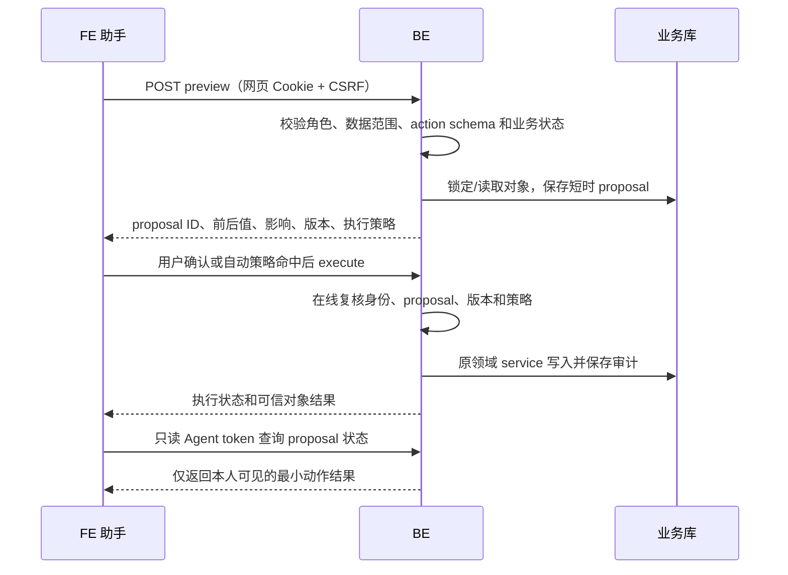
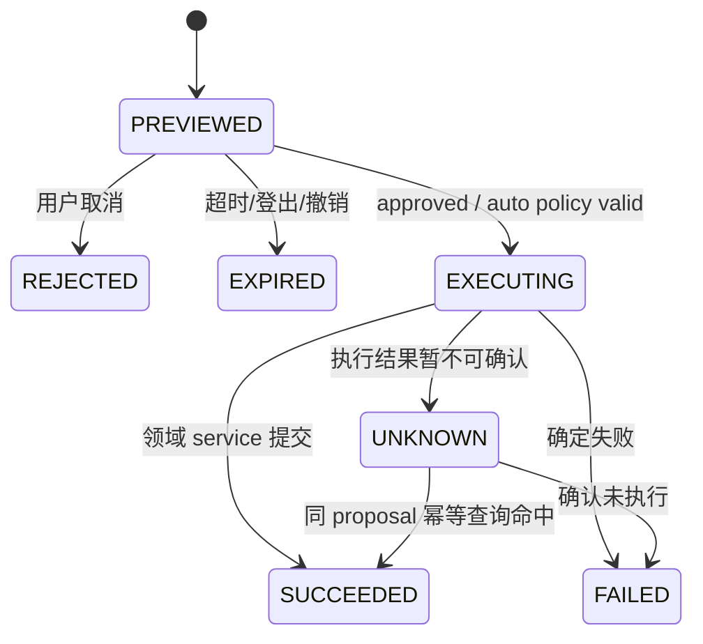

# V11 · BE 受控 Agent 业务写入规格

> 2026-10-21 · 根据 [V11 Agent PRD](../../../prd/v11/JINGPO-agent-v11.md) 与 [Agent 技术规格](../agent/spec.md) 编写，待 BE/FE/Agent 联合 review。本文是目标契约，不代表接口或迁移已经实现。

## 1. 用户会看到什么

网页助手可先生成修改提案。BE 用当前登录用户检查对象、业务规则和最新数据，返回确认卡片需要的前后值与影响。用户确认后 BE 执行一次；对已明确允许自动执行的操作，BE 可按当前用户设置免逐次确认。所有写入仍走现有领域 service，保留业务状态校验、用户数据范围、幂等和审计。



## 2. 身份、权限和边界

- 写入口只接受当前网页登录 Cookie，并要求正确 Origin 与 CSRF；不接受 Agent/CLI 只读 Bearer、服务凭据、客户端自报角色或管理员代办。
- 每个 endpoint 重新检查账号状态、角色、权限版本和对象归属。普通用户仅可修改自己有权操作的订单；ops/admin 沿用当前公司范围和业务资格；developer 只读。
- 现有 Agent 子凭据仍只有 `business:read`；Agent 继续使用它读对象及查询 proposal 状态，不能调用 preview、policy 修改或 execute。
- BE 以 `action_type` allowlist + tagged Pydantic schema 映射固定领域 service。拒绝任意 URL、方法、字段路径和模型生成 SQL。
- 用户确认是产品流程，不代替 BE 授权。execute 每次重新检查用户、数据范围、状态、版本和业务限制。

## 3. API 契约

以下路径位于 `/api/v1`。所有响应 `Cache-Control: no-store`。写接口均检查网页 CSRF，并按现有格式返回 `{error:{code,message,details},request_id}`。

### 3.1 自动执行偏好

| 方法与路径 | 用途 | 请求 / 响应 |
| --- | --- | --- |
| GET `/auth/agent-write-policy` | 获取当前账号自动执行设置 | 返回 `enabled_action_types`、服务端 `eligible_action_types` 和版本；默认均为空 |
| PUT `/auth/agent-write-policy` | 修改当前账号设置 | `{enabled_action_types:[...]}`；只能选择当前服务端 eligible 列表中的 action type；空数组关闭自动执行 |

每个用户只能管理自己的偏好。`eligible_action_types` 是服务端风险白名单；代码未批准的操作不能通过数据库值、客户端参数或模型输出启用。V11 首期白名单为空，后续另行评审后逐项开放。策略改变写入 auth 审计，下一次 preview/execute 立即使用新版本。

### 3.2 生成动作预览

`POST /agent-actions/preview`

请求示例：

```json
{
  "candidate_id": "uuid",
  "agent_session_id": "uuid",
  "message_id": "uuid",
  "action_type": "shipment.destination.update",
  "subject_id": "812",
  "payload": {
    "expected_destination_station_id": 21,
    "destination_station_id": 34,
    "reason": "用户提出的更正原因"
  }
}
```

`candidate_id`、session 和 message 仅用于关联审计，不构成授权。BE 根据 action type 选择严格 schema，验证 subject ID、业务范围、权限、当前值、目标值、必需原因和当前业务状态。未通过时返回领域错误，不创建可执行 proposal。

成功响应示例：

```json
{
  "proposal_id": "uuid",
  "candidate_id": "uuid",
  "action_type": "shipment.destination.update",
  "subject": { "type": "shipment", "id": "812", "number": "SHP-0012" },
  "changes": [
    { "field": "destination_station_id", "label": "目的站", "before": "广州南站（21）", "after": "深圳北站（34）" }
  ],
  "impact": ["需重新核对运输计划；不会自动改写已有任务"],
  "execution_policy": "CONFIRM_REQUIRED",
  "expires_at": "2026-10-21T10:05:00Z"
}
```

`execution_policy` 仅允许 `CONFIRM_REQUIRED` 或 `AUTO_ALLOWED`。系统未开放自动白名单、用户未启用、角色/范围不匹配、策略服务不可用或操作被高风险规则覆盖时均返回 `CONFIRM_REQUIRED` 或拒绝；永远不因 Agent 参数返回 `AUTO_ALLOWED`。影响说明由领域规则生成，不能从模型自由文本复制。

### 3.3 执行、拒绝和状态读取

| 方法与路径 | 请求 | 行为 |
| --- | --- | --- |
| POST `/agent-actions/{proposal_id}/execute` | `{mode:"approved"}` 或 `{mode:"automatic"}` | 仅能由 proposal 所有者执行；automatic 重新检查当前用户设置和系统白名单；锁 proposal、复核对象版本后调用固定 service |
| POST `/agent-actions/{proposal_id}/reject` | `{reason_code:"USER_CANCELLED"}` | proposal 状态转为拒绝，不触碰业务数据；不可再次消费 |
| GET `/agent-actions/{proposal_id}` | 无请求体 | 仅允许与 proposal actor 相同的已认证用户读取最小状态；read-only Agent token 可读，不能写 |

`approved` 代表网页确认流程已发生，但不是 BE 权限凭证；业务身份和权限仍由 Cookie/CSRF、角色及领域 service 决定。`automatic` 必须由 BE 检查用户偏好、白名单、角色、数据范围和风险门槛。客户端不能通过换 mode 提权。

执行响应至少包含 `proposal_id`、状态、对象 type/id/number、实际写入结果摘要、BE request ID 和服务器完成时间。Agent 的 GET 状态响应还包含 `candidate_id`、`agent_session_id`、`message_id`、action type、subject、状态、批准方式和最小核验字段；不返回凭据、完整订单地址或其他用户资料。

## 4. 首期 action 和业务 service

| action type | 固定 schema | BE 当前基础 | V11 补齐要求 |
| --- | --- | --- | --- |
| `order.update` | Pydantic discriminated variant；仅允许现有 `OrderUpdateRequest` 字段 | `PATCH /orders/{id}` 已有角色/归属校验、状态限制和 `Idempotency-Key` | proposal 保存 `updated_at`；执行时锁定订单并拒绝版本变化；复用 `update_order_service` |
| `shipment.destination.update` | `expected_destination_station_id`、`destination_station_id`、`reason` | 已有 `PATCH /shipments/{id}/destination`、旧站前提、幂等和更正历史 | proposal 与现有服务一起检查旧站、运单状态及新站；影响解释不声称自动改写运输任务 |

当前已有端点继续供传统页面使用。Agent 写入统一从 Agent Action Gateway 进入以保存 preview/approval/auto/audit 状态；Gateway 只 dispatch 到明确登记的领域 service，不允许客户端选择任意 path。后续 action type 需新增相应 schema、权限测试、业务预览和迁移评估。

## 5. Proposal 生命周期和数据结构



建议新增 `agent_action_proposals`：proposal UUID、actor user/login session、candidate/session/message correlation、action type、subject type/id、规范 payload 与 hash、数据版本、前后值及影响快照、执行策略版本、状态、审批方式、过期/执行时间、BE request correlation。状态更新和业务服务写入必须处于同一数据库事务；不会因 proposal 表删除业务记录。

建议新增 `auth_agent_write_policies`（user_id + action_type 唯一）：enabled、updated_at、updated_by。用户策略默认关闭；eligible actions 由代码端 allowlist 控制。将策略版本与 proposal 一起保存，执行时重新读取当前值。

proposal 是短时的执行准备数据，定期清理已终结且过期的 payload；不可在普通日志输出完整 payload。审计记录保留最小必要字段，按现有操作审计访问控制。保留期限由部署/隐私约定在实现前确认。

### 执行安全要求

- Execute 按 proposal 行锁定；只允许 PREVIEWED 状态转换一次。复用 `proposal_id` 派生 idempotency key，重复请求返回同一结果。
- 订单修改必须比较 preview 中的 `updated_at` 或强版本；目的站还需比较 expected old station。对象版本变化返回 409 `PROPOSAL_STALE`，不覆盖新数据。
- 执行前调用现有 `assert_current` / 业务身份复核，并在同一事务中检查 role、created_by_user_id、allowed state 和当前字段。
- 已经写入但客户端超时，GET 状态返回原执行结果；禁止生成新幂等键重复执行。
- 多对象操作、取消、计划调整、执行轨迹及删除不进入初始 action allowlist。
- 若预览/策略/身份服务不可用，拒绝自动执行；高风险/未知风险操作不降级为自动。

## 6. 错误码

| HTTP | code | FE/Agent 行为 |
| --- | --- | --- |
| 401 | `AUTH_REQUIRED` / `ACCOUNT_DISABLED` | 清理登录态，要求重新登录 |
| 403 | `FORBIDDEN` / `READ_ONLY_CREDENTIAL` / `CSRF_REJECTED` | 不重试写入；显示无权或会话保护失败 |
| 404 | `NOT_FOUND` | 对本人范围外与不存在对象使用同一安全行为 |
| 409 | `PROPOSAL_STALE` / `PROPOSAL_EXPIRED` / `PROPOSAL_CONSUMED` / `BUSINESS_STATE_CONFLICT` | 重新读取和生成预览；不复用旧审批 |
| 422 | `INVALID_ACTION` / `INVALID_PAYLOAD` | 提示补正；不能按宽松 fallback 修改 |
| 429 | `RATE_LIMITED` | 显示稍后重试；不自动换新 proposal |
| 503 | `POLICY_UNAVAILABLE` / `AUTH_UNAVAILABLE` | fail closed，不允许自动执行 |

所有错误含 request_id；不把 SQL、内部异常或隐藏对象资料返回客户端。

## 7. 验证与风险

- 使用独立 PostgreSQL 测试库做迁移、`alembic check`、proposal 并发和 service 事务测试。
- 每个 role 测试自动策略配置和动作执行；验证读只读 Agent token 不能调用 POST preview/execute，也不能读取别人 proposal。
- 测试过期、重放、重复请求、对象字段被并发修改、权限撤销、策略关闭和服务不可用时 fail closed。
- 测试写成功与 proposal 状态在同一事务；rollback 后业务记录、操作历史和 proposal 不得出现互相矛盾的结果。
- 所有样本使用合成数据；常规 CI 不连接真实 LLM 或线上数据库。

迁移、接口响应和审计字段变化须同步更新 BE README、OpenAPI、FE/Agent 契约及[文档导航](../../../README.md)（若模块职责/主调用链发生变化）。
