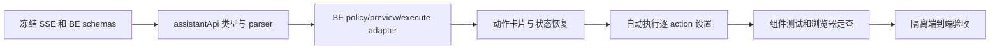

# V11 · FE Agent 写入交互实施与验证计划

> 代码实现与自动化验收已完成。已接入受控动作卡片、BE 权威预览与确认、取消、结果核验和 Agent sync；自动白名单为空。实体读屏器与触屏设备手工走查待完成。交互契约见 [FE spec](spec.md)。

## 1. 实施顺序

| 步骤 | 工作 | 完成条件 | 状态 |
| --- | --- | --- | --- |
| V11-FE-01 | 冻结 Agent SSE、BE preview/policy/execute/status schema | 三端实现字段一致；首期网页写、CLI 只读、自动白名单为空 | 已按实现冻结；隔离 BE/Agent API、真实 Agent 浏览器订单流程通过 |
| V11-FE-02 | 严格解析 `action_proposed` 及候选参数 | 未知 action、无效字段/类型、额外字段及错误 ID 不产生确认按钮 | 已实现；typecheck/lint 通过 |
| V11-FE-03 | 通过 auth adapter 调用 BE preview/execute/reject/status | Cookie+CSRF，不向 Agent 传网页凭据；Agent sync 只传 proposal ID | 已实现 |
| V11-FE-04 | 实现动作卡片和状态恢复 | 预览前不确认；用户确认后才 execute；未知结果查相同 proposal | 已实现；headless Chrome 已验证真实 FE→Agent HTTP→BE 订单预览、确认、结果核验和取消；Agent 使用确定性假模型 |
| V11-FE-05 | 逐 action 自动执行设置 | 只读 eligible 列表；空时隐藏设置；仅 BE preview=`AUTO_ALLOWED`、action eligible 且当前用户已启用时自动执行 | 已接 BE policy GET/PUT；首期两个动作均不适合免确认，列表为空时隐藏开关并说明逐次确认；三项自动执行条件均 fail closed |
| V11-FE-06 | Agent action sync | 只发 proposal correlation；仅 BE/Agent 验证终态后显示结果 | 已实现；Agent sync 用例通过 |
| V11-FE-07 | 组件与页面验收、typecheck/lint/build | 未开启自动策略的操作确认前 mutation 调用数为 0；键盘/窄屏/读屏/账号切换通过 | 35 项组件/API 测试覆盖确认、取消、多提案刷新恢复、过期状态核对与倒计时、Agent 会话丢失后继续核对、无授权时拒绝伪造 `AUTO_ALLOWED`、服务端允许且用户启用后的自动执行、自动执行条件变化后的安全回退、未知执行结果、新对话保留待处理提案、账号切换清空旧会话、键盘移动/调整窗口及读屏尺寸播报、动作卡片可键盘聚焦、鼠标/触控指针拖动标题、四角缩放的最小/最大尺寸、视口边界约束和右侧按钮不触发拖动、窄屏布局、预览响应严格校验、预览重试、stale 失败清理旧值、空白名单提示、eligible 策略设置、BE 已成功时的请求超时恢复和 Agent 核验失败后恢复；真实读屏与触屏设备手工走查仍待完成 |
| V11-FE-08 | 隔离 BE/Agent 联调 | 覆盖订单、目的站、取消、过期、stale、权限和未知结果 | 订单与目的站已完成隔离 BE/Agent API 确认闭环；Chrome 验证 FE→真实 Agent→BE 订单确认和取消，其中模型为确定性假模型；拒绝、stale、撤权、过期和回滚由 BE/Agent 回归覆盖；读屏/触屏手工验收仍待完成 |

## 2. 验收矩阵

| 场景 | 通过条件 |
| --- | --- |
| 只读问答 | 沿用现有消息、引用、警告和对象导航，无动作卡片 |
| 人工确认 | BE preview 后展示准确前后值/影响；用户确认前 execute 请求为 0 |
| 取消/过期 | 仅取消/过期状态；无 mutation；旧按钮不可复用 |
| 自动执行 | 默认 off；仅 BE `AUTO_ALLOWED`、该 action 在 BE eligible 列表且当前用户已启用时调用 automatic execute；策略或状态不确定时保持确认/核对，不重试写入 |
| 并发修改 | BE 409 后清除旧 preview 并刷新；不能用旧内容继续确认 |
| 网络超时 | 显示核对中，GET 同一 proposal；不换幂等键重试 |
| 登录变化 | 撤销待确认 UI、会话和凭据缓存；不能在新账号下继续旧 proposal |
| 无障碍与布局 | 键盘、读屏、手机窄屏下可以查看完整变更并执行/取消 |

## 3. 依赖及范围

- BE 提供 policy/preview/execute/reject/status API、严格 schema、CSRF 和 proposal 生命周期。
- Agent 输出 candidate event 并提供受 session owner 保护的 action sync 接口。
- 初始自动白名单为空；自动开关可在 eligible actions 为空时不显示。UI 不自行批准高风险操作。
- 首期按网页 Agent 助手实施；CLI 保持只读。
- 不新增 FE 直接绕过 assistant 的自然语言写接口；现有订单/运单业务表单行为保持既有规则。

## 4. 交付记录

| 日期 | 内容 | 验证 | 状态 |
| --- | --- | --- | --- |
| 2026-10-21 | 实现 SSE 候选解析、权威 preview 卡片、人工确认/取消、超时核对、刷新后状态核对和 Agent sync | `make check-fe`：TypeScript、ESLint、生产构建通过；Agent 67 项受控测试通过 | UI 代码已接入；浏览器端到端、刷新恢复、键盘/读屏和账号切换手工验收待完成 |
| 2026-10-21 | 完成 BE/Agent 隔离 HTTP 联调，覆盖订单更新与目的站更正；回归 FE 生产构建 | `make check-fe`：typecheck、lint、build 通过；`make check-v11-integration`：订单与目的站 API 确认/结果同步闭环通过 | FE 编译验收及 API 契约联调通过；页面真实浏览器、窄屏、键盘、读屏和账号切换验收仍待完成 |
| 2026-10-21 | 添加 Vitest + Testing Library 组件回归；修复预览卡片重复挂在提问和回答上的问题 | `make check-fe`：typecheck、lint、3 项组件测试和生产 build 通过 | 组件级确认/取消/刷新恢复通过；真实浏览器视觉、窄屏、键盘、读屏和账号切换验收仍待完成 |
| 2026-10-21 | 加固首期逐次确认、账号变化时中止动作请求、多提案刷新恢复和新对话生命周期；在助手标题区明确说明修改须确认 | `make check-fe`：typecheck、lint、6 项组件测试和生产 build 通过；Impeccable detector 无发现 | 自动策略保持 fail closed；浏览器真实渲染与无障碍手工走查待完成 |
| 2026-10-21 | 完成新对话期间保留待处理提案、终态清理缓存及切换账号清空旧会话；更新助手提示文案与 Render 显式开关说明 | `make check-fe`：7 项组件测试、typecheck/lint/build 通过；Impeccable detector 无发现 | 组件层账号隔离通过；真实浏览器视觉与无障碍走查仍待完成 |
| 2026-10-21 | 动作卡片增加服务端预览对象的固定站内链接，完成对象定位 | `make check-fe`：7 项组件测试、typecheck/lint/build 通过 | 修改结果可回到对应订单/运单；真实浏览器页面验收仍待完成 |
| 2026-10-21 | 补充助手窗口键盘移动/调整、窄屏布局、过期恢复和 Agent 重启恢复回归；修复恢复 UNKNOWN 状态下缺少重复核对入口的问题 | `make check-fe`：11 项组件测试、typecheck/lint/build 通过；生产构建有既有大 chunk 警告 | 过期 proposal 不恢复确认按钮；Agent correlation 丢失时保留 UNKNOWN 并允许再次查同一 proposal；登录态下真实浏览器、读屏和触屏走查仍待完成 |
| 2026-10-22 | 预览失败可重试同一候选；stale/过期终态隐藏失效前后值，并允许用原问题重新提案（刷新后提示重新描述，不持久化用户问题） | `make check-fe`：13 项组件测试、TypeScript、ESLint 和生产 build 通过；build 有既有大 chunk 警告 | 不会用旧预览继续确认；真实浏览器、读屏和触屏手工走查仍待完成 |
| 2026-10-22 | 用 headless Chrome 登录一次性用户，在独立 PostgreSQL 上走真实 FE→BE 订单预览和确认 | 页面展示 BE 返回的 ORD-000001 前后值；点击确认后 UI 显示完成，BE GET 验证 `product_name` 已更新；使用本地假 Agent 事件，BE 服务、数据库和用户均隔离并已清理 | Chrome 页面确认闭环与 FE/BE Cookie+CSRF 路径通过；Agent 事件使用 mock，不代表真实模型验收；读屏/触屏及取消页面流程仍由组件/BE 回归覆盖 |
| 2026-10-22 | 用真实 Agent HTTP 服务和 Chrome 验证订单修改取消页面流程 | Agent 提供确定性假模型候选；FE 展示 BE 权威预览，点击取消后显示“本次修改已取消”，确认按钮消失，BE 查询确认订单值未改变；Agent 全量 70 项测试通过 | 真实 FE→Agent→BE 页面取消与拒绝终态同步通过；模型非真实付费模型，读屏/触屏手工验收和自动白名单风险评审仍待完成 |
| 2026-10-22 | 接入自动执行策略读取和设置；白名单为空时明确展示当前仍需逐次确认 | `make check-fe`：15 项组件测试、TypeScript、ESLint、生产构建通过；`make check-v11-integration`：BE 92 项（83 passed、9 skipped）、迁移/schema 和 Agent→BE HTTP 闭环通过 | 策略依据 BE eligible 列表；当前无可自动执行操作，开关隐藏，FE 不会自动执行；读屏/触屏手工验收仍待完成 |
| 2026-10-22 | 键盘窗口移动/缩放增加读屏尺寸与位置播报，动作卡片标题绑定可访问名称 | `make check-fe`：15 项组件测试、TypeScript、ESLint、生产构建通过；Impeccable detector 无发现；`git diff --check` 通过 | 自动化检查覆盖 live region；真实屏幕阅读器及触屏设备走查仍待完成 |
| 2026-10-22 | 补齐 BE 已提交但浏览器请求超时、以及 Agent 状态核验临时失败后的同提案恢复 | `make check-fe`：17 项组件测试、TypeScript、ESLint、生产构建通过；两条回归均确认写入仅调用一次，并经 GET 同一 proposal 与 Agent sync 恢复可信结果 | 未知结果不重试业务写入；真实读屏与触屏设备手工走查仍待完成 |
| 2026-10-22 | 在 `feat/v11` 上复跑 FE 全量门禁，并与 BE/Agent 页面及 API 验收记录对齐 | `make check-fe`：typecheck、lint、17 项组件测试、生产 build 通过；build 仍提示既有大 chunk | FE 自动化回归复核通过；实体读屏器、触屏设备手工走查仍待完成 |
| 2026-10-22 | 接通 BE 白名单内的自动执行路径；用户授权、BE eligible 列表及单次 preview 策略必须同时允许，自动提交被拒但仍未执行时退回人工确认 | `make check-fe`：typecheck、ESLint、19 项组件测试、生产 build 通过；测试覆盖伪造 `AUTO_ALLOWED` 被拦截、授权后的 automatic execute 和策略变化后的回退；build 保留既有大 chunk 警告 | V11-FE-05 自动执行能力已实现；首期 eligible 白名单为空，所以线上首期仍逐次确认；实体读屏/触屏手工验收待完成 |
| 2026-10-22 | 本轮重新运行 FE 全量门禁 | `make check-fe`：typecheck、ESLint、19 项组件测试和生产 build 通过；生产 build 仍提示既有大 chunk；`git diff --check` 通过 | 代码侧 FE 验收复核通过；真实读屏器与触屏设备手工走查待完成；自动白名单为空 |
| 2026-10-22 | 让有名称的业务动作卡片进入键盘焦点顺序，补齐 FE spec 的键盘聚焦要求 | `make check-fe`：typecheck、ESLint、20 项组件测试和生产 build 通过；新增回归检查动作卡片可聚焦；保留既有大 chunk 警告 | 键盘用户可聚焦并读取动作卡片；真实读屏器与触屏设备手工走查仍待完成 |
| 2026-10-22 | 补四角触控指针缩放、标题区触控拖动和按钮排除回归；修复缩放时窗口越出视口的边界计算 | `make check-fe`：typecheck、ESLint、30 项组件测试和生产 build 通过；覆盖四角最小/最大尺寸、对角点锚定、视口边界与标题手势；保留既有大 chunk 警告 | 指针手势与 viewport 边界自动回归通过；实体触屏设备、真实读屏器手工走查仍待完成 |
| 2026-10-22 | 严格验证 BE 预览响应与 candidate/对象绑定；展示提案有效期并在到期后核对服务端状态，不自动重放写入 | `make check-fe`：typecheck、ESLint、35 项测试和生产 build 通过；`make check-v11-integration`：BE 95 项（86 passed、9 skipped），隔离 Agent/BE HTTP 闭环通过 | 预览契约及到期安全回归通过；真实读屏器/触屏设备走查和生产日志/留存观察仍待完成；自动白名单为空 |
