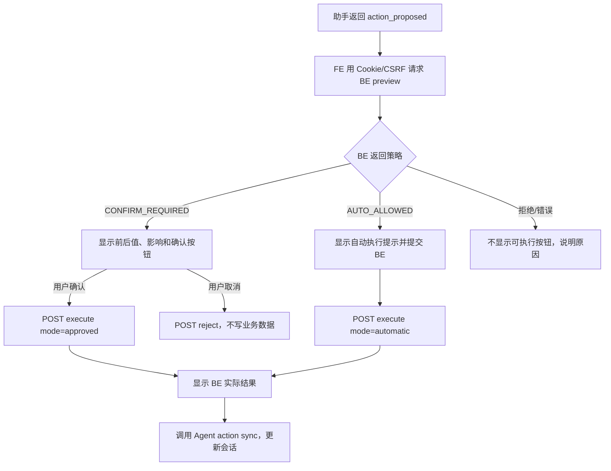

# V11 · FE Agent 写入交互规格

> 2026-10-21 · 根据 [V11 Agent PRD](../../../prd/v11/JINGPO-agent-v11.md)、[Agent spec](../agent/spec.md) 和 [BE spec](../be/spec.md) 编写，待三端 review。本文描述目标交互，不代表前端已实现。

## 1. 用户会看到什么

用户在现有浮动助手里提出写入请求。助手先给出候选动作，FE 再向 BE 申请权威预览。页面展示对象、字段前后值、影响和执行方式；用户确认后由 FE 用当前网页登录态调用 BE。只有 BE 明确判定已启用的低风险动作可自动提交。成功后显示服务端结果及对象链接。

## 2. 页面位置与视觉规则

- 沿用 `AssistantPanel` 浮动模块和现有主题；不新增全屏工作区或独立写操作聊天模式。
- 在助手标题/输入区明确标示“物流助手可查询；业务修改会先预览”。用户开启某项自动执行后，显示该项名称和可随时关闭的入口。
- 将动作提案作为独立、非 Markdown 卡片渲染。显示对象类型、业务编号、数据库 ID、操作名称、每个字段前后值、影响、有效期与执行策略。
- 确认按钮明确写“确认修改/确认执行”；取消写“取消本次修改”。自动执行必须显示“已按你的自动执行设置提交”，不能伪装成用户点击确认。
- 操作处理中禁用重复提交；`UNKNOWN` 结果显示“正在核对结果”，用户可刷新/查询，不能显示成功绿勾。
- 成功态显示 BE 返回的关联对象卡片，并刷新已打开的订单/运单详情；失败态区分权限拒绝、数据变化、业务限制、网络未知。

## 3. FE 状态模型

| 状态 | 界面 | 可执行动作 |
| --- | --- | --- |
| `PROPOSED` | 等待 BE 预览 | 无 |
| `PREVIEW_READY_CONFIRM` | 展示确认卡片及倒计时 | 确认、取消 |
| `PREVIEW_READY_AUTO` | 显示已启用的自动策略和预览 | 自动提交一次；允许用户取消尚未发送的请求 |
| `EXECUTING` | 处理中，禁用按钮 | 不可重复提交 |
| `SUCCEEDED` | 展示实际结果和对象链接 | 继续提问 |
| `REJECTED` / `EXPIRED` | 已取消/过期 | 重新生成提案 |
| `FAILED` | 展示 BE 错误分类 | 刷新对象并重新预览 |
| `UNKNOWN` | 正在核对，保留 proposal ID | 查询同一 proposal 状态，不能新建幂等键盲目重试 |

页面刷新后不恢复可点击的旧确认。通过 BE 的 proposal 状态 API 恢复其最终状态；如果状态仍待执行，按过期/确认策略重新校验，不直接复用页面内缓存。

## 4. FE → BE 与 FE → Agent 契约

### 4.1 BE

| 接口 | FE 用途 | 认证 |
| --- | --- | --- |
| GET/PUT `/api/v1/auth/agent-write-policy` | 显示并修改当前用户逐 action 自动执行设置 | Cookie + CSRF（PUT） |
| POST `/api/v1/agent-actions/preview` | 将 Agent candidate 交由 BE 校验并生成权威预览 | Cookie + CSRF |
| POST `/api/v1/agent-actions/{proposal_id}/execute` | 提交 `mode=approved` 或 `mode=automatic` | Cookie + CSRF |
| POST `/api/v1/agent-actions/{proposal_id}/reject` | 取消当前 proposal | Cookie + CSRF |
| GET `/api/v1/agent-actions/{proposal_id}` | 超时/刷新后读取结果 | 当前用户 Cookie；Agent token 仅供 Agent server owner-only 核验 |

FE 不把 Cookie/CSRF 给 Agent，不把 Agent proposal 直接转换为任意 endpoint。`proposal_id` 和服务器端保存的 payload 决定执行内容；FE 只传执行模式。BE 返回权限/版本/状态错误后清除旧确认卡片并重新预览。

### 4.2 Agent API

- 当前 `/sessions/{id}/messages` SSE 新增解析 `action_proposed`。响应只包含固定 `action_type`、candidate ID、subject type/ID 和 schema 化候选 payload。
- FE 对未知 action type、字段不匹配、ID 非正整数、超长字段或额外字段拒绝解析，不显示确认按钮。
- BE 写入完成/取消后，FE 调用 `/agent/api/v1/sessions/{session_id}/actions/{candidate_id}/sync`，只提交 BE `proposal_id`；不传成功文字或客户端自制业务状态。
- Agent API 校验 session owner/candidate 关联，并用自己的只读凭据 GET BE proposal 状态；返回可信结果供 FE 更新助手时间线。接口路径与响应字段由三端 review 冻结。

### 4.3 CSRF、身份和请求生命周期

- 沿用 `authRequest`/`identityFetch` 的 Cookie 和 CSRF 行为；请求身份始终是当前已登录用户。账号切换/登出时取消未完成 preview、清除助手本地待审批状态并废弃旧 session。
- proposal 未获得 BE 预览前不渲染按钮；BE `execution_policy` 是唯一确认/自动执行策略来源，FE 不能从本地状态推断。
- 新 proposal 的所有网络请求使用 AbortController。取消确认不代表取消已发送的写请求；进入 `EXECUTING` 后需查询 BE 最终状态。
- 按后端幂等约定重复点击同 proposal 只返回同一结果，不生成新的 Idempotency-Key。

## 5. 自动执行偏好

- 默认关闭。设置页只显示 BE 的 `eligible_action_types`；列表为空时隐藏开启控件并说明目前没有可自动执行操作。
- 每个 action type 单独开关，显示准确动作名称和适用范围；不提供“自动修改所有物流数据”的总开关。
- 保存后重新从 BE 读取并显示服务端返回的策略，不乐观显示开启成功。
- 即使用户打开自动开关，高风险/不在白名单/权限变化的操作仍显示确认卡片或拒绝；FE 遵循 preview 的 `execution_policy`。
- 用户关闭某项策略后立即更新 UI；任何已有待执行 proposal 仍由 BE execute 时检查最新策略。

## 6. 异常和无障碍

- 预览、policy 查询和状态查询失败时停止在可执行前，提供重新加载；不能按默认值猜成允许。
- 409 stale/expired 后移除旧确认内容，重新查询最新对象并生成新预览；不能保留旧“确认”按钮。
- 403 展示当前账号无权执行；404 采用后端的安全提示；401/账号变化沿用现有全局登录失效处理。
- 键盘可聚焦操作卡片、确认与取消；危险操作按钮不默认聚焦；屏幕阅读器播报对象、变化和执行结果。
- 小屏下卡片内容可滚动，按钮始终可见；长地址和备注截断但可查看完整值，避免遮挡旧值/新值差异。

## 7. 验证

1. 类型和 API schema 测试覆盖有效/无效 action event、BE preview/execute/policy 错误。
2. 组件测试覆盖待确认、取消、过期、stale、执行中、成功、失败和未知结果；确认前断言未调用 execute。
3. 自动模式只在 BE 返回 `AUTO_ALLOWED` 时调用；本地伪造设置或 action event 不能触发执行。
4. 浏览器走查网页 Cookie+CSRF、账号切换、刷新恢复、窄屏、键盘及读屏状态。
5. 与隔离 BE/Agent 联调，确认日志与结果引用按用户可见范围显示。CI 使用模拟服务，不调用真实模型或开发数据库。

详见 [FE plan](plan.md)。
