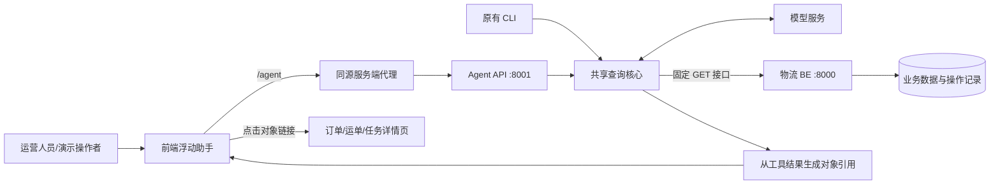
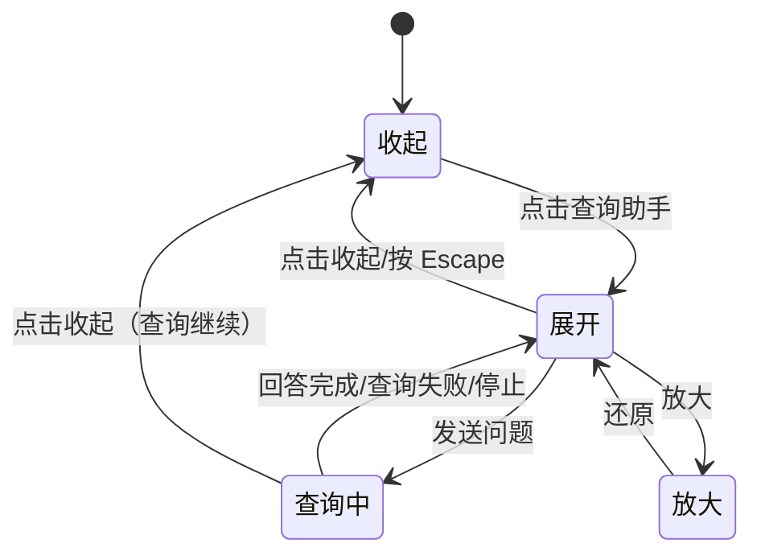

# 前端物流查询助手与独立 Agent API

2026-10-14。第一版面向演示操作者和内部运营人员，复用已有只读查询能力。用户在业务页面随时打开助手提问，回答中的订单、运单和任务可以点击进入详情；窗口支持移动、调大小、放大、还原和收起。

> V8 已改为个人只读 Bearer、会话归属隔离和在线权限复核，CLI 也统一调用 Agent API。本文保留 V7 历史行为；当前身份与失效契约以 [V8 spec](../../v8/agent/spec.md) 为准。

## 接入方式

Agent 新增独立 HTTP 服务，与 BE 分开运行。浏览器只请求同源 `/agent`，服务端代理再转到 Agent API。CLI 和 API 共用 `registry.py` 注册只读工具、共用 `graph.py` 执行查询，模型密钥保留在 Agent 服务端。



## 窗口行为



桌面窗口默认 440×604，拖动标题移动、拖动右下角调整大小；方向键也可移动或调尺寸。尺寸与位置受当前视口约束，缩小浏览器后不会丢到屏幕外。手机上固定到屏幕底部并适应宽度。收起与系统内跳转保持会话和草稿；刷新页面建立新会话。对话只读，第一版不自动带入当前页面对象，用户用完整编号/明确对象 ID 或会话中的唯一对象追问。

## HTTP 契约

| 方法和路径 | 用途 | 返回 |
| --- | --- | --- |
| `GET /agent/health` | Agent 进程就绪 | `status=ok`，不代表模型供应商或 BE 永远可用 |
| `POST /agent/api/v1/sessions` | 创建隔离会话 | `session_id`、`expires_after_seconds=1800` |
| `POST /agent/api/v1/sessions/{id}/messages` | 提问，进度流和最终回答 | SSE `progress`、`result` 或 `error` |
| `DELETE /agent/api/v1/sessions/{id}` | 删除旧会话及检查点 | 204；查询中返回 409 |

模型工具参数进入严格校验前，只将 schema 声明为整数的正整数十进制字符串（最多 19 位），或声明为布尔的 `true`/`false` 字符串转换为对应类型；业务编号、额外字段、负数、小数和不明确格式均不转换，继续交给原输入校验。该修复用于现场模型反复传 `order_id="26"` 而导致查询失败的问题。

问题请求：`message_id` 是浏览器生成的 UUID，`message` 是 1～4,000 字符的非空问题，禁止额外字段。同一会话重复提交相同 `message_id` 和内容，复用最近 10 个已完成结果；相同 ID 配不同问题返回 409。网络断连会停止未完成的一轮，恢复到前一轮结束的检查点。

SSE 每 15 秒发送保活注释。`progress` 只说明“思考中/正在查询物流数据”，最终 `result` 才包含完整回答，不输出模型内部推理或原始工具响应。

```json
{
  "message_id": "浏览器生成的 UUID",
  "answer": "已经查询到的回答文本",
  "references": [
    { "type": "shipment", "id": "26", "number": "SHP-000026" }
  ],
  "references_truncated": false,
  "warnings": [],
  "stop_reason": null,
  "usage": { "model_calls": 2, "tool_calls": 1, "http_calls": 1 },
  "trace_id": "本轮诊断标识"
}
```

以上为结构示例。对象 `type` 只允许 `order`、`shipment`、`transport_task`，ID 统一正整数十进制字符串。对象引用从固定工具结果路径提取，不解析模型回答；编号缺失时展示类型与 ID。一个回答最多 100 个引用并按类型+ID 去重；超过时明确提示。已查询的对象集合不表示对象之间一定互相依赖。前端详情路径由固定类型映射生成，Markdown 中的模型链接不作为导航入口，HTML/图片不执行或加载。

会话空闲 30 分钟过期，最多 100 个会话、同时 4 个查询；同一会话查询互斥，超限返回 429，过期返回 404 `SESSION_EXPIRED`。API 保留原来每轮 5 次模型、8 次工具、24 次 HTTP、120 秒预算，前端最长等待 150 秒。会话和结果仅保存在单进程内存；启动一个 worker，服务重启会丢失会话。公开部署需由已有代理/身份层补齐用户鉴权与会话归属，这一版不提供账号系统。

## 启动与生产代理

BE 保持在 8000，另开终端启动 Agent：

```bash
cd agent
source .venv/bin/activate
python -m pip install -r requirements.txt
python -m uvicorn api:app --host 127.0.0.1 --port 8001 --reload
```

`agent/.env` 沿用现有模型和 BE 配置。FE 开发代理在 `vite.config.ts` 中将 `/agent` 转到 8001；`npm run dev` 后直接打开页面使用助手。

生产代理示例（路径不剥离 `/agent`）：

```nginx
location /agent/ {
    proxy_pass http://127.0.0.1:8001;
    proxy_http_version 1.1;
    proxy_buffering off;
    proxy_read_timeout 150s;
}
```

## 实现与验证记录

| 项目 | 记录 |
| --- | --- |
| API 与前端代码 | 已接入；没有新增 BE 写接口或数据库结构 |
| 受控测试 | 29 项通过；新增 7 项覆盖会话隔离、相同请求重放、输入校验、断连回滚、忙碌/容量/过期和引用真实性/上限、过大回答恢复，以及模型传数字 ID 字符串时的订单到运单任务联动；原物流测试补齐 V7 计划模拟接口 |
| 依赖检查 | Agent `pip check` 通过 |
| FE 检查 | lint、TypeScript 编译与构建通过；构建仍有已有页面的大 chunk 提示 |
| 代理与真实查询 | 5173 的 `/agent/health` 返回 200；浏览器调用真实模型、API 和 BE 查询更正记录，收到真实运单引用，并成功跳转详情 |
| 页面交互 | 浏览器检查桌面及 400px 窄屏布局、放大/还原/收起、收起后草稿保留、对象跳转与多轮追问通过；键盘移动/调尺寸已走查，鼠标拖动实现已接入但未记为自动验收通过 |
| 真实订单联动 | 通过 FE 的 5173 代理请求真实模型和 BE：HTTP 200，3 次模型、2 次工具、5 次 BE HTTP；返回订单 26、运单 26、任务 51/53 的引用，stop_reason=null，无查询警告 |

自动检查与现场真实模型查询分开记录；少数现场查询不代表所有 V7 物流问题都已验收。
