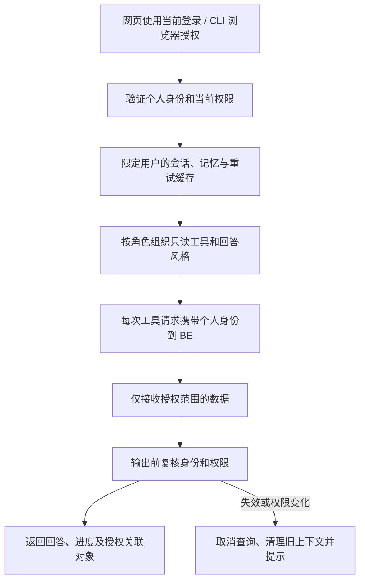

# V8 · Agent 身份与权限实施计划

> 2026-10-15 · 已按 BE/FE V8 实际契约适配，见 [spec](spec.md)；受控测试及隔离真实 BE 验证通过，真实模型和浏览器端到端待验收。依据：[V8 PRD](../../../prd/v8/JINGPO-logistics-system-v8.md)。

## 1. 要解决什么

网页助手和 CLI 都使用当前用户身份查询 BE。普通用户只查询自己的订单、关联运单和进度；admin、ops、developer 可查询全公司业务数据，developer 使用更技术化的解释。所有角色均只读。

当前 `agent/api.py`、`web_service.py` 提供流式查询和内存会话，`cli.py` 直接运行查询图；二者共享 `graph.py`、`registry.py`、`tools.py`、`be_client.py`。现有会话以随机 ID 区分但没有用户归属，HTTP 查询也没有传递个人身份；不能把会话 ID 当作身份凭据。



已经展示的信息无法追溯收回；目标是权限变更生效后，不再提供新的受限结果，也不从旧上下文继续回答。

## 2. 编码前确定的共同契约

| 对接方 | 要确认什么 |
| --- | --- |
| BE | 用户身份校验、个人凭据转发、24 小时有效期/撤销/角色变化的检查办法、共享任务安全响应、各查询接口授权错误 |
| FE | 助手请求凭据、会话归属、流式失效事件、退出/切号/降权清理、关联卡片及不可见对象提示 |
| CLI 与浏览器 | 发起授权、浏览器确认、凭据交付/存储、退出、到期重登、无浏览器时的可操作提示；凭据不得超过用户登录期限 |
| Agent 内部 | 每次执行的身份上下文、缓存隔离、检查点归属、权限变化时清空范围；角色由可信服务决定 |

在后续 Agent spec 中明确：CLI 是否继续本地运行查询图，或统一调用 Agent API；无论哪种方式都必须保留个人身份和即时撤销。不得先用共享管理员凭据把联调跑通，再把鉴权留到最后。

## 3. 分步工作清单

| 阶段 | 要做的事 | 完成条件 | 状态 |
| --- | --- | --- | --- |
| AG-01 spec 与查询盘点 | 确定三端身份契约；盘点全部工具、分页/批量查询、关联对象和日志路径 | 每条查数链路都有用户身份、范围和失效处理 | 已按 BE 实际契约更新 spec 与 9 工具盘点 |
| AG-02 个人查询身份 | 在执行上下文及 BEClient 接入可信用户身份；禁止模型参数覆盖用户/角色；无凭据或 BE 不可用时拒绝受保护查询 | 每次请求由 BE 按当前用户校验；凭据不进入模型、对话或诊断输出 | 已实现，验证见下文 |
| AG-03 会话归属隔离 | 网页会话、检查点、消息幂等缓存和关联结果绑定用户；创建/读取/删除/重试全部鉴权 | A 不能使用 B 的 session/message ID；同号缓存不跨用户命中 | 已实现，验证见下文 |
| AG-04 数据与工具适配 | 对接普通用户安全查询；限制全局任务/更正历史等工具；严格处理分页总数、关联跳转和不可见对象 | 工具只拿授权数据；不先读全量再让模型过滤；保留只读注册表 | 已实现，验证见下文 |
| AG-05 风格与可信上下文 | developer 解释 ID、关联关系、版本与状态；其他角色解释业务进度；角色不接受用户自报 | 同权限查询不因措辞改变范围；技术化回答不泄露配置和凭据 | 已实现，验证见下文 |
| AG-06 撤销和流式输出 | 查询前、工具请求和输出边界校验；取消失效任务；清理旧记忆/缓存，防止恢复或重试返回旧权限结果 | 停用、重置、降权、切号后不再输出受限数据；失败时拒绝继续查询 | 已实现，验证见下文 |
| AG-07 CLI 登录 | 浏览器授权、受保护的本地凭据保存、退出/过期提示；切号清理旧图记忆；支持用户拒绝和授权超时 | CLI 与网页角色范围一致，个人登录最多 24 小时，不在终端打印凭据 | 已实现，验证见下文 |
| AG-08 联调与交付 | 与 FE/BE 测试真实用户链路；验证流式错误、只读查询、Google/邮件后的登录和 Docker 部署 | 自动测试与受控模型验证有证据；真实模型和浏览器结果单独记录 | 自动测试与隔离 BE 通过；浏览器/模型/完整容器待验收 |

## 4. 关键取舍和边界

- 会话的闲置清理时间与登录的 24 小时有效期分别处理；查询活跃不能延长登录。
- 当前网页服务共享查询图和工具注册表，个人身份必须放在隔离的执行上下文中，不得通过全局变量或共享 HTTP 默认头切换用户。
- 对象详情、历史、重试缓存、压缩记忆及最终回答都可能携带旧权限数据。权限范围变化后，应作废相应会话记忆，不能只修改下一轮提示词。
- 进度事件只能包含已获授权且适合用户查看的信息；最终结果复核不能弥补前面已流出的敏感进度。
- 登录过期、禁止访问和对象不可见要给用户清楚提示，不能当作“查询为空”或让模型编造不存在的业务结论。
- 不增加创建、修改、取消订单或运输任务的工具；身份服务允许的登录/退出操作不属于物流业务写工具。

## 5. 验证与验收安排

| 验证组 | 必须覆盖 | PRD 对应 |
| --- | --- | --- |
| 身份与工具 | 无登录、伪造角色、用户提示注入、BE 校验失败、每次查询个人身份、工具无物流写能力 | A03、A05、A06 |
| 用户隔离 | A/B 并发查询、猜会话、读取/删除/重试另一人会话、消息重复、检查点和缓存隔离 | A03、A12 |
| 业务范围 | 自己订单/运单、别人编号、共享成员、全局任务、总数、历史无归属记录、关联链接 | A03、A04、A07 |
| 登录与权限变化 | 24 小时边界、退出、停用、重置、developer 降为普通用户；查询中/工具后/输出前变化 | A08、A09、A10、A12 |
| CLI | 浏览器授权成功/拒绝/超时/重放、凭据存储、退出与多设备、切号记忆清理 | A09、A10、A11、A12 |
| 回答与诊断 | developer 技术解释、其他角色业务解释、无凭据进入提示词/日志、旧权限追问失效 | A13 |

复用现有 `agent/tests/` 增加受控测试，先用固定模型/模拟授权结果验证边界，再以 A/B 和共享任务样本调用真实 BE。之后验证网页助手与 CLI 的真实登录流程，最后检查真实模型的表达差异。

实施后可在 Agent 虚拟环境运行 `python -m unittest discover -s tests`，但须先确认当前用例的环境依赖；新增测试和实际命令记录在交付记录中。测试不得要求在开发库关闭身份校验。模型自然语言表现、受控工具测试和真实后端联调分别记结果。

## 6. 依赖、上线和交付记录

AG-01/02 依赖 BE 身份契约，AG-03/06 与 FE 的切号和失效处理联调，AG-04 依赖 BE 安全查询，AG-07 依赖 BE/FE 的浏览器授权流程。

上线前清理旧匿名会话/检查点，确认历史缓存不沿用；Agent 服务不可带着旧全量查询能力连接已升级后端。部署配置、模型密钥和用户登录凭据分别管理，Google/SMTP 不需要进入模型提示。

| 项目 | 当前结果 |
| --- | --- |
| Agent spec / 身份契约 | [spec](spec.md) 已按 BE introspect/recheck/CLI 协议及 FE Bearer adapter 更新 |
| 网页助手、工具、CLI 代码 | 已接个人只读身份、会话隔离、权限失效、工具范围和浏览器授权客户端 |
| 自动测试、真实 BE、模型与浏览器联调 | 自动测试与隔离真实 BE 已执行；真实模型、浏览器、系统凭据库与完整 Compose 运行待验证 |

后续证据记录日期、代码版本、身份/数据样本、命令、模型/运行环境、结果及剩余问题。关联计划：[BE](../be/plan.md)、[FE](../fe/plan.md)。

2026-10-15：对照 PRD、三端 plan 与当前 `api.py`、`web_service.py`、`state.py`、`registry.py`、`tools.py`、`be_client.py`、`references.py` 完成 Agent spec 草案。明确 V8 CLI 统一走 Agent API，盘点匿名会话、缓存直接重放、组合任务查询及失效恢复的改动位置。身份接口地址和字段尚未冻结，spec 中明确标为建议；未修改运行代码或执行功能测试。

### 2026-10-15 V8 实际接入与验证

用户确认 BE/FE V8 改造完成后，按现有 `auth/introspect`、`auth/recheck`、Agent token 和 CLI device grant 实施，未修改 BE 业务代码或开发库。本轮适配包括：

- `identity.py` 在线确认只读个人身份、校验到期和 auth_version；凭据仅留在隐藏 repr 的执行上下文。模型等待期间每 2 秒复核，每轮校验上限 256 次且受 120 秒预算约束；该实现有检测/网络延迟，不能描述为零延迟通知。
- `api.py` / `web_service.py` 按用户、来源登录和权限版本限制会话；缓存发送也复核；失效清上下文，断流等回滚完成后才释放锁。
- 普通用户只绑定 6 个订单/运单工具，执行层拒绝其他 3 个工具；组合查询使用自身安全 schedule，站点改取 ordering-options，不读取共享任务详情或生成其链接。支持取消订单/运单状态与订单取消信息。
- `cli_client.py` 浏览器授权、pending/slow_down/拒绝/超时处理、一次凭据领取、系统 keyring、个人退出和 Agent SSE；CLI 不再创建模型或本地图。新增 `keyring==25.6.0`，系统凭据库不可用时明确提示只保存在进程内存。
- 新增 Agent Dockerfile、Compose 服务及 FE Nginx SSE 代理，Compose 构建启用助手。本机 `fe/.env.local` 设置 `VITE_AGENT_V8_ENABLED=true`（该本地文件被 gitignore 忽略）；读取 Vite 转换后的 App 模块确认该值已加载，未代替真实浏览器走查。

实际验证命令（agent 目录）：

```bash
./.venv/bin/python -m unittest discover -s tests -q
./.venv/bin/python tests/verify_v8_integration.py
./.venv/bin/python -m pip check
./.venv/bin/python -m py_compile *.py
docker compose -f ../docker-compose.yml config --quiet
git diff --check
```

| 验证 | 实际结果 |
| --- | --- |
| 受控自动测试 | 44 项通过：原有预算/恢复回归；会话归属、缓存降权、个人请求头隔离、工具注入、等待模型时撤销、凭据不进入模型/检查点/日志、CLI 协议和 SSE 失效清理 |
| 隔离真实 BE | 6 组通过：自建专属 PostgreSQL *_test 库，从空库完整迁移后启动临时 BE；真实个人 token/introspect、A/B 不可见、共享进度与 SSE/缓存/会话归属、取消订单/运单响应、查询中降权、CLI 单次交付及退出撤销；结束已停临时 BE 并删本轮测试库 |
| 本机运行服务 | 已有 8001 reload 进程加载新代码；health=200，匿名 POST sessions=401 AUTH_REQUIRED；8000 BE 就绪=200。未代替用户创建管理员或修改开发库身份 |
| 依赖、语法、文档和 Compose 配置 | pip check、Python 编译、git diff --check 和 Compose config 检查通过；相对文档链接检查无缺失 |
| 真实模型和浏览器 | 未执行真实模型自然语言评测，未操作真实 Google/邮件登录或浏览器 CLI 授权页面；真实 BE 联调使用受控模型和 HTTP 授权确认 |
| 系统凭据库与 Docker | keyring 依赖已安装，保存/清理分支用替身测试；真实 OS 凭据弹窗及重启恢复未验收；未进行完整镜像构建/容器运行 |

受控测试不能证明真实模型一定正确选择工具；HTTP 设备授权成功也不能代替浏览器页面、Google 和邮件流程的联合验收。数据权限由 BE 校验，普通用户没有精确任务延误字段时明确说明未知，不承诺与公司级任务详情完全相同的延误展示。
