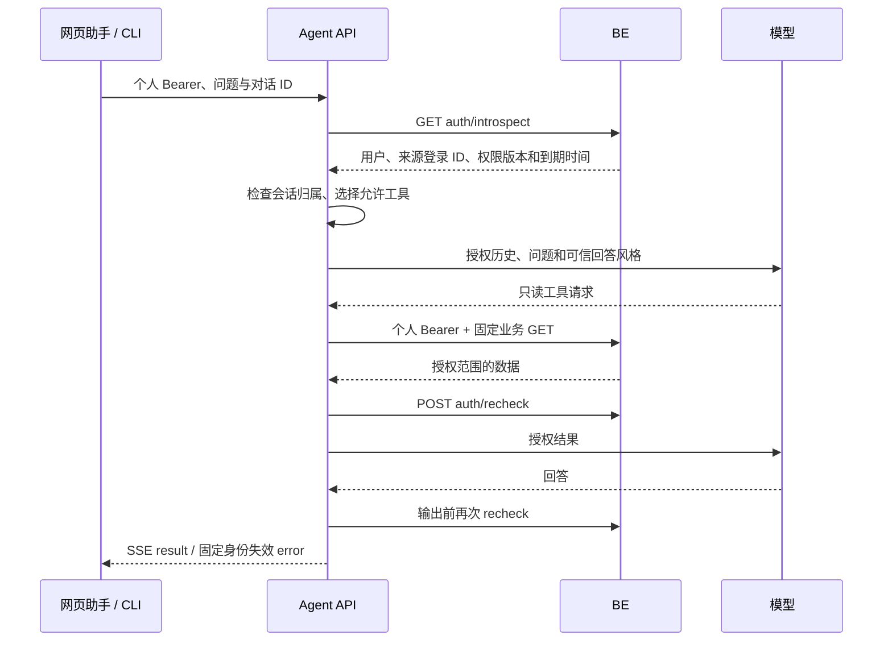

# V8 · Agent 个人身份、会话与查询权限

2026-10-15。已按 [BE V8 契约](../be/spec.md) 和现有 FE Bearer adapter 接入；验证证据与待验收项见 [plan](plan.md)。本文件描述当前实现，不能将受控模型验证视为真实模型或浏览器验收。

## 用户会看到什么

网页助手使用当前网页登录派生的只读凭据。CLI 输入 `/login` 后打开浏览器，确认账号并批准授权，之后通过同一个 Agent API 查询。普通用户只能查询自己的订单、运单和进度；developer 可查看全公司数据并获得业务 ID、关系与版本说明。所有角色的 Agent 都只查询业务。



CLI 不再加载本地查询图或请求模型；模型密钥只由 Agent API 使用。CLI 可以没有 LLM 配置，只配置 BE/Agent 地址。

## 身份契约与隔离

| 边界 | 当前实现 |
| --- | --- |
| FE → Agent | `Authorization: Bearer`，FE 从 BE `POST /api/v1/auth/agent-token` 获取，内存缓存；Agent 不接受网页登录 Cookie、自报角色或完整网页写凭据 |
| CLI → Agent | 浏览器确认后取得 BE `cli` 只读 Bearer；Agent 与网页使用相同的校验入口 |
| 校验 | `GET /api/v1/auth/introspect`，检查 user.id / role / enabled / email_verified / needs_username / auth_version、来源 login_session_id、expires_at 和 read_only |
| 角色 | 只接受 admin、ops、developer、user；工具集合与表达风格由可信角色决定 |
| 复核 | `POST /api/v1/auth/recheck`，请求 `{auth_version}`，要求 `{valid:true,auth_version}`；身份服务错误或异常响应拒绝继续 |
| 业务请求 | 每次固定 GET 独立携带当前 Bearer；请求前后复核身份，不使用全局共享身份头 |
| 凭据 | `Identity` 隐藏 token repr；只进入执行上下文，不写 AgentState、检查点、模型消息、工具参数、响应或日志 |

会话绑定 `(user_id, login_session_id, auth_version)`。同一网页登录刷新派生 Agent token 可继续同一对话；其他设备、账号或新的网页登录不能复用。API 每次创建、读取、发送、重试与删除会话均先在线鉴权。跨身份访问和不存在会话均返回 `404 SESSION_EXPIRED`，不暴露另一人的会话是否存在。

缓存仍按会话内 message_id 和问题摘要处理，同 ID 不同问题返回 409。缓存命中前检查归属和权限版本，发送缓存前仍 recheck。版本变化后取消该会话任务、清空响应缓存和检查点；普通断流仅在会话未被判定失效时恢复本轮前状态。

保留单进程内存会话：空闲 30 分钟、最多 100 会话、同时 4 轮、同对话独占。会话 ID 不是登录凭据；即使内存尚未按空闲期回收，过期身份也无法再次读写。多进程/多实例会话共享尚未实现，当前部署使用单进程。

## 查询中撤销与输出

开始执行、模型调用前后、业务请求前后、工具结果处理后、缓存重放和最终输出前均检查权限版本。等待模型时后台每 2 秒复核；SSE 事件发送前也复核。身份请求单次最多 3 秒，每轮 SSE 与图共用最多 256 次校验、120 秒预算。业务 HTTP 仍为最多 24 次，登录校验不计入业务次数。

BE 的退出、停用、密码重置使对应凭据失效；角色变更使旧 auth_version 的 recheck 返回 `409 AUTH_CHANGED`。身份错误不交给模型重试，不恢复旧权限上下文，也不发送已生成的旧权限答案。

2 秒轮询不是零延迟通知。检测延迟还取决于网络和请求超时；复核与发送之间存在并发窗口，已发送内容无法追回。当前不逐 token 输出业务正文；progress 仅为固定“思考中/正在查询物流数据”，不带业务编号或参数。这个边界须在严格实时撤销要求变化时重新评审。

| 错误情况 | HTTP / SSE 行为 |
| --- | --- |
| 缺 Bearer、凭据无效/过期、停用、未完成验证资料、非只读凭据 | `401 AUTH_REQUIRED`；FE 清身份相关状态，CLI 提示重新登录 |
| 权限版本变化 | `409 AUTH_CHANGED`；清旧对话，FE 重取当前身份，CLI 新建对话 |
| 会话不存在、不同用户/登录设备或已失效 | `404 SESSION_EXPIRED` |
| 身份服务失败/超时/响应不合法/校验预算耗尽 | `503 AUTH_SERVICE_UNAVAILABLE`，不返回旧缓存 |
| 已开 SSE 后出现身份问题 | `event:error`，data 仅有 code/message，不包含答案和对象引用 |
| 业务对象不可见 | 工具返回对象不存在；BE 404 不被改成“没有此业务事实”的全局结论 |

FE 已处理 AUTH_REQUIRED / AUTH_CHANGED 的流式失效和迟到响应；Agent 沿用这些 code，不采用早期草案中的 AUTHORIZATION_CHANGED。

## 九个工具的实际范围

BE 负责过滤列表、total、详情及历史；Agent 额外限制工具及组合分支。

| 工具 | 公司级角色 | 普通用户 |
| --- | --- | --- |
| search_orders / get_order | 全公司只读 | 自己订单及取消信息 |
| search_shipments | 全公司只读 | 自己关联运单，包含 CANCELLED |
| get_shipment_tracking | 轨迹 + schedule + 关联任务延误 | 仅自己运单轨迹和安全 schedule，不调用任务详情 |
| get_shipment_schedule | 当前计划及按需历史 | 自己运单的安全计划/历史 |
| get_shipment_destination_changes | 运单更正历史 | 自己运单更正历史，BE 处理敏感自由文本 |
| find_shipments_with_destination_changes | 全局更正审计分页 | 不绑定给模型；执行层也拒绝 |
| search_transport_tasks / get_transport_task | 全公司只读 | 不绑定给模型；执行层也拒绝 |

普通用户的 `include_tasks=true` 使用运单自身 schedule；没有精确任务延误字段时明确提示不能确认精确分钟数，不先查共享任务再过滤。站点补齐改用 BE 允许的 `/api/v1/ordering-options`，不读取 `/stations` 全量配置；停用站点不在下单选项中时保留 ID 和未知名称提示。

普通用户不生成 transport_task 详情卡片，只生成授权订单/运单引用；BE 返回的安全计划可保留解释关联所需的 task_id，但不因此开放任务详情。其他角色保留任务引用。CANCELLED 为订单/运单取消状态，不当作正在运输；订单取消时间和原因从已授权响应读取。

## CLI 登录与凭据

`cli_client.py` 只连接 HTTPS 或本机 HTTP 地址；配置 `BE_BASE_URL`、`AGENT_BASE_URL`。不从命令行参数读取个人密码/登录 token。

```mermaid
flowchart LR
    L[/login] --> D[BE cli/authorize]
    D --> W[浏览器 cli/authorize 页面确认账号与短码]
    W --> P[CLI 按 interval 轮询 cli/token]
    P --> S[在线校验只读身份]
    S --> K[系统凭据库 / 不可用时仅进程内存]
    K --> Q[Agent API 查询]
```

| 命令或状态 | 行为 |
| --- | --- |
| /login | 清旧登录及会话后申请设备授权；显示 verification_uri 与公开 user_code，尝试打开浏览器 |
| 授权等待 | 最少 5 秒一次轮询；slow_down 延长；最多等待服务端 expires_in 且不超过 600 秒 |
| 拒绝、过期、取消 | 调用 cli/cancel 结束未交付授权；不保存 token，不打印 device_code |
| 登录成功 | 先 introspect，再保存到 keyring；系统凭据库不可用时明确提示仅本次进程内保存 |
| /new | 删除当前 Agent 会话；个人登录保留 |
| /logout | 尝试删除对话并撤销当前 CLI 登录，然后清本地凭据 |
| /exit | 清当前对话并退出；系统凭据库中的登录保留至退出登录/撤销/绝对到期 |
| 重新启动 | 从系统凭据库取 token 后在线校验，失败清理本地记录；不根据旧文件信任用户 |

CLI 登录和网页退出的范围以 BE 契约为准：独立 CLI 登录不会因单个网页设备退出而撤销，重置密码/停用会撤销所有登录。切号先作废本地旧对话，不把旧记忆带入新身份。

## 部署与验证入口

新增 `agent/Dockerfile` 和 Compose agent 服务，模型配置运行时来自 `agent/.env`，不复制入镜像；容器覆盖 BE 地址为 `http://be:8000`。FE Nginx `/agent/` 转发到 Agent 并保留 Bearer、关闭 SSE 缓冲、设置 150 秒读取超时。Compose 构建启用 FE V8 助手；本地开发用 `VITE_AGENT_V8_ENABLED=true`。

| 入口 | 验证范围 |
| --- | --- |
| `python -m unittest discover -s tests -q` | 原预算/恢复/工具回归，身份隔离、权限注入、撤销、SSE 缓存与 CLI 协议替身 |
| `python tests/verify_v8_integration.py` | 自建临时 PostgreSQL *_test 库、完整迁移、真实 BE，A/B 共享任务、个人 Bearer、查询中降权、CLI 单次领取与退出；最后停止临时 BE 并删自己创建的库 |
| `python verify_backend.py` | 使用 CLI 系统凭据库登录做真实只读契约检查，不调用模型；普通用户跳过全局任务接口 |

实际命令、测试数量、已验证与待验证范围见 [交付记录](plan.md)。真实模型回答质量、真实浏览器授权页面、操作系统凭据库弹窗及完整 Compose 运行须分别验收。
