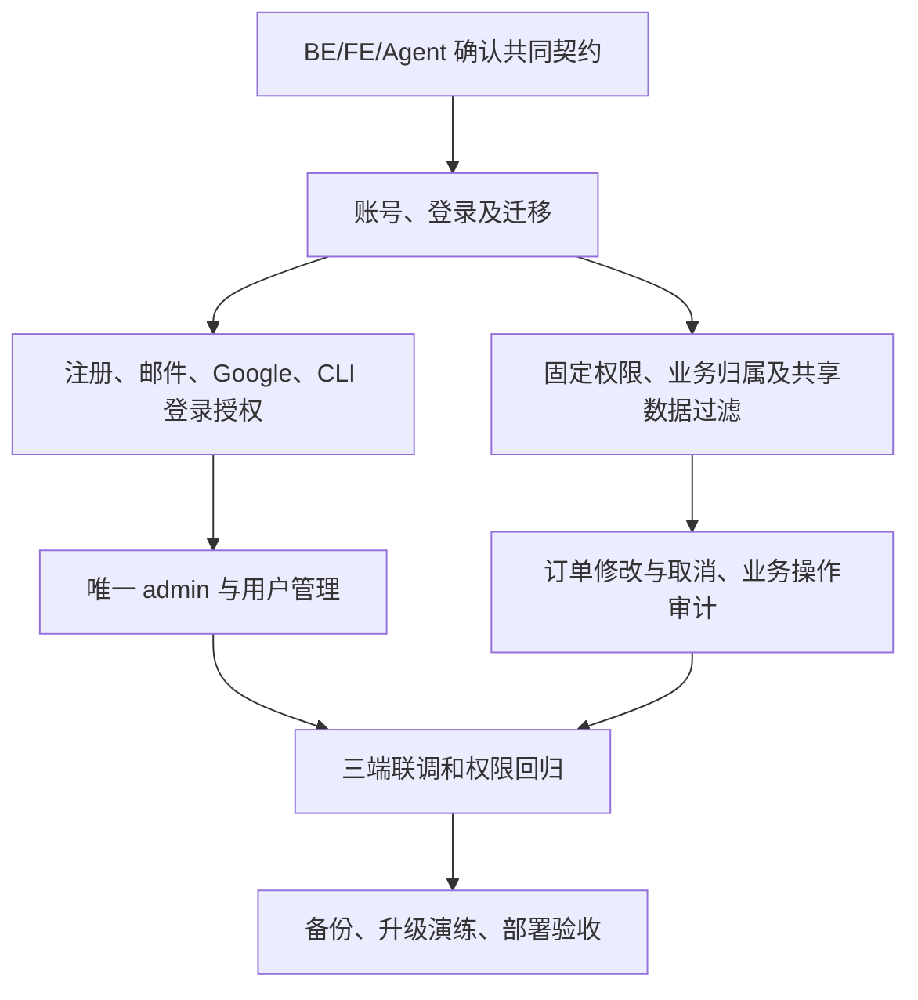

# V8 · BE 登录与权限实施计划

> 2026-10-15 · 用户确认启动开发后，BE 身份接口、业务授权及迁移已实现；隔离库和本地邮件验证完成，三端联调及真实 Google 验收待完成。依据：[V8 PRD](../../../prd/v8/JINGPO-logistics-system-v8.md)，正式接入契约见 [BE spec](spec.md)。

## 1. 要解决什么

BE 统一确认当前用户、角色和数据范围，让网页、网页助手及 CLI 得到一致的授权结果。先确定三端契约，再建立身份基础、接入业务授权，最后联合验收和部署。

现有入口为 `be/main.py`，业务分散在 orders、shipments、transport、scheduling、network、lines、regions。当前路由未统一接入登录；订单没有可用于本需求的创建账号归属。代码中已有运输任务取消，不等于已有订单取消流程。



箭头表示依赖；每一步的完成证据记录在文末，不能只勾代码完成。

## 2. 已交付的接入契约

以下事项已落实到 [BE spec](spec.md) 和代码。FE/Agent 按该契约接入后，分别记录适配和联合验收结果；不能把后端通过测试写成三端完成。

| 事项 | 必须交付的结果 |
| --- | --- |
| 身份传递 | 浏览器登录状态、跨服务 Agent 请求、CLI 凭据的传递与撤销方式；24 小时绝对有效期；多设备退出范围 |
| 当前用户 | 稳定用户 ID、单一角色、邮箱验证/启用状态、可执行动作与数据范围表达；不信任前端传入的角色 |
| 错误与失效 | 未登录、未验证、停用、过期、禁止操作、不可见对象、角色变化的返回与前端处理；保持现有请求追踪能力 |
| 注册和邮件 | 用户名/邮箱唯一与规范、密码规则、验证/重置链接时限、一次性消费、重发和失败行为、限流与防账号枚举 |
| Google | 服务端验证身份、登录与绑定区别、首次补用户名、同邮箱冲突、回调地址限制及请求防伪；首次 Google 用户如何设置本地密码 |
| CLI 浏览器授权 | 如何发起、用户确认、交付个人凭据、过期/取消/重放处理；不能把网页登录凭据放到回调 URL |
| 业务授权 | 固定角色对应具体动作；创建者归属、历史无归属数据、列表/总数/历史/共享任务的过滤契约 |
| 取消订单 | 可取消状态、关联运单与未执行计划处理、共享任务影响、已发车拒绝条件、事务和幂等；区别于取消运输任务 |
| 实时变更 | 停用/角色变更/密码重置的生效边界、并发写入和 Agent 输出前复核办法；已发给用户的信息无法追溯撤回 |

## 3. 分步工作清单

| 阶段 | 要做的事 | 完成条件 | 状态 |
| --- | --- | --- | --- |
| BE-01 契约与接口盘点 | 编写 spec；逐个盘点业务路由、后台脚本和 Agent 查询入口；列出公开入口及授权矩阵 | FE/Agent 可以按同一契约开发；业务接口无未分类入口 | BE 已实现；三端接入待验收 |
| BE-02 数据与身份基础 | 规划账号、单角色、外部身份、可撤销登录、邮件凭据和审计存储；新订单保存真实创建者；历史创建者保留空值 | 隔离库迁移成功；历史数量、业务引用和状态不变；登录凭据不明文持久化 | 已实现，隔离升级和历史对账通过 |
| BE-03 注册和密码登录 | 用户名密码注册/登录、邮箱验证/重发、找回/重置、当前用户与退出；限制未验证账号访问 | 新用户始终为普通用户；验证与重置一次有效；重置撤销全部登录 | 已实现；接口和真实本地邮件通过 |
| BE-04 Google 与 CLI 授权 | 完成 Google 登录/绑定、用户名补全、冲突处理和 CLI 浏览器授权 | 无自动合并或角色提升；不同设备/进程只能取得其授权的个人身份 | BE 已实现；替身契约测试通过，真实 Google/CLI 页面待验收 |
| BE-05 业务授权 | 将动作权限与数据范围接入所有相关查询、写入及允许操作响应；按授权数据计算分页总数 | 普通用户只见自己的订单/运单；developer 全量只读；ops/admin 按状态写入 | 已实现；匿名、越权、分页和权限变化测试通过 |
| BE-06 共享数据和取消订单 | 提供普通用户可安全查看的运单进度/计划；补齐订单取消状态机；同一事务保存业务变化和操作者 | 不泄露共享成员；取消不误伤其他运单、不改写实际事实；失败整笔回滚 | 已实现；共享保护与取消/揽收并发通过 |
| BE-07 用户管理与恢复 | 唯一 admin 初始化/恢复；用户查询、分配普通用户/ops/developer、启停；审计角色与状态变化 | 禁止停用、降级或并发生成第二个 admin；恢复可用且撤销旧登录 | 已实现；唯一约束和临时库初始化/恢复通过 |
| BE-08 三端与部署 | 提供契约样本；接入邮件测试环境、SMTP/Google 配置；与 FE/Agent 联调并完成升级演练 | 网页与 CLI 的真实授权、邮件、撤销和历史数据场景有证据 | 隔离升级、Compose 配置和本地邮件通过；开发库发布与三端联调待完成 |

新增 `auth` 模块负责身份、授权、查询范围、外部登录与管理。原业务 router 统一挂载鉴权依赖；数据库工作区携带后端验证的身份，查询限制创建者，写入和返回前复核权限版本。业务幂等 key 按账号隔离，操作日志保存实际操作者。

## 4. 验证与验收安排

在独立测试库准备 admin、ops、developer、普通用户 A/B、未验证用户、停用用户；准备历史无归属订单及 A/B 共享运输任务。涉及破坏性状态变更的用例不得使用开发库或 Docker 演示库。

| 验证组 | 重点 | PRD 对应 |
| --- | --- | --- |
| 注册与凭据 | 高权限角色注入、并发重名、密码不入日志、验证/重置过期和重放、SMTP 失败、24 小时边界 | A01、A02、A09、A10、A15 |
| 数据范围 | A/B 列表、编号搜索、详情、总数、轨迹、历史、共享成员、关联链接；历史空归属 | A03、A04、A07 |
| 动作和事务 | 普通用户修改/取消自己的订单，developer 拒绝写；ops 修改不改变创建者；取消的共享影响与幂等 | A05、A06 |
| 管理与撤销 | 角色变化、停用、恢复、重置对多设备和并发请求生效；唯一 admin 约束和审计 | A08、A10、A14 |
| 外部身份 | Google 可信身份/错误回调/同邮箱冲突/重复绑定；CLI 授权被取消、过期和重放 | A11 |
| Agent 协同 | 个人凭据、每次查询授权、角色变化后的上下文/缓存/输出失效 | A12、A13 |

先运行新增身份与权限测试，再对受影响的订单、运单、排程、运输接口和历史迁移做回归。接口测试须携带合法测试身份，不能用“测试时关闭鉴权”代替权限验证。具体测试命令和模块名在实施时补入记录。

## 5. 依赖、部署与风险

- BE 先交付契约和可联调身份接口；FE 与 Agent 再并行接入。浏览器会话、CLI 授权和输出前复核必须在接口阶段共同评审。
- 根目录 `docker-compose.yml` 当前只有 db、be、fe；计划补本地邮件测试服务和所需配置，Agent 服务接入部署由三端协同负责。
- Google 客户端配置与正式 SMTP 是外部依赖。测试替身通过后仍须真实浏览器/邮件走查，缺配置要记录为待验证。
- 上线前停止相关写入、备份并记录现有迁移头，演练迁移与管理员初始化，再协调切换 FE/BE/Agent。不能通过回滚为匿名接口恢复服务；回退需恢复兼容代码和备份，并撤销新凭据。
- 多实例下撤销与会话状态必须一致；spec 明确共享存储和失败时拒绝访问的行为。

## 6. 交付记录

| 项目 | 当前结果 |
| --- | --- |
| spec / 接口契约 | [spec](spec.md) 已交付，含会话/CSRF、Google、CLI、权限和取消订单契约 |
| 代码与迁移 | `auth/` 与业务授权接入；新增 `f81a3d6c2907`；开发库已按用户指令备份升级，发布记录见下文 |
| 自动测试 | 见下方实际命令；V8 身份、隔离、撤销与部署测试通过，现有业务回归通过 |
| 邮件/Google | 临时 Mailpit 的真实 SMTP 收信、验证、重置通过；Google 签名/nonce/冲突/绑定使用替身验证，未使用真实 Google 账号 |
| 迁移演练 | 新建隔离库完整升级通过；临时旧版本库订单/运单/任务/关联/轨迹/日志逐项对账一致，admin 初始化/恢复通过，临时库与容器已清理 |
| FE/Agent 联合验收 | 未执行；当前各端离线界面或 spec 不等于真实鉴权已经接入 |

后续每条证据记录日期、代码版本、环境、执行命令、结果和剩余问题。关联计划：[FE](../fe/plan.md)、[Agent](../agent/plan.md)。

### 2026-10-15 工作区验证

基线：`ff7037d` 上的本次未提交改动。验证库为新建 `jingpo_logistics_v8_verification_test`，从空库升级到 `f81a3d6c2907`。本节所有测试均在隔离库执行；后续用户授权的开发库发布单独记录如下。

```bash
DATABASE_URL='postgresql+psycopg:///jingpo_logistics_v8_verification_test' \
  .venv/bin/python -m alembic upgrade head
RUN_V8_MIGRATION_TESTS=1 RUN_V8_SMTP_TESTS=1 \
DATABASE_URL='postgresql+psycopg:///jingpo_logistics_v8_verification_test' \
  .venv/bin/python -m unittest discover -s tests -v
DATABASE_URL='postgresql+psycopg:///jingpo_logistics_v8_verification_test' \
  .venv/bin/python -m alembic check
docker compose -f ../docker-compose.yml config --quiet
git diff --check
```

结果：共 75 项，68 项通过、7 项历史版本迁移演练因未开启旧版本 opt-in 而跳过；其中 23 项 V8 身份/权限测试及 2 项 V8 部署测试全部通过。V8 自己的历史保留与管理员恢复演练已实际执行。模型无新增迁移差异，Compose 配置和差异检查通过。真实 Google 登录需配置客户端并由三端联合走查；本轮不宣称正式 SMTP、公网 TLS 或三端端到端验收通过。

### 2026-10-15 开发库发布

用户明确要求“备份、迁移、重启”后执行，目标为本机 PostgreSQL `jingpo_logistics`，不是 Compose 数据库。停止原后端 PID 6200 后创建并验证自定义格式备份，随后执行 Alembic 升级和结构检查。

| 核对项 | 实际结果 |
| --- | --- |
| 备份 | `be/backups/jingpo_logistics_before_v8_20261015_152019.dump`，2,923,059 字节，`pg_restore --list` 可读取 |
| SHA-256 | `94ca4f9c768089146dff5df3ee57cdfd9a0b7a667000cd7e4851cb3837ebfc3e` |
| 核对记录 | 同目录同名 `.json`，含升级前后各表数量与原字段内容摘要 |
| 迁移 | `e2a7c4b19d63` → `f81a3d6c2907`，`alembic check` 无差异 |
| 数据 | 原 19 张业务表的行数和全部原字段摘要一致；新增身份表为空，历史归属仍为空 |
| 后端 | PID 53611，`127.0.0.1:8000`；日志 `/tmp/jingpo-be-v8-20261015_152019.log` |
| 存活/就绪 | `/health`、`/health/ready` 均为 200 |
| 登录保护 | 匿名 `/api/v1/orders`、`/api/v1/auth/me` 均为 401，符合 V8 契约 |
| 本地身份配置 | `AUTH_FRONTEND_URL=http://localhost:5173`、`AUTH_COOKIE_SECURE=false`，仅用于本机 HTTP 开发 |

尚未创建管理员，也未配置 SMTP 或 Google 客户端。需在服务器交互执行 `DATABASE_URL='postgresql+psycopg:///jingpo_logistics' .venv/bin/python -m auth.admin init --username <用户名> --email <邮箱>`，由使用者输入密码，不生成默认密码。业务登录、正式邮件/Google 与 FE/Agent 联调仍需后续验收。

### 2026-10-16 更改密码接口

新增 `POST /auth/change-password`：要求已验证网页会话、CSRF 和当前密码；新密码沿用 12～128 位且含字母和数字的规则，不能与旧密码相同。成功保留当前会话，撤销该用户其他会话及派生凭据，提升 `auth_version`，审计不含密码。`py_compile` 通过，未运行后端测试或真实改密流程。

### 2026-10-16 Gmail API 邮件发送通道

保留默认 SMTP（本地 Mailpit/Gmail SMTP 可继续使用），新增 `EMAIL_PROVIDER=gmail_api`。发信时服务端用配置的 refresh token 换取短期 access token，再通过 Gmail API HTTPS 发送原有验证/重置邮件；凭据缺失、provider 拼错或远程失败均返回 503，注册和找回接口在缺配置时不会先写入账号或邮件 token。未做 SMTP 自动回退，避免不确定投递结果时重复发信。

隔离的单元测试 `./.venv/bin/python -m unittest discover -s tests -p 'test_email_delivery.py' -v`：3 项通过；`py_compile` 与 `git diff --check` 通过。只验证模拟的 Google HTTP 往返，尚未配置 Render secrets，也未做真实收件验收。部署需在 Render 配置 `EMAIL_PROVIDER=gmail_api`、`GMAIL_API_CLIENT_ID`、`GMAIL_API_CLIENT_SECRET`、`GMAIL_API_REFRESH_TOKEN`、`GMAIL_API_SENDER`；refresh token 必须单独授予 `gmail.send`。Google OAuth 同意屏幕为 Testing 时 refresh token 可能 7 天失效，需后续完成真实发件账号授权和到期策略。
