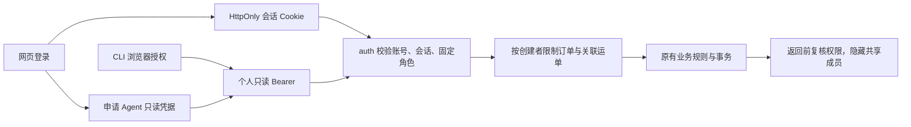
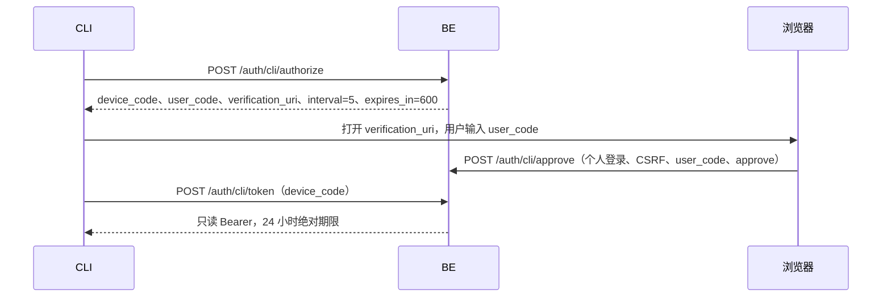

# V8 BE：账号、权限与数据归属契约

2026-10-15。依据 [V8 PRD](../../../prd/v8/JINGPO-logistics-system-v8.md)。本文是 BE 实施契约；前端与 Agent 按此接入，实际验证记录见 [plan](plan.md)。

## 用户会看到什么

业务接口都需要登录。普通用户仅能查看自己的订单及关联运单，能下单并在业务允许时修改或取消；ops/admin 可处理全公司业务；developer 仅查询。历史订单没有创建者时继续保留，普通用户看不到。

所有时间使用服务器 UTC。无“关闭鉴权”配置，也不自动将首个注册者提升为管理员。

## 身份与会话

随机 256 位登录凭据只保存 SHA-256 摘要，不使用无法即时撤销的自包含 JWT。每个会话自成功登录起绝对有效 24 小时，不滑动续期。同一浏览器再次登录成功时撤销被替换的旧网页登录及其派生 Agent 凭据，其他设备登录不变。`jingpo_session` 为 HttpOnly、SameSite=Lax、Path=/，正式环境 Secure；只允许 HTTPS，开发机显式设 `AUTH_COOKIE_SECURE=false`。

网页写请求必须同时携带正确的 `Origin` 和 `X-CSRF-Token`。登录成功返回 `csrf_token`，同时设置可读的 `jingpo_csrf` Cookie；FE 可在刷新后从该 Cookie 读取。浏览器不在本地存储保存登录凭据。跨服务请求使用 `Authorization: Bearer <token>`，不用 Cookie。

| 会话来源 | 权限 | 退出和撤销 |
| --- | --- | --- |
| 网页用户名/密码或 Google | 当前账号的固定角色权限 | 退出当前设备；退出同时使该设备派生的 Agent 凭据失效 |
| Agent token | 当前用户的数据范围，只读 | 不晚于父网页会话过期；父会话退出即失效 |
| CLI 浏览器授权 | 当前用户的数据范围，只读 | 单独会话，可退出；重置密码或停用账号全部失效 |

每次请求重新查账号角色和会话；业务写入在原有全局业务事务锁内复核身份。角色/启停修改与业务写入共用此锁。读取业务结果发送前再次检查 `auth_version`，变化则返回 `409 AUTH_CHANGED`。Agent 还必须在最终回答前调用 recheck，变化时丢弃旧上下文及结果。已经发送的数据无法撤回。

## 注册、邮件和密码

用户名只限制为 1～40 位，不限制字符种类，也不改变用户输入；邮箱去空格并转小写，最长 254 位，两者在数据库唯一。密码 12～128 位，包含字母和数字；使用随机盐 scrypt，N=2^17、r=8、p=1。密码和凭据不写业务/认证审计。

注册只接受用户名、邮箱和密码，额外字段（包括 role）返回 422。默认角色 user。未验证账号可登录并处理个人验证事务，不能读取业务。Google 新用户还需补用户名。

验证链接 60 分钟、重置链接 30 分钟，只能成功消费一次。重发使旧的同用途链接失效。邮件只包含 FE 链接，FE 将 token 通过 POST 请求体交给 BE。邮件失败返回 503 并作废该次 token；注册账号仍保留，可重发。注册冲突/未知邮箱采用相同 202 文案；不提供可用链接时发送中性说明邮件，SMTP 失败仍如实返回，避免通过邮箱存在与否区分发送故障。

注册、登录、邮件和验证按 IP/账号使用数据库限流，多进程共享；通常每 IP 每 15 分钟 60 次、同账号 10 次，超限 429。CLI 轮询单独为每 IP 15 分钟 300 次，且每设备至少间隔 5 秒。反向代理需保留真实连接边界，不接受客户端随意提供的 X-Forwarded-For 作为可信身份。

## 接口

以下路径均位于 `/api/v1`。业务写入沿用 `Idempotency-Key`，服务端按当前用户派生独立 key，防止另一用户重放缓存。认证接口用各自的一次性凭据，不要求业务幂等头。所有认证响应禁止缓存。

| 方法与路径 | 请求/结果 |
| --- | --- |
| POST `/auth/register` | `{username,email,password}` → 202，邮箱操作说明 |
| POST `/auth/login` | `{username,password}` → Cookie、`{user,csrf_token,token_type,expires_at}`，不返回网页 access_token |
| GET `/auth/me`、`/auth/introspect` | 当前用户、expires_at、read_only、session_id、login_session_id；Bearer introspect 供 Agent 使用 |
| POST `/auth/logout` | 撤销当前会话并清 Cookie |
| POST `/auth/verify-email` | `{token}` → 验证邮箱 |
| POST `/auth/resend-verification` | `{email}` → 202 |
| POST `/auth/forgot-password` | `{email}` → 202 |
| POST `/auth/reset-password` | `{token,password}` → 撤销全部会话，需重新登录；Google 用户也可通过此方式设置本地密码 |
| POST `/auth/change-password` | 已验证网页登录身份和 CSRF；`{current_password,password}` → 修改密码，保留当前设备会话并撤销其他会话 |
| POST `/auth/complete-profile` | `{username}`，仅需补用户名的已登录账号可调用 |
| POST `/auth/agent-token` | 仅已验证完整网页身份；返回只读 Bearer、到期时间与用户 |
| POST `/auth/recheck` | `{auth_version}` → `{valid:true,auth_version}`；版本不同返回 409 |
| GET `/admin/users` | admin 分页搜索 username/email，参数 search/page/page_size |
| PATCH `/admin/users/{id}` | admin 修改 `{role:user\|ops\|developer,enabled:bool}`；不能修改唯一 admin |
| GET `/admin/users/{id}/audit` | admin 查询账号审计，page/page_size |
| GET `/ordering-options` | 已登录用户下单所需的启用站点最小选项；区域继续 `/provinces`、`/cities`、`/districts` |
| POST `/orders/{id}/cancel` | `{reason}`，业务幂等写入，返回最新订单 |

`user` 包含字符串 id、username、email、role、enabled、email_verified、needs_username、auth_version、google_bound、has_password、data_scope（own/company）、answer_style（technical/business）、permissions。FE 按权限显示入口，服务端仍重新判断。

session_id 是当前凭据对应的独立随机 UUID，login_session_id 是其来源网页登录会话的随机 UUID（CLI 等独立登录时二者相同）。它们不使用凭据或其摘要生成，不能代替登录凭据。Agent 用 `(user.id, login_session_id, user.auth_version)` 绑定对话；重新领取同一网页登录派生的只读 token 不改变来源登录 ID。只读凭据返回的 permissions 仅含 business:read。

错误沿用 `{error:{code,message,details},request_id}`：401 未登录/失效/停用；403 未验证、无权操作、只读凭据写入、CSRF 拒绝；不可见对象 404；状态/版本冲突 409；参数 422；限流 429；邮件/外部配置不可用 503。CLI token 轮询遵守设备授权的错误格式（见下）。

更改密码时必须验证当前密码，新密码不能与当前密码相同；成功后保留当前网页登录会话、撤销该账号其他设备及其派生凭据，并提升 `auth_version`。密码不写入审计记录。

## Google 登录与绑定

配置固定 GOOGLE_CLIENT_ID、GOOGLE_CLIENT_SECRET、GOOGLE_REDIRECT_URI，不接受客户端传回调地址。`GET /auth/google/start` 返回 authorization_url 并设置短期 HttpOnly state Cookie；`POST /auth/google/bind/start` 需要已验证的网页登录身份及 CSRF。

授权码回调 `GET /auth/google/callback` 校验一次性 state、浏览器 Cookie、10 分钟有效期、PKCE，并服务端换取 token；Google 官方库校验签名、audience、issuer、到期时间，另校验 nonce。绑定还要求浏览器仍是发起绑定时的同一个会话。失败不记录原始授权码或 token。

已有 Google sub 仅登录已绑定账号；没有绑定但邮箱已有账号时返回冲突，必须先登录原账号绑定。新用户只创建 user，先生成临时用户名再要求补填；仅 Google 已验证且 Gmail/托管域身份可信时直接验证邮箱，其他情况仍需邮件验证。成功设置会话 Cookie，并 303 跳转 FE `/oauth/google/callback`，URL 不包含登录凭据。验证和重置邮件分别指向 FE `/verify-email`、`/reset-password`。

依据：[Google OIDC](https://developers.google.com/identity/openid-connect/openid-connect)、[Google 服务端身份验证](https://developers.google.com/identity/gsi/web/guides/verify-google-id-token)。

## CLI 浏览器授权

CLI 授权入口不能自动同意：页面展示当前登录账号并让用户批准或拒绝。授权码和设备码数据库仅存摘要。轮询错误为 HTTP 400 `{error:authorization_pending|slow_down|access_denied|expired_token}`；token 只交付一次。`POST /auth/cli/cancel` 接收 device_code 撤销尚未交付的授权。角色变更或停用后的旧授权不能再领取凭据。协议行为参照 [RFC 8628](https://www.rfc-editor.org/rfc/rfc8628)。

verification_uri 指向 FE `/cli/authorize`。FE 和 Agent 需按本契约接 HTTP adapter，现有离线预览页面不代表已经接入。

## 业务数据范围和取消

订单新增 created_by_user_id，后端从实际登录人写入，不能从客户端指定或通过修改改变。SQL 查询统一按归属过滤 Order/Shipment，包含列表、搜索和总数；详情入口额外校验，猜测其他对象 ID 返回 404。历史空归属仅公司级角色可见。普通用户不能读取全局变更历史或直接读取共享任务详情；自身运单计划、历史与轨迹可查，结果隐藏共享成员及可能包含他人资料的任务取消说明。developer 和普通用户的物流 allowed_actions 均返回禁用。

订单修改沿用现有 PENDING_SHIPMENT 状态限制，生成运单后的订单快照不可直接修改。订单取消只允许未揽收：PENDING_SHIPMENT，或关联运单仍 PENDING_PICKUP 且未发生实际运输。已揽收及以后阶段拒绝。取消事务将订单和关联运单标记 CANCELLED，释放该运单未执行关联，只取消已无其他成员的任务；保留历史轨迹与计划，不新增虚假物流扫描。该运单不能继续排程或执行。订单响应新增 created_by_user_id、cancelled_at、cancel_reason；客户端需显示新增 CANCELLED 状态。

## 数据结构和部署

新增 auth_users、auth_sessions、auth_email_tokens、auth_google_identities、auth_oauth_attempts、auth_device_grants、auth_audit、auth_rate_buckets；orders 新增归属和取消字段，operation_logs 新增 actor_user_id。管理员唯一由部分唯一索引保证。迁移不回填猜测的历史归属，也不修改历史业务数量或状态。

迁移为 `f81a3d6c2907`，接 `e2a7c4b19d63`。发布时先停服务、pg_dump 备份、升级并执行结构检查，再通过 `python -m auth.admin init --username ... --email ...` 初始化唯一 admin（密码交互输入），最后启动服务。恢复用相同命令将 init 改为 restore，撤销全部管理员旧会话。命令只在服务器执行，无公开恢复接口；不把密码放命令行或环境日志。

环境：AUTH_FRONTEND_URL、AUTH_COOKIE_SECURE；SMTP_HOST、SMTP_PORT、SMTP_FROM、SMTP_STARTTLS、SMTP_SSL、SMTP_USERNAME、SMTP_PASSWORD；GOOGLE_CLIENT_ID、GOOGLE_CLIENT_SECRET、GOOGLE_REDIRECT_URI。Docker 本地邮件容器为 Mailpit，SMTP 1025、查看页面 localhost:8025；正式 SMTP 必须启用 TLS。

FE/Agent 接入前不能宣称三端验收完成。Google 真账号、真实 SMTP、CLI 浏览器完整流程和历史开发库升级需分别记录证据。开发库已于 2026-10-15 按用户指令备份升级并重启，历史数据对账和发布边界见 [plan](plan.md)；尚需初始化管理员并配置邮件/Google。
