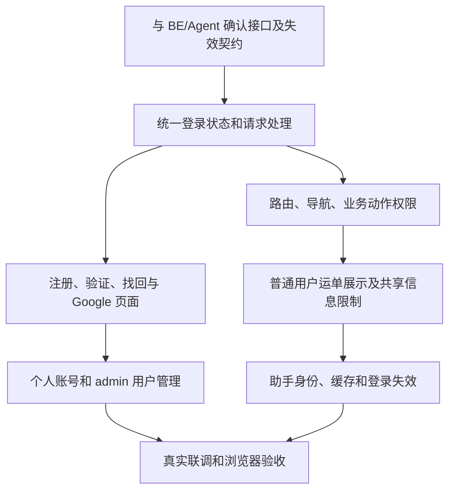

# V8 · FE 登录与权限实施计划

> 2026-10-15 · 本会话负责 FE。已完成离线界面并按 BE V8 接入真实 HTTP；临时测试库上的接口验证通过，浏览器与外部服务验收待完成。依据：[V8 PRD](../../../prd/v8/JINGPO-logistics-system-v8.md)、[FE spec](spec.md)。

## 1. 用户会看到什么

增加登录、注册、邮箱验证、邮件找回密码、Google 登录和个人账号入口。admin 可以进入简单用户管理页；其他用户按角色看到对应业务页面和操作。普通用户能操作自己的订单，查看关联运单的计划与进度。

现有主要入口为 `fe/src/App.tsx`、`api.ts`、`pages/`、`NetworkPage.tsx`，网页助手为 `AssistantPanel.tsx`、`assistantApi.ts`。正式业务与账号请求已接入身份及失效处理；助手个人凭据已预留，默认等待 Agent V8。

## 2. 编码前的共同前提

| 依赖 | FE 需要确认的内容 |
| --- | --- |
| BE 身份与权限 | 登录载体、当前用户、角色/允许动作、24 小时过期、未验证/停用处理、退出及角色变化感知方式 |
| 邮件与 Google | 注册/验证/重发/重置流程、回调完成与失败、补用户名、已有账号绑定及冲突响应 |
| CLI | 浏览器授权确认页面、设备/客户端提示、取消和完成反馈；避免把个人凭据暴露在地址栏 |
| 业务接口 | 普通用户的列表/进度响应，公共下单选项，允许操作与业务状态禁用原因；订单取消契约 |
| Agent | 助手鉴权、会话归属、流式错误事件、当前查询被停用/降权时如何结束并清理结果 |

上述内容写入后续 FE spec；本计划不预先约定不存在的 API 地址。页面推荐地址和组件拆分同样在 spec 中确认。

## 3. 分步工作清单

| 阶段 | 要做的事 | 完成条件 | 状态 |
| --- | --- | --- | --- |
| FE-01 接口与页面 spec | 形成页面清单、导航/动作矩阵、错误文案和三端接口映射；检查所有详情链接与旧入口 | BE/Agent 同意数据和失效契约；无“等登录后再补”的业务入口 | 已推进，待完整验收 |
| FE-02 登录基础 | 统一身份装载和请求凭据；支持初始化等待、登录失效和退出；保留安全的站内返回地址 | 刷新或直开深链接正确处理；重定向不跳第三方；未登录不闪现业务数据 | 已推进，待完整验收 |
| FE-03 账号页面 | 登录、注册、验证/重发、找回/重置密码、Google 登录/回调/补用户名、绑定入口 | 未验证账号有明确下一步；链接过期/重复/邮件失败可理解；账号冲突不自动合并 | 已推进，待完整验收 |
| FE-04 权限接入 | 按角色控制菜单、路由和操作；结合 BE 业务状态显示禁用原因；对接自己的订单修改与取消 | developer 只读，ops/admin 有业务动作，普通用户仅自己的订单动作 | 已推进，待完整验收 |
| FE-05 安全的业务展示 | 普通用户运单详情保留自己的进度/计划；收敛任务链接、共享成员及关联历史入口；下单只取必要公共选项 | 共享运输场景不显示其他用户资料；越权深链接无数据；历史无归属记录不可见 | 已推进，待完整验收 |
| FE-06 个人账号和用户管理 | 展示账号/邮箱验证/单角色/Google 绑定；admin 搜索用户、改角色和启停 | 普通账号不能选择 admin；唯一 admin 无降级/停用入口；失败时不假更新界面 | 已推进，待完整验收 |
| FE-07 助手与全局清理 | 统一助手身份；退出/切号/失效/权限变化时停止流、清空会话缓存和业务状态；丢弃旧账号迟到响应 | 登录 B 后不显示 A 的表格、弹窗、消息、关联卡片或重试结果 | 已推进，待完整验收 |
| FE-08 联调和交付 | 四角色走查；邮件/Google/CLI 授权联调；Docker 代理和生产刷新回退检查 | 真实接口与浏览器证据完整；lint/build 通过，剩余项明确 | 已推进，待完整验收 |

角色限制由 BE 最终校验。FE 不靠隐藏按钮证明权限有效，也不在普通用户页面读取全量数据后自行筛选。业务写请求的幂等 key、表单草稿和异步结果都应随账号切换正确隔离。

## 4. 交互与失效检查

- 登录状态未确认时展示加载状态；禁止先渲染上次用户内容再跳登录。
- 邮箱验证后重新读取账号状态；验证/重置链接的敏感参数不进入埋点、错误日志或后续业务导航。
- 对无权限、不可见对象、未验证、登录失效分别提供合理提示；不通过错误文案泄露其他人的业务记录。
- 到期、停用及密码重置后阻止后续操作，清理业务与助手状态；其他标签页同步退出。角色变化不能要求手工刷新才限制访问。
- 所有新表单支持键盘、字段错误提示、提交中状态和重复提交保护；窄屏能正常操作。

## 5. 验证与验收安排

| 场景 | 浏览器验收内容 | PRD 对应 |
| --- | --- | --- |
| 注册到业务首页 | 普通用户默认角色、邮箱验证前受限、重发/过期/发送失败、深链接返回 | A01、A02、A15 |
| 两用户数据隔离 | A/B 列表/搜索/总数/详情/共享任务链接；developer/ops 查看历史数据 | A03、A04、A07 |
| 操作矩阵 | 普通用户编辑/取消自己订单、developer 只读、ops 操作和状态禁用原因 | A05、A06 |
| 用户管理 | 只有 admin 可进入/提交，角色更新和停用反馈，保护唯一 admin | A08、A14 |
| 登录失效 | 24 小时边界、多设备退出、重置撤销、停用、多标签页、切账号迟到请求 | A09、A10、A12 |
| Google 与 CLI | 新用户补用户名、已有账号主动绑定、同邮箱冲突、错误回调、浏览器确认 CLI 授权 | A11 |
| 查询助手 | 四角色回答与关联对象、权限变化时停止输出、不提供业务写操作 | A05、A12、A13 |

实施后在 `fe/` 执行 `npm run lint`、`npm run build`；浏览器验收单独记录，构建通过不算业务验收。当前 FE 无现成测试命令，本计划不假定已有前端自动化测试框架；核心越权由 BE/Agent 自动测试覆盖，FE 保留可复现的页面走查步骤。

## 6. 依赖与交付记录

FE-01 依赖 BE 契约，FE-03/06 依赖可联调身份接口，FE-05 依赖普通用户安全响应，FE-07 依赖 Agent 失效契约。邮件测试与 Google 真实配置缺失时必须记录待验收，不能仅凭模拟页面认定完成。

上线与 BE/Agent 同步切换，开发代理与 Nginx 对登录、回调、助手流式接口保持一致。回退不能让旧客户端接入匿名业务接口。

| 项目 | 当前结果 |
| --- | --- |
| FE spec 与接口映射 | 已按 BE spec 落地 HTTP adapter，Agent 服务升级待完成 |
| 页面与业务适配 | 登录、账号、用户管理、业务动作/导航权限、共享任务限制、订单取消已接入；Agent 个人 token 接入预留且默认关闭 |
| lint/build | 2026-10-15 通过；构建保留现有大块体积提示 |
| 预览逻辑 | Node 冒烟检查通过：状态流、角色能力、admin 保护、验证/重置、返回地址，断言零网络请求 |
| 设计检查 | 对 `src/auth` 和 `src/App.tsx` 的机械检查无报告项 |
| 浏览器和三端联调 | FE adapter 对真实 BE 的隔离 HTTP 验证通过；页面点击/窄屏、多标签页、真实 Google/SMTP/Agent 待验收 |

### 2026-10-15 离线阶段记录

执行 `npm run lint`、`npm run build`；Node 使用现有 TypeScript 转译器加载预览 adapter/权限模型进行断言，未增加测试框架。入口 `/v8-preview/login`，行为和限制见 [spec](spec.md)。

FE-01 已有前端规格，协议仍待对齐；FE-02/03/06 完成离线界面和状态基础；FE-04/05/07 真实业务权限和身份待接口，FE-08 仅完成静态/构建检查与状态逻辑验证。上方各阶段的完整完成条件尚未全部满足。

后续记录日期、代码版本、浏览器/运行环境、角色与样本、执行步骤、结果及截图。关联计划：[BE](../be/plan.md)、[Agent](../agent/plan.md)。

### 2026-10-15 BE V8 兼容记录

- FE-01～07 已推进到真实接口接入：HTTP Cookie/CSRF、24 小时到期与身份变更清理、邮件和 Google/CLI 入口、服务端用户分页、角色动作与数据范围、订单取消。Agent 尚未实现 V8，面板默认关闭，保留只读个人凭据代码。
- 隔离环境：独立临时 PostgreSQL 库，使用当前 BE 的 alembic upgrade head 到 f81a3d6c2907，测试服务端口 18008。Node 使用 esbuild 打包实际 httpAdapter/api/transport，模拟浏览器 Cookie jar 和 Origin 发请求，邮件发送替换为测试 token 捕获。
- HTTP 断言通过：注册、未验证拒绝、登录/CSRF、验证、创建归属、订单取消、普通用户列表/详情隔离和管理接口拒绝、developer 只读、admin 分页/修改/保护、CLI 批准、Agent 子凭据撤销、密码重置与新旧密码/会话、身份变化迟到结果拒绝。未调用真实 Google/SMTP。
- 本机 8000 服务 OpenAPI 尚无 auth 路由，开发库仍在 e2a7c4b19d63；本轮未升级或修改现有开发库。正式使用需 BE 负责方备份迁移、初始化管理员并重启。
- 浏览器与三端验收仍未完成，不能把接口检查写成页面通过。阶段表中的完整完成条件据此保留待验收。
