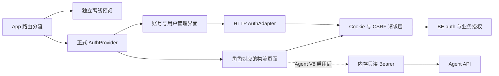

# V8 · FE 登录、账号与业务权限规格

> 2026-10-15 · 已按 [BE spec](../be/spec.md) 接入真实 HTTP，独立预览保留。真实后端隔离验证通过，浏览器和外部服务验收待完成。依据：[PRD](../../../prd/v8/JINGPO-logistics-system-v8.md)、[FE plan](plan.md)。

## 1. 用户会看到什么

正式业务页面要求登录。普通用户创建和维护自己的订单，查看关联运单的计划与进度；developer 查询全公司数据但不能修改；ops/admin 处理业务和公共配置，admin 可以管理用户。BE 负责数据过滤、归属和最终授权。

账号页面沿用现有 React、Ant Design 与鲸破蓝白后台样式。离线预览仍位于 /v8-preview，不连接真实身份服务，也不会使用真实业务数据。



## 2. 页面与交互

| 正式入口 | 行为 |
| --- | --- |
| /login | 用户名/密码登录、找回密码、注册和 Google 登录 |
| /register | 用户名、邮箱、新密码与确认；202 中性邮件说明，不自动登录 |
| /verify-email | 未登录也可提交邮件 token、重发验证邮件；成功后返回登录或个人账号 |
| /forgot-password | 注册邮箱与中性邮件反馈，不泄露账号是否存在 |
| /reset-password | 新密码确认、过期反馈、重置成功后重新登录 |
| /account | 身份、邮箱验证、单角色、范围、登录到期时间、Google 绑定、本地密码；已设置本地密码的账号可进入更改密码 |
| /change-password | 验证当前密码并设置新密码；当前设备保持登录，其他设备退出；账号页面不显示面包屑或额外返回按钮 |
| /admin/users | 仅 admin；服务端搜索分页、修改单角色、启停确认、保护唯一 admin |
| /oauth/google/callback | 从 BE 当前身份决定补用户名、验证邮箱或进入账号 |
| /cli/authorize | 显示当前账号，输入 8 位授权码，主动允许或拒绝只读 CLI 登录 |

每个适用入口增加 /v8-preview 前缀可预览；/v8-preview/permissions 展示角色动作样例。预览账号 admin、ops、developer、sales、finance 只保存在工作区内存，finance 待验证；模拟密码不验证也不保存。Google OAuth 只保留正式回调 `/oauth/google/callback`，预览不提供回调模拟页面。

新密码遵守 BE 的 12～128 位、包含字母和数字规则；用户名只限制为 1～40 位，不限制字符种类。验证/重置 token 读取到临时状态后从地址栏移除，不写浏览器存储；刷新后需要重新打开邮件链接。

账号表单宽度最多 560px，用户管理使用宽表格；窄屏缩小边距，表格支持横向滚动。账号区页眉只保留“返回首页”入口，不额外显示 Agent 说明或页脚返回链接；需要返回时使用浏览器后退。保留加载、空状态、错误、键盘焦点及确认步骤；操作成功才更新界面。

## 3. 内部模型与 HTTP 映射

AuthAdapter 是界面接入边界，httpAdapter.ts 映射 BE 的下划线字段，不把前端命名当作服务端新契约。

| 模型 | 内容 |
| --- | --- |
| Account | 用户 ID、用户名、邮箱、单角色、启用/验证/Google 绑定、needsUsername、authVersion、permissions、hasPassword |
| LoginSession | 当前用户、来源网页登录会话 ID、绝对到期时间 |
| UserChange | user/ops/developer 角色或 enabled，不允许设置 admin |
| AuthAdapter | 当前身份、登录/注册/退出、验证/重发、找回/重置/更改密码、Google、服务端用户分页/修改、CLI 批准 |

正式应用使用全局 HTTP adapter；只有预览分支使用独立内存 adapter。浏览器使用 HttpOnly 会话 Cookie，不保存网页登录 access_token。

以下路径均位于 /api/v1：

| 能力 | 接口 |
| --- | --- |
| 登录和当前账号 | POST /auth/login，GET /auth/me，POST /auth/logout |
| 注册、验证与重发 | POST /auth/register、/auth/verify-email、/auth/resend-verification |
| 找回与重置 | POST /auth/forgot-password、/auth/reset-password |
| 更改密码 | POST /auth/change-password，提交 current_password 和 password |
| Google | GET /auth/google/start，POST /auth/google/bind/start；成功回调后读取 /auth/me，POST /auth/complete-profile 补用户名 |
| 用户管理 | GET /admin/users，search/page/page_size；PATCH /admin/users/{id} |
| CLI 确认 | POST /auth/cli/approve，user_code 和 approve |
| 取消订单 | POST /orders/{id}/cancel，reason 和业务 Idempotency-Key |
| 下单公共选项 | GET /ordering-options，省市区仍调用对应区域接口 |
| 助手个人凭据 | POST /auth/agent-token，只读 Bearer、到期时间 |

所有账号与业务请求禁止缓存。Cookie 请求使用 credentials include；写请求从 jingpo_csrf 读取 X-CSRF-Token。使用同源 /api 代理，浏览器 Origin 必须与 BE AUTH_FRONTEND_URL 一致。Google 可信身份由 BE 验证，FE 不接受 URL 自报的邮箱或角色。

## 4. 登录失效与权限控制

```stateDiagram-v2
    [*] --> Loading
    Loading --> Anonymous: 无登录
    Loading --> SignedIn: 获得可信身份
    Anonymous --> SignedIn: 登录成功
    SignedIn --> ProfileRequired: Google 需要用户名
    ProfileRequired --> SignedIn: 完成资料
    SignedIn --> VerifyRequired: 邮箱待验证
    VerifyRequired --> SignedIn: 验证后读取账号
    SignedIn --> Anonymous: 退出、到期或撤销
```

- 装载完成前不显示业务内容，身份服务失败时拒绝继续展示并提供重试；未验证或需补用户名的账号只能处理账号流程。
- AuthProvider 按绝对到期时间退出。可见页面每 15 秒及重新聚焦时读取账号；这只是界面感知频率，不是即时推送保证。BE 每次请求即时拒绝无效身份。
- 401、AUTH_CHANGED、EMAIL_NOT_VERIFIED、USERNAME_REQUIRED 和 CSRF_REJECTED 触发清理或重新确认身份；未授权对象的 404 不泄露真实存在性。
- 身份变化时终止旧请求及流，拒绝迟到结果，清空网络缓存、助手 token 和重试状态，并重建业务页面。跨标签页只用随机变更标记通知，不在 localStorage 放凭据。
- 页面动作结合 BE permissions 和业务 allowed_actions。普通用户禁止进入全局任务和网络配置，获取站点选项使用 ordering-options；共享成员和任务详情链接不展示。
- developer 的运输/网络操作禁用；普通用户不能手工创建运单或执行物流动作。订单编辑仍受 PENDING_SHIPMENT 限制；取消仅未揽收、需填原因，由 BE 事务校验共享影响。新增 CANCELLED 状态与原因/时间展示。
- 个人账号和用户管理不复用上一用户页面状态；公共验证/重置页面保留本次操作反馈，避免清理登录后丢失成功结果。

## 5. Agent 和外部服务边界

当前 Agent 仍是匿名实现，默认不挂载查询面板。Agent V8 升级并配置同源代理后，设置 VITE_AGENT_V8_ENABLED=true 才启用；Docker 构建接受同名 build arg，默认 false。不得回退到匿名 Agent。

FE 已准备只读个人 token 的领取、内存缓存、身份变化清理、Bearer 请求和流式失效事件处理；不向 Agent 发送浏览器 Cookie，普通用户不展示任务引用。Agent 对会话归属、工具查询及输出复核的服务端校验仍需由 Agent 实现，FE 不能代替。

Google 失败可能由 BE 回调直接返回 JSON 错误，未自动跳回 FE 冲突页面；友好错误重定向需与 BE 再对齐。真实 Google、SMTP 投递和完整 CLI 浏览器流程尚未验收。

## 6. 验证记录与部署前提

2026-10-15：lint、生产构建通过；离线预览状态流与零网络调用冒烟检查已完成。构建保留现有大块体积提示。

使用独立临时 PostgreSQL 测试库迁移到 f81a3d6c2907，在 18008 运行当前 BE；Node/esbuild 打包执行真实 FE adapter 和业务 API，用 Cookie jar 模拟浏览器 Cookie/Origin。以下实际 HTTP 检查通过：

- 注册、Cookie 登录、CSRF、邮箱验证和未验证访问拒绝。
- 创建者归属、普通用户列表/详情隔离、最小下单选项和管理接口拒绝。
- 订单取消、developer 写入拒绝、admin 分页/修改及唯一 admin 保护。
- CLI 批准与只读 token、Agent 子凭据在网页退出后失效。
- 邮件找回/重置、旧密码拒绝、旧登录失效、新密码重新登录。
- 身份变化后的迟到请求结果拒绝。

测试服务捕获邮件 token，未真实投递邮件；未使用或修改现有开发库。当前没有可用浏览器实例，页面点击、截图、窄屏、多标签页实际交互和外部 Google/SMTP/Agent 联调尚待验收。

检查时 8000 端口仍运行旧版（OpenAPI 无 auth 路由），开发库为 e2a7c4b19d63。需由 BE 负责方备份、迁移 V8、初始化 admin 并重启，再使用当前正式 FE。
