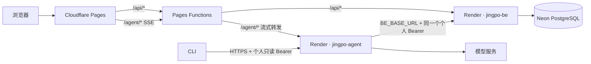

# V9 · Agent 部署到 Render

> 2026-10-17 · 部署方案已确定，仓库配置已准备；Render 服务创建、Cloudflare 生产变量和线上验收由用户操作后完成。V8 身份与权限契约不变。

## 要解决什么

网页助手现在只在本地 Docker 和开发环境运行。把现有 Python Agent API 部署为 Render Web Service，让 Cloudflare Pages 上的前端通过同源 `/agent/*` 调用它；CLI 使用 Render HTTPS 地址。前端仍由 Cloudflare Pages 提供，业务后端和数据库均不迁移。



浏览器继续走 Pages 同源代理，登录 Cookie 不跨站发送；Agent 只接收现有的个人只读 Bearer，并继续向 BE 在线复核身份。BE 接口、数据库和权限代码无须修改。

## 模块改动

| 模块 | 改动 | 本地环境 |
| --- | --- | --- |
| Agent | Docker 启动端口读取 `PORT`；未设置时回落到 `8001` | 本地 CLI 和 Compose 继续用 `8001` |
| FE / Cloudflare Pages | 新增 `/agent/*` Pages Function 代理，转发请求和响应流；生产构建启用助手 | Vite `/agent` 代理不变；Compose 仍由 Nginx 转发到 `agent:8001` |
| BE | 继续使用已有 V8 Auth、只读业务接口，不改代码或环境变量 | 不变 |
| Neon | 不直接由 Agent 连接；Agent 只通过 BE 读业务数据 | 不变 |

`/agent/*` 代理不读取 SSE 响应体，不缓存响应，并保留上游状态码、内容类型和流。Agent 对 SSE 设置 `Cache-Control: no-store` 与 `X-Accel-Buffering: no`；Cloudflare Function 也设置 `no-store`。不新增跨域直连。

## Render 操作步骤

### 1. 创建 Agent Web Service

在 Render Dashboard 选择 **New → Web Service**，连接 `jingpo-logistics-system` 仓库，填写：

| 项目 | 设置 |
| --- | --- |
| Name | `jingpo-agent`（若名称已占用，记录 Dashboard 实际 URL） |
| Branch | `main`，开启自动部署 |
| Root Directory | `agent` |
| Runtime | Docker |
| Dockerfile Path | `Dockerfile`（相对 Root Directory） |
| Docker Build Context | `.` |
| Region | 与 `jingpo-be` 相同，以便通过 Render 私有网络访问 BE |
| Health Check Path | `/agent/health` |
| Instances | 保持单实例，不启用横向自动扩容 |

Render Docker Web Service 会使用容器的 Dockerfile；Web Service 在 `0.0.0.0` 上监听平台提供的 `PORT`。本项目默认端口仍为 `8001`，Render 运行时传入的 `PORT` 会覆盖它。Render 支持设置 Root Directory 和 Dockerfile；相关路径以服务根目录为准。[Render Docker 部署](https://render.com/docs/docker)、[Render 单仓库配置](https://render.com/docs/monorepo-support)、[Render Web Service](https://render.com/docs/web-services)

如果希望助手请求不经过公网，将 `jingpo-agent` 与 `jingpo-be` 放在同一 Render workspace 和 region，并从 `jingpo-be` 的 **Connect → Internal** 复制内部 URL。两项服务必须位于同一 region 才能使用私有网络。Render 免费 Web Service 不能接收私有网络请求；若当前 `jingpo-be` 使用免费实例，Agent 的 `BE_BASE_URL` 应先使用其 HTTPS 公网地址。[Render Private Network](https://render.com/docs/private-network)

### 2. 配置 Render 环境变量

在 `jingpo-agent` → **Environment** 配置变量。所有模型密钥只填 Render Secret，不写进仓库或 Cloudflare：

| Key | Value |
| --- | --- |
| `BE_BASE_URL` | `jingpo-be` 在 Connect → Internal 显示的 HTTP URL；若没有私有网络条件，使用 `https://jingpo-be.onrender.com` |
| `LLM_PROVIDER` | `qwen` 或 `deepseek` |
| `LLM_MODEL` | 对应供应商当前可用的模型名称 |
| `DASHSCOPE_API_KEY` 或 `DEEPSEEK_API_KEY` | 与所选供应商对应的 API Key，只设所需的一项 |
| `LLM_BASE_URL` | 可选；使用供应商默认端点时不设置 |
| `AGENT_DEBUG` | `false` |

不要手动设置 `PORT`。确认服务日志显示启动成功，并在部署详情中得到 Agent HTTPS 公网地址，例如 `https://jingpo-agent.onrender.com`。免费 Web Service 闲置 15 分钟后会休眠，首次唤醒会增加等待时间；正式给用户持续使用时选择常驻付费实例。[Render 首次部署与免费服务限制](https://render.com/docs/your-first-deploy)

### 3. 先验证 Render 服务

将下面的 origin 替换成 Dashboard 给出的实际地址：

```bash
AGENT_ORIGIN="https://jingpo-agent.onrender.com"
curl -i "$AGENT_ORIGIN/agent/health"
curl -i -X POST "$AGENT_ORIGIN/agent/api/v1/sessions"
```

健康检查应返回 `200` 和 `{"status":"ok"}`；不带 Bearer 的会话请求应返回 `401`。第二个检查确认服务仍要求用户身份。

### 4. 配置 Cloudflare Pages

打开现有 `jingpo-fe` Pages 项目，在 **Settings → Environment variables** 设置：

| 变量 | 位置 | 值 |
| --- | --- | --- |
| `AGENT_API_ORIGIN` | Pages Functions Production 运行时，Agent 部署后设置 | Render 给出的 Agent HTTPS origin，例如 `https://jingpo-agent.onrender.com`；不要附加路径末尾斜杠 |
| `VITE_AGENT_V8_ENABLED` | Production 构建变量，确认代理变量已设置后 | `true` |
| `BE_API_ORIGIN` | 保留现有 Pages Functions 运行时变量 | `https://jingpo-be.onrender.com` |

FE 代码新增 `fe/functions/agent/[[path]].js`，`fe/public/_routes.json` 将 `/agent/*` 纳入 Functions。提交并推送后等待 Pages 从 `main` 完成构建。Pages Function 通过 `fetch()` 原样转发响应流；其 Worker 响应需保持流式处理，不调用 `text()` 或 `json()` 消费 SSE body。[Pages Functions API](https://developers.cloudflare.com/pages/functions/api-reference/)、[Cloudflare 流式响应建议](https://developers.cloudflare.com/workers/best-practices/workers-best-practices/)

### 5. 浏览器和 CLI 验收

1. 浏览器打开生产站点并登录，右下角出现「查询助手」。
2. 发起一个可返回数据的查询，确认 `/agent/api/v1/sessions` 成功，消息请求以 `text/event-stream` 返回 progress，最后得到 result。
3. 停止一次查询，再开始新对话；确认没有 1102/5xx、SSE 缓冲或超时。
4. 未登录时确认不能创建助手会话；使用普通用户确认只能查询个人订单/运单。
5. CLI 配置 `AGENT_BASE_URL` 为 Render Agent HTTPS 地址、`BE_BASE_URL` 为 BE 地址后，执行 `/login` 并完成一条查询。

## 本地开发与本地 Docker

本次部署配置不得替换本地代理或改变本地端口：

| 方式 | Agent 地址 | 代理 |
| --- | --- | --- |
| Vite 开发 | `127.0.0.1:8001` | `fe/vite.config.ts` 的 `/agent` 代理 |
| 本地 Compose | `agent:8001` | `fe/nginx.conf` 的 `/agent/` 代理；Compose 未设置 `PORT`，Dockerfile 回落到 `8001` |
| 生产浏览器 | Render Agent HTTPS origin | Cloudflare Pages Function `/agent/*` |
| 生产 CLI | Render Agent HTTPS origin | 直接调用 Agent API |

本地模型参数继续从 `agent/.env` 读取；Render 环境单独设置云端变量。Pages 生产变量不进入 Vite 本地开发或 Compose 配置。

## 已知边界与交付状态

Agent 会话、检查点和响应缓存位于单个进程内存，服务重启或新版本部署会清空会话。当前部署固定单实例；增加实例前需实现共享会话存储与跨实例身份/缓存协调。云端密钥、Render 服务创建、Pages 变量设置和真实浏览器验收尚未完成，由用户按上述步骤操作后记录结果。
